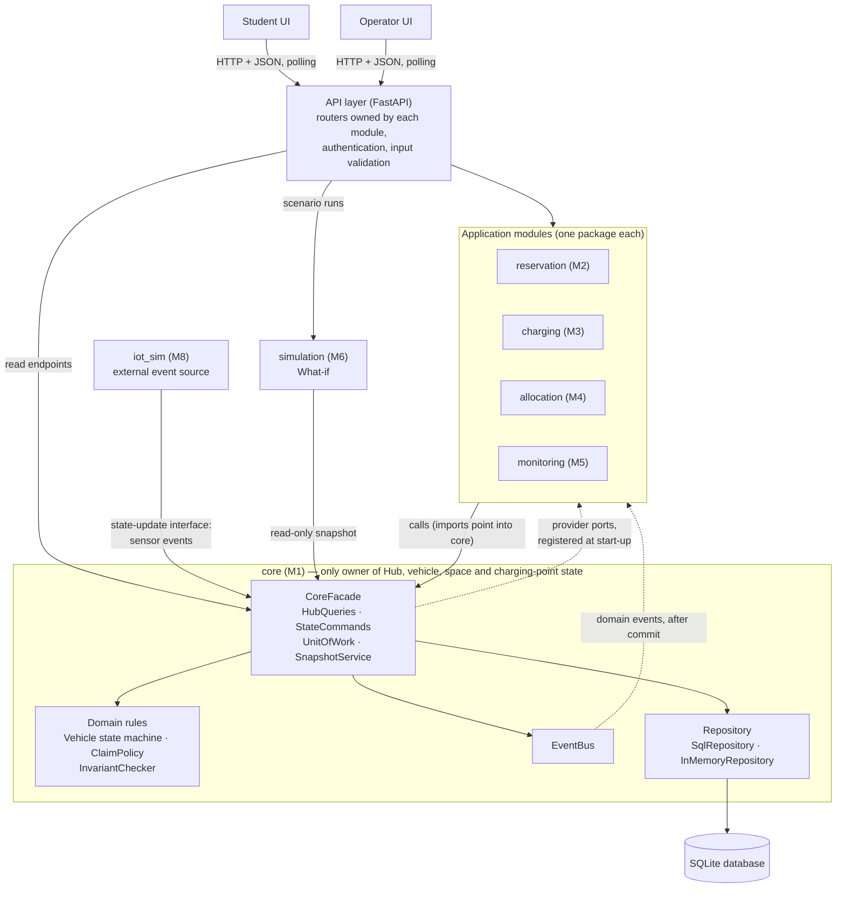
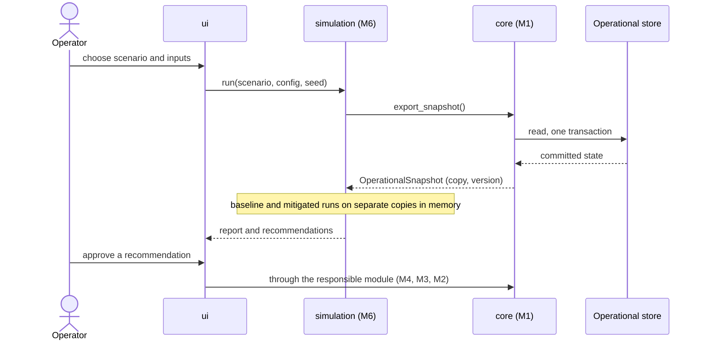
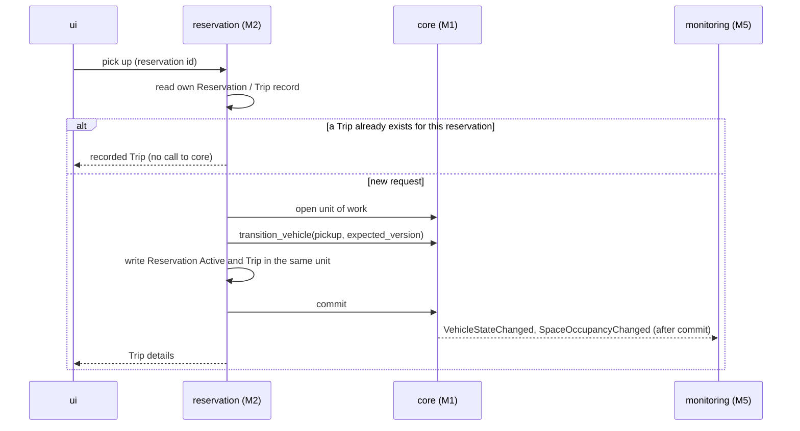
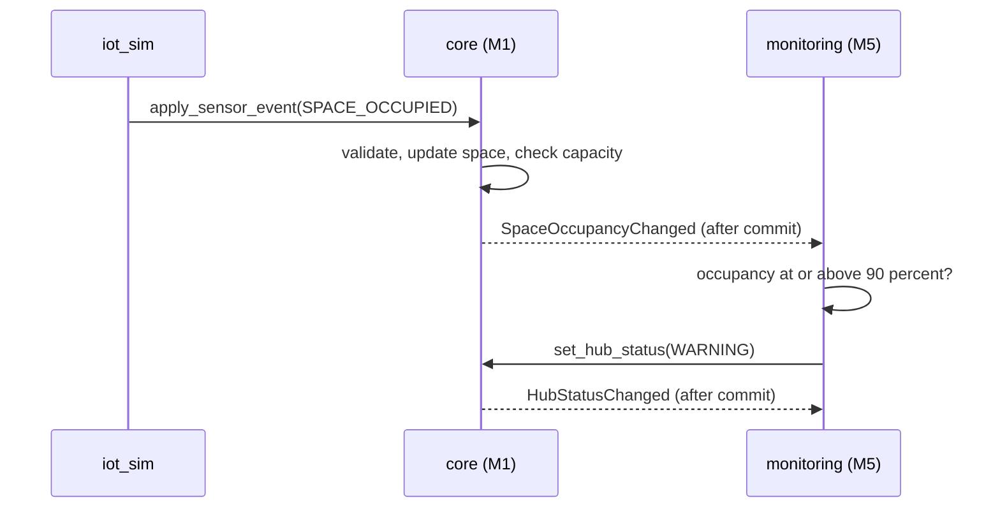

# Software Architecture

**Owner:** M1 — Đoàn Nhật Minh (2452738)
**Status:** v1.0 · 2026-11-04 (released with the Core API spec v1.0; decided by the Lead)
**Related:** D-002, D-003, D-004, D-005, D-006, D-007, `tech-stack-proposal.md`, `core-api-spec.md`, `../structural/class-diagram-core.md`, `../behavioral/vehicle-state-machine.md`, `docs/report/03-architecture.md` (report text built from this file)

## 1. Scope

This file is the source for the architecture of the whole system: the components, how they depend on and talk to each other, where the business logic is, how data is stored, and how the What-if Simulation touches the operational state. It answers the five points of rubric 3.1. The class diagram of `core` is in `class-diagram-core.md`; the other modules draw their own activity, sequence and state diagrams.

## 2. Component diagram

Solid arrows are calls; dashed arrows go from `core` to a module but are not imports (events, and ports that `core` defines and the module implements). Every import points into `core`, so `core` imports no other module (NFR-22).

## 3. Responsibilities

| Component | Responsibility | Does not do |
|---|---|---|
| `ui` (M7) | Student and operator screens; shows the state it reads from the API and sends user actions. | Hold business rules or state. |
| API layer | HTTP endpoints, authentication and roles (NFR-16), input validation (NFR-18), error codes. Each module owns the routers of its workflow; `core` owns the read routers and the sensor intake. | Decide business outcomes. |
| `core` (M1) | Hub, vehicle, parking-space, charging-point and user-account state; interval claims; Vehicle state machine; capacity, uniqueness and valid-transition rules (`BR-M1-01`, `BR-M1-02`, `BR-M1-03`); the unit of work; the state-change log; the event bus; the snapshot. | Reservations, trips, charging sessions, tasks, incidents. |
| `reservation` (M2) | Rental and parking reservations, trips, hold and expiry, student limits (`BR-M2-xx`). | Change a vehicle or space directly; it asks `core`. |
| `charging` (M3) | Charging requests, queue and schedule, priority within the charging class (`BR-M3-03`), handling of a failed charging point (`UC-M3-08`). | Allocate between classes (M4). |
| `allocation` (M4) | Order between request classes (`BR-M4-01`), redistribution tasks, alternative Hub and bay lookup. | Execute a vehicle move without M2 or `core`. |
| `monitoring` (M5) | Hub utilization, Hub status (`BR-M5-01`, `BR-M5-02`), incident detection and lifecycle (`BR-M5-03` to `BR-M5-05`). | Store Hub state (it sets the status through `core`). |
| `simulation` (M6) | Scenario definition, evolution of a copy of the state, impact metrics, coordination recommendations. | Write to the operational store (NFR-12). |
| `iot_sim` (M8) | Seed data and the simulated sensor and demand feed, reproducible from a seed (NFR-13). Treated as outside the system boundary (D-004). | Write to storage; it only calls the state-update interface of `core`. |

## 4. Communication and dependency rules

| Mechanism | Used for | Rule |
|---|---|---|
| Direct call to `CoreFacade` | Reads, commands and units of work from M2–M5 and the API layer. | Only the public types exported by `core` (NFR-22). Commands return `Result`, never raise for business failures. |
| Domain events (in-process, after commit) | `core` tells M3, M4, M5, M2 that something changed (`VehicleStateChanged`, `SpaceOccupancyChanged`, `ChargingPointStatusChanged`, `HubStatusChanged`, `ClaimPlaced`, `ClaimReleased`). | Handlers run after commit; a failing handler never undoes the commit. Modules do not import each other (D-003). |
| Provider ports | The few calls that go from `core` to a module: demand data, alternative Hubs or bays, consuming a reservation hold. | The interface lives in `core`, the module registers an implementation at start-up, so the import still points into `core` (`core-api-spec.md` §6.1). |
| State-update interface for sensors and seed data | `iot_sim` → `core` (`apply_sensor_event`, `load_network`). | Malformed events are rejected as a whole, logged and announced (NFR-10). `iot_sim` never writes to the database; it hands `core` a `NetworkSpec` for the first load. |
| Snapshot | `core` → `simulation`. | Read-only copy with no live references (§7). |
| HTTP + JSON | UI ↔ API layer. | Polling; the OpenAPI schema generated from the Pydantic models is the interface document for M7. |

Allowed imports, checked by an import-boundary test in CI (NFR-22):

| Package | May import | Must not import |
|---|---|---|
| `core` | standard library, SQLAlchemy, Pydantic | any other `src/` package |
| `reservation`, `charging`, `allocation`, `monitoring` | `core` (public API) | another module's internals, `iot_sim` |
| `simulation` | `core` (snapshot types and the read-only rules it reuses) | write paths of `core`, other modules' internals |
| `iot_sim` | `core` (state-update interface) | all other modules |
| `ui` | nothing from `src/` Python; talks HTTP | — |

## 5. Where the business logic is

| Logic | Owner | Why there |
|---|---|---|
| Valid vehicle state transitions, capacity, no overlapping claims, version check | `core` | Rules that every module relies on must have one implementation and one place to test (`BR-M1-01` to `BR-M1-03`). |
| Student limits, hold and expiry, trip and reservation lifecycle | `reservation` | These rules depend on the booking process only. |
| Charging priority within a class, charging schedule, charging-point failure handling | `charging` | Depends on batteries and the charging queue. |
| Priority between classes, redistribution plan | `allocation` | Needs the view of all demand classes. |
| Hub status, incident rules and escalation | `monitoring` | Reacts to events from `core`. |
| Scenario evolution, metrics, recommendations | `simulation` | Works on a copy, so it cannot affect `core`. |
| Display and input forms | `ui` | No business decision is taken in the interface. |

## 6. Data storage and access

- One SQLite database for development and demo, accessed with SQLAlchemy 2.x (D-002). The same code can target PostgreSQL later.
- **Table ownership:** `core` owns Hub, ParkingSpace, ChargingPoint, Vehicle, UserAccount, ResourceClaim and StateChangeRecord. M2 owns Reservation and Trip, M3 ChargingSession, M4 RedistributionTask and RedistributionTaskVehicle, M5 Incident, M6 SimulationRun and CoordinationRecommendation (M7's ERD draft).
- **Access rule:** a module reads and writes only its own tables directly. It registers each table with `core.register_entity` at start-up, and writes inside the unit of work (`uow.repository`) so its records commit together with core's changes (`core-api-spec.md` §5.2). It gets another module's data through that module's interface, and it gets Hub, vehicle, space and charging-point state only through `core`.
- **Consistency:** every entity of `core` has a `version` column (optimistic locking); a command with an old `expected_version` fails with `VERSION_CONFLICT`. An operation that changes several entities runs in one `UnitOfWork`, which is one database transaction, shared with the module tables written in the same operation (NFR-06, NFR-09).
- **SQLite:** one dedicated connection, write-ahead logging, `BEGIN IMMEDIATE` for every transaction that writes, foreign keys switched on (SQLite has them off by default) and a busy timeout. The database repeats the rules it can check alone: foreign keys, one plate per vehicle, one vehicle per space, one charging point per bay (D-007), value ranges, and the pairing of a vehicle's Hub and space and of its owner. Interval overlap and per-student limits are checked inside the same serialized write transaction. Times are stored as UTC and come back timezone-aware (D-005).
- **Commit counter:** the database keeps a counter that grows with every commit and a log of which entity changed at which count, in the same transaction as the data. It backs the snapshot `version` and `unit_of_work(snapshot_version=...)`.

## 7. What-if Simulation and the operational state

- The snapshot is a read-only copy taken in one read transaction. It has no references to live objects or connections and carries a `version`.
- `simulation` never holds a connection to the operational store. Its output is a report; applying a recommendation is a separate operator action that goes through the responsible module and `core` (NFR-12, M6 design §7.5).
- Same state, same seed, same scenario give the same output (NFR-13); `core` sorts all snapshot content by ID.
- The snapshot holds `core` entities and claims. Due times of trips and the contents of sessions and tasks come from `ReservationDemand` and `ChargingDemand` (`core-api-spec.md` §6.1 and §7, D-020).

## 8. Two more runtime flows

## 9. Decisions, benefits and limitations

| # | Decision | Why | Benefit | Limitation | Alternative considered |
|---|---|---|---|---|---|
| 1 | Modular monolith, one process (D-003, A-08) | 8 people and about 7 weeks; many multi-entity operations must be atomic (NFR-09). | Simple transactions, easy to run and test (NFR-14). | Not physically distributed; throughput is limited to one node. Stated as a limitation of the project. | Microservices per module: rejected for coordination cost and for the difficulty of atomic multi-entity operations. |
| 2 | `core` is the only owner of shared resource state | One place to enforce `BR-M1-01` to `BR-M1-03`. | No two modules can disagree about a vehicle or a space. | `core` is a dependency of everyone; a bug there affects all modules. Mitigated by tests and by the stub of the API spec. | Each module keeps its own copy of state: rejected, copies drift. |
| 3 | In-process event bus, handlers after commit (D-002) | Monitoring, charging and allocation must react to changes without importing each other. | No broker to install or run. | Events are not stored: a crash between commit and publish loses them. Subscribers re-read the state when they start (for example M5 recomputes Hub status). | Message broker: too heavy for one deployment. |
| 4 | Optimistic locking plus unit of work | Meets NFR-06 and NFR-09 with SQLite. | No lock manager, no long-held locks. | Under heavy contention a caller must retry after `VERSION_CONFLICT`. | Pessimistic row locks: need PostgreSQL. |
| 5 | Import direction always into `core`; ports defined in `core` | Keep `core` independent and testable alone (NFR-22). | `core` tests need no module; modules are replaceable by stubs. | A few interactions (alternative Hubs, hold consumption) need a registered port. | `core` imports modules: rejected, creates cycles. |
| 6 | Snapshot copy for What-if | Isolation by construction (NFR-12). | The simulation cannot write to the operational store. | The copy can go stale; the `version` lets a later step detect it. | Copy-on-write database file: heavier and less portable. |
| 7 | SQLite for development and demo, PostgreSQL as upgrade path | Zero install, reproducible from a clean clone. | Fast setup. | Single writer. Measured against NFR-02 and NFR-03 during testing. | PostgreSQL in Docker from the start. |

## 10. How the architecture meets the quality targets

| Target | Mechanism |
|---|---|
| NFR-01, NFR-02, NFR-03 (response times) | Short transactions; reads from committed state without blocking commands; indexed lookups by ID and Hub. |
| NFR-06 (no double allocation) | Claim overlap check and `version` check inside one transaction. |
| NFR-07 (capacity, uniqueness) | Derived Hub counters, bay rule (D-007), `InvariantChecker` in tests. |
| NFR-08 (valid transitions) | Data-driven Vehicle state machine; every (state, event) pair tested. |
| NFR-09 (atomic operations) | `UnitOfWork`, with module tables in the same transaction. |
| NFR-10 (faulty input, equipment failure) | `apply_sensor_event` rejects and logs bad events; failure events create incidents without stopping other Hubs. |
| NFR-12, NFR-13 (isolation, determinism) | Snapshot copy, injectable clock (D-005), sorted outputs, seed as a parameter. |
| NFR-14 (clean clone) | One database file, pinned dependencies, one test command. |
| NFR-15 (grow by data) | Hubs, spaces, points and vehicles are rows, not code. |
| NFR-16, NFR-18 (access, validation) | Authentication and roles in the API layer; Pydantic models validate input. |
| NFR-22 (module boundaries) | Public API of `core`; import-boundary test `tests/core/test_import_boundaries.py`, run by CI (D-019). |
| NFR-25 (audit) | `StateChangeRecord` for every state change. |

## 11. Decisions behind this version

1. **Composition root and API layer.** Done in the draft: `src/main.py` reads the settings, builds `core` on the database, then calls `install(core, app)` of each module in the order `reservation`, `charging`, `allocation`, `monitoring`, `simulation`, `ui`. A module registers its providers (`core.register_provider`), subscribes to events and mounts its routers there. Modules never import `main`. It is outside the folder list of the README; recorded as D-013.
2. **Frontend delivery.** Decided (D-002): server-rendered pages, Jinja2 + HTMX, no Node toolchain. The `ui` module renders HTML and may call `core` in-process, keeping the token in a cookie; the browser does not need the JSON endpoints, but they stay available (`/openapi.json`) for tools and tests. The arrow "browser calls the JSON endpoints of `core`" in the diagram above applies only if a page script is added later.
3. **Where authentication lives.** Decided in the draft: `core/auth.py` (seeded accounts, A-06; salted password hashes; signed tokens; the account is re-read on every request) and `core/api` (login, token check, roles). The key `SECRET_KEY` has no default.
4. **Sensor intake path.** In-process call from `iot_sim`, or `POST /sensor-events` (operator-level service credential). Decided: both, same function (`apply_sensor_event`; the REST route calls it).
5. **Start-up order.** Done in `src/main.py`: settings, database, `core`, the modules in the fixed order, then (only if `SEED_ON_START=true` and the database is empty) the demo network from `iot_sim.build_network_spec(seed)` (a proposal for M8). The simulator's event feed starts separately. A module that fails to install stops the start with its name; a module with no code yet is skipped.
6. **Durable event record.** M7's ERD lists one. Decided: events are not stored (decision 3); the audit trail is the state-change log (NFR-25). M7 may drop the event table from the ERD.
7. **Simulation reuse of `core` rules.** M6 builds its own mutable state from the snapshot. Whether it also reuses the state machine and `InMemoryRepository` of `core` is M6's choice: `OperationalSnapshot.to_repository()` gives an `InMemoryRepository` that a `CoreFacade` can run on, so the rules are reusable without a connection to the operational store.
