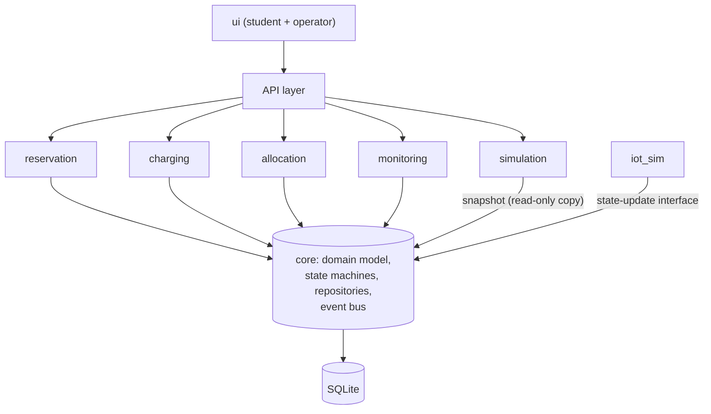

# Tech Stack

> **Status:** Accepted, Lead decision 2026-11-04 (D-002) · **Owner:** M1 · **First written:** 2026-10-05 · **Updated:** 2026-11-04
> The first version of this file proposed React + Vite + TypeScript for the frontend. The team now uses server-rendered pages (Jinja2 + HTMX); the reasons are in section 2. Everything else in the first proposal stands and is now implemented in `src/core` and `src/main.py`.

## 1. Selection criteria

| Criterion | Why it matters here |
|---|---|
| Team familiarity | 8 people, a few weeks left; no time to learn a new language or a second toolchain. |
| Speed of development | Many modules must integrate in two sprints. |
| Testability | Rubric weights testing at 10% and demands technique-based test cases. |
| Typing and structure | CONTRIBUTING requires explicit types and clear module interfaces. |
| Easy to run from a clean clone | NFR-14: ≤ 15 minutes, ≤ 5 commands. |
| Fit for concurrency and consistency | NFR-06 to NFR-09 (no double booking, atomic operations). |
| Simulation support | What-if needs a state copy and deterministic runs (NFR-12, NFR-13). |
| Well supported by AI assistants | Members use AI tools (declared in `docs/ai-usage/`); a common, well-documented stack gives better and more checkable output. |

## 2. The stack

| Layer | Choice | Reason | Main alternative |
|---|---|---|---|
| Language | Python 3.12 | Fast to write, strong testing ecosystem, easy simulation and seeded randomness. | Java 21 (Spring Boot): stronger typing, heavier setup. |
| API framework | FastAPI with Pydantic, plain `def` handlers | Typed request/response models, automatic validation (NFR-18), and `/openapi.json` that doubles as the interface spec for other modules. Plain `def` runs in a thread pool, which fits `core`'s single writer lock. | Django REST Framework; Flask. |
| Persistence | SQLAlchemy 2.x **Core** with SQLite (foreign keys on, write-ahead log) | Zero-install database, reproducible from a clean clone. Core, not the ORM: tables are explicit and a repository class hides them. | PostgreSQL (via Docker): better concurrency, more setup. |
| Consistency approach | One writer lock, transactions with savepoints, optimistic locking (`version` column) | Meets NFR-06 and NFR-09 without a distributed lock manager. | Pessimistic row locks (needs PostgreSQL). |
| Events | In-process event bus inside `core` (publish after commit) | Lets monitoring and allocation react to state changes without importing each other. | Message broker (overkill for one deployment, A-08). |
| What-if isolation | Snapshot of state loaded into an in-memory repository that implements the same `Repository` interface | Isolation by construction (NFR-12): the simulation never holds a connection to the operational store. | Copy-on-write database file. |
| Frontend | **Jinja2 templates + HTMX**, served by the same FastAPI application (pages and fragments), polling for updates | One language and one process: no Node, no build step, no second test setup. The screens needed (search, reserve, charge, monitor, simulate) are forms, tables and status panels, which server-rendered pages cover well. | React + Vite + TypeScript (first proposal): more flexible UI, but a second toolchain, a CORS setup and a separate test stack for a team with few days left. |
| Tests | pytest, pytest-cov | Parametrized tests fit equivalence partitioning and boundary-value tables; a marker per `TC-M<n>-###`. | unittest. |
| Lint / format / types | ruff (lint and format), mypy (strict on `core` and `src/main.py`) | Enforces CONTRIBUTING section 9 (rules 10, 11). Other modules join mypy when their owners are ready. | flake8 + black. |
| Dependencies | pip + `.venv`, exact versions in `requirements.txt` and `requirements-dev.txt` | Pinned versions (CONTRIBUTING 9.12), nothing to install besides Python 3.12. | `uv` or `pip-compile` with a lock file. |
| CI | GitHub Actions (`.github/workflows/ci.yml`): ruff, format check, mypy, pytest with coverage | Runs on every PR and on pushes to `develop` and `main`. GitHub Free + private repo cannot block the merge button (D-001), so the reviewer reads the result before approving. | None. |
| Diagrams | Mermaid for sequence/state/activity/class diagrams (renders on GitHub); draw.io or PlantUML where Mermaid is not enough | Source files stay in the repo. | — |
| Test-case management | Markdown/CSV tables in `docs/testing/` plus pytest markers carrying the `TC-M<n>-###` ID | Keeps tests, IDs and traceability sheet in one repo. | External tool (extra cost). |

Pinned versions at the time of writing: Python 3.12; FastAPI 0.162.0, Pydantic 2.14.2, SQLAlchemy 2.1.6, Jinja2 3.1.6, uvicorn 0.54.0; for development httpx 0.28.1, pytest 9.2.0, pytest-cov 7.1.0, ruff 0.17.3, mypy 2.4.1. The files `requirements.txt` and `requirements-dev.txt` are authoritative.

## 3. Architecture direction

Modular monolith (D-003). `core` owns all hub, vehicle, parking and charging-point state. Other modules call `core` for reads and for validated state changes, and react to domain events. `iot_sim` only calls the `core` state-update interface. `simulation` works on a snapshot. The full design is in `architecture-diagram.md`.

Trade-offs:

- **Benefit:** one process, simple consistency (transactions), easy to run and test.
- **Limitation:** not physically distributed (A-08); throughput limited to one node. Stated as a limitation in the report.
- **Alternative considered:** microservices per module. Rejected for this project because of coordination cost, difficulty of atomic multi-entity operations (NFR-09) and the schedule.

## 4. Repository and import layout

The structure mandated by README and CONTRIBUTING is kept (`src/core`, `src/reservation`, ..., `src/iot_sim`, `src/ui`). Decided:

- `src` is on the import path (`pythonpath = ["src"]` in `pyproject.toml`), so modules import `core` and each other's package names directly.
- The REST layer of `core` is `src/core/api`. The pages of the UI are templates and static files under `src/ui`, mounted by `ui.install(core, app)`; M7 chooses their internal layout.
- `src/main.py` is the composition root (D-013): it builds `core`, then calls `install(core, app)` of each module package in a fixed order. Modules never import it.
- Tests mirror modules: `tests/<module>/`, integration tests in `tests/integration/` (M8).
- The import-boundary check of NFR-22 is `tests/core/test_import_boundaries.py` (D-019).

## 5. Development environment

- Python 3.12 virtual environment in `.venv/` (ignored by git). Setup and commands are in the README, "Getting Started".
- VS Code as the common editor, with shared settings documented in the README rather than committed (`.vscode/` is ignored by CONTRIBUTING 11.3).
- `.gitattributes` fixes line endings to LF so that Windows, macOS and Linux machines produce the same diffs.
- `.env` created from `.env.example`; thresholds and seeds come from configuration, not hard-coded values (CONTRIBUTING 9.3).
- Optional: `pre-commit` hooks running ruff and mypy before each commit.

## 6. Risks

| Risk | Mitigation |
|---|---|
| Team is not comfortable with Python | Most code is written with AI assistants and reviewed by the module owner; the checks in CI (types, lint, tests) catch many mistakes without deep Python knowledge. |
| SQLite limits concurrent writers | Write-ahead logging; one writer lock and short transactions in `core`; PostgreSQL via Docker stays a documented upgrade path (only `SqlRepository` would change). |
| HTMX pages are less interactive than a single-page app | The screens are forms, tables and status panels; polling is enough for the demo. If a screen needs more, add a small amount of JavaScript to that page only. |
| Frontend work (M7) blocks on the API | `/openapi.json` and `core-api-spec.md` §8 are the contract; the demo network (`iot_sim.build_network_spec`) gives data from the first run. |
| Version drift between machines | Pinned versions, the same Python minor version (3.12), the same CI commands. |
