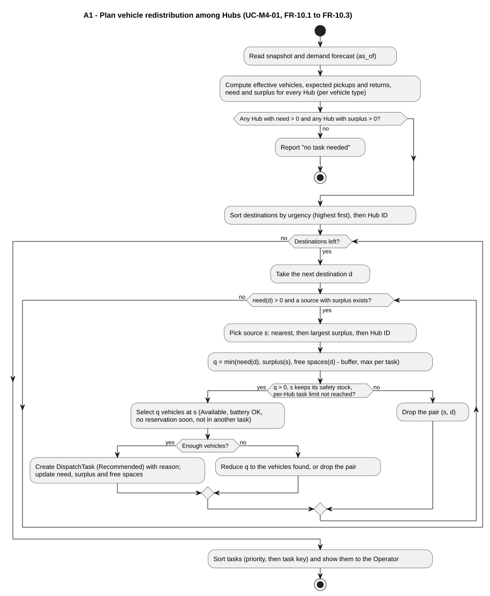
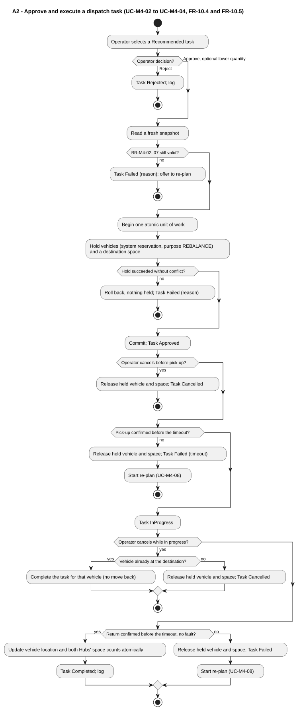
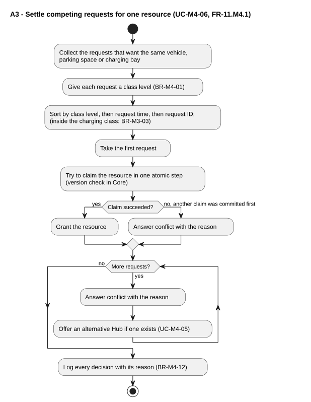

# M4 - Allocation activity design

> Owner: M4 - 2412466 Huỳnh Minh Nhật. Date: 2026-10-22. **Proposed for team review**.

The diagrams use UML activity notation. Each has an editable `.puml` source and a generated `.svg`. The algorithm behind A1 is explained, with its alternatives, in [`allocation-algorithm-design.md`](../architecture/allocation-algorithm-design.md).

## A1 - Plan vehicle redistribution among Hubs

[Source](allocation-diagrams/a1-plan.puml). FR-10.1, FR-10.2, FR-10.3; UC-M4-01; BR-M4-03, BR-M4-04, BR-M4-05, BR-M4-06.

Main concern: decision logic and loops. Destinations are served from the most urgent one; for each, the nearest source with surplus is used. A pair is dropped when the quantity is zero, the source would fall below its safety stock, or the per-Hub task limit is reached. A dropped source is removed from that destination's candidates, so the inner loop always ends. The plan is sorted before it is shown (NFR-13).

## A2 - Approve and execute a dispatch task

[Source](allocation-diagrams/a2-approve-execute.puml). FR-10.4, FR-10.5, FR-10.7; UC-M4-02, UC-M4-03, UC-M4-04; BR-M4-02 to BR-M4-09.

Main concern: alternative paths. Every exit releases what was held: reject, changed conditions, hold conflict, cancel, timeout and fault. Failures start a re-plan (UC-M4-08) so that the missing vehicles are covered by a new task.

## A3 - Settle competing requests for one resource

[Source](allocation-diagrams/a3-arbitrate.puml). FR-11.M4.1; UC-M4-06; BR-M4-01, BR-M4-02, BR-M4-12.

Main concern: who wins. The order is class level (BR-M4-01), then request time, then request ID. The winner claims the resource in one atomic step; if another claim was committed first, the request gets a conflict answer. Losers receive the reason and, where possible, an alternative Hub (UC-M4-05). Inside the charging class the order is set by M3's BR-M3-03 (D-012).
