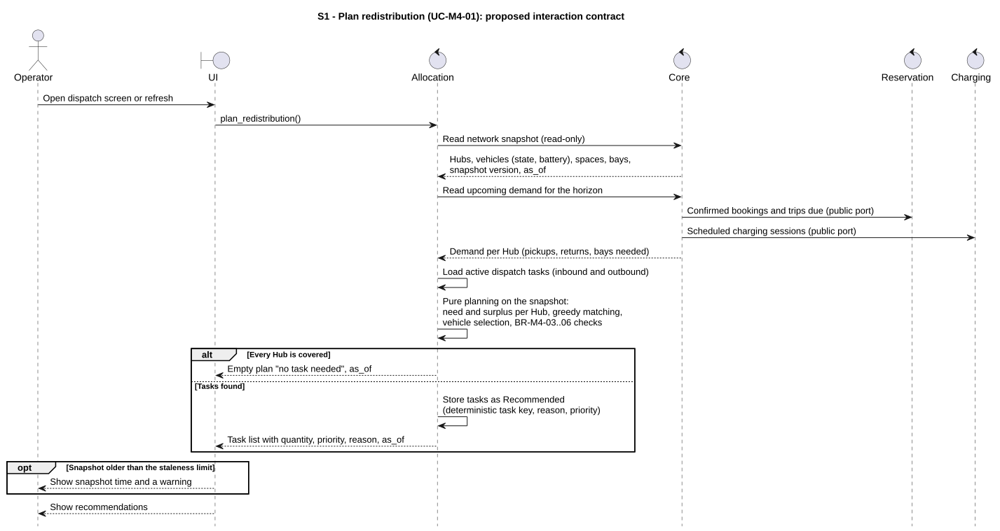
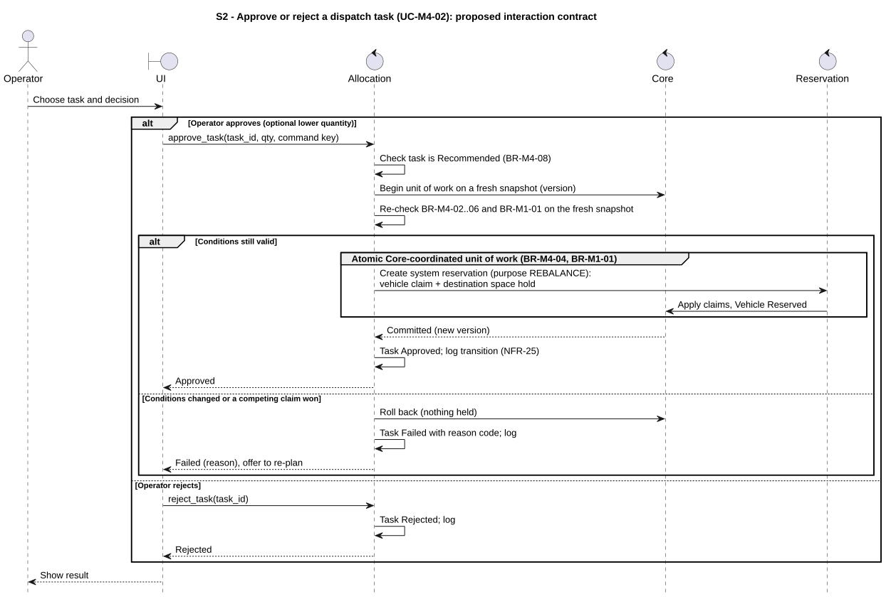
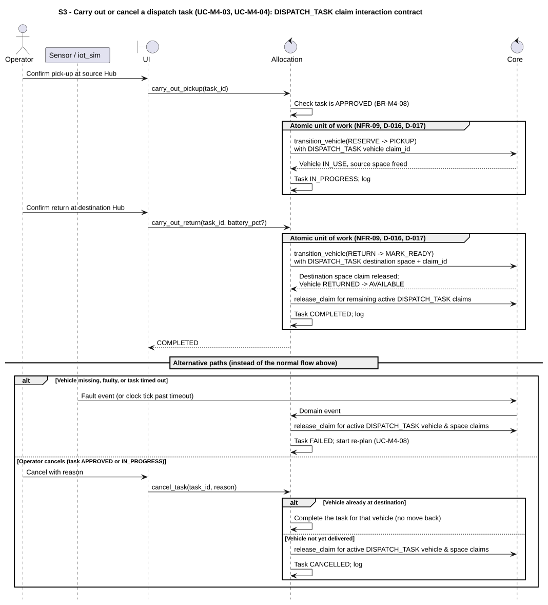
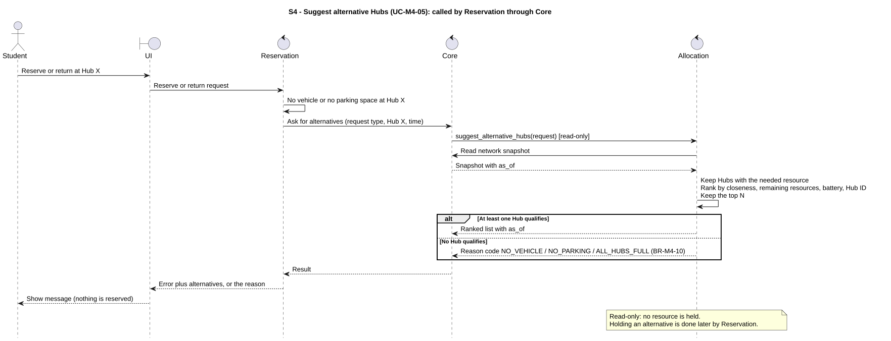
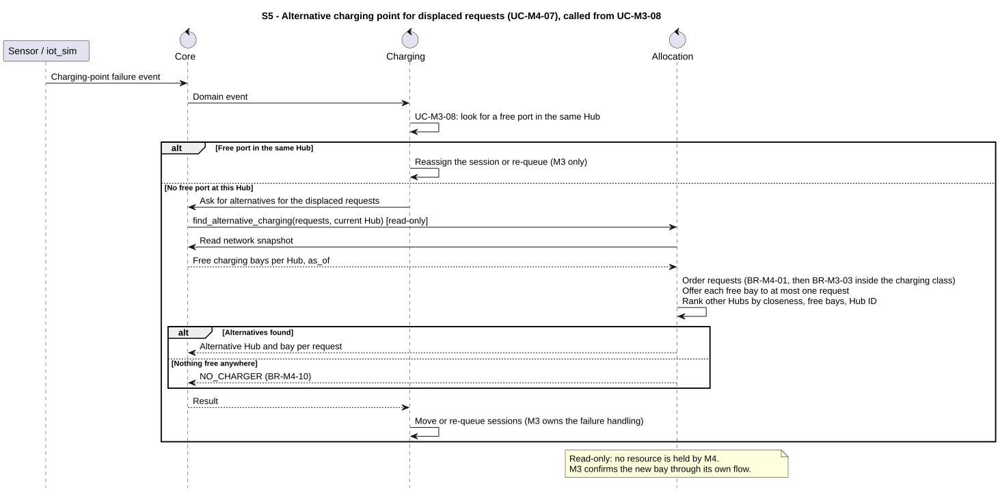

# M4 - Allocation interaction design

> Owner: M4 - 2412466 Huỳnh Minh Nhật. Date: 2026-10-22. **Proposed for team review**.

## Responsibility

The requirements baseline is [`fr-10-11-allocation.md`](../../requirements/fr-10-11-allocation.md). Responsibilities follow D-003 and D-012:
- **Core** owns hub, vehicle and charger state and coordinates every multi-owner write. Allocation never writes state directly.
- **Allocation (M4)** owns the dispatch tasks, the planning logic, the arbitration order and the alternative-lookup logic. Planning and lookup are read-only and work on a snapshot.
- **Reservation (M2)** owns rental and parking reservations (`RESERVATION` claims) and supplies upcoming demand (`ReservationDemand`). M4 owns and manages its own `DISPATCH_TASK` claims through Core (`D-017`).
- **Charging (M3)** owns the handling of a failed charging point (UC-M3-08). M4 only supplies the cross-Hub lookup (UC-M4-07).
- Modules never call each other directly (NFR-22). Where a diagram shows `Core -> Reservation` or `Core -> Charging`, it means a public provider port reached through Core (`D-020`).

The IoT simulator is outside the system boundary (D-004). Time comes from the injectable clock (D-005).

## S1 - Plan redistribution

[Source](allocation-diagrams/s1-plan.puml). FR-10.1, FR-10.2, FR-10.3; UC-M4-01; BR-M4-03, BR-M4-05, BR-M4-06.

Input: the operator's request. Output: a list of `Recommended` tasks (or "no task needed") with `as_of`. The planning step is a **pure function** of the snapshot, the demand and the parameters, so M6 can run the same logic on a copy of the state without touching the operational state. Nothing in the real state changes during planning.

## S2 - Approve or reject a task

[Source](allocation-diagrams/s2-approve.puml). FR-10.4, FR-10.5, FR-11.M4.3; UC-M4-02; BR-M4-02, BR-M4-04, BR-M4-08, BR-M1-01.

The task is re-checked against current Hub and vehicle state, because the plan may be minutes old. Placing `HolderKind.DISPATCH_TASK` claims on the vehicles and destination spaces through Core is one atomic unit of work (NFR-09, D-017): either everything is claimed or nothing is. A competing claim that was committed first makes the approval fail with a reason, and the state is unchanged (NFR-08).

## S3 - Carry out or cancel a task

[Source](allocation-diagrams/s3-execute.puml). FR-10.5, FR-10.7; UC-M4-03, UC-M4-04; BR-M4-04, BR-M1-01, BR-M1-02.

Pick-up and return are confirmed by the operator (or reported by the simulator): pick-up transitions each vehicle (`reserve` -> `pickup` to `IN_USE`) using M4's `DISPATCH_TASK` vehicle claim; return transitions each vehicle (`return` -> `mark_ready`) using M4's `DISPATCH_TASK` destination space claim and releases remaining claims atomically. A failure, a missing vehicle or a timeout releases active `DISPATCH_TASK` claims and starts a re-plan.

## S4 - Suggest alternative Hubs

[Source](allocation-diagrams/s4-alt-hubs.puml). FR-10.6; UC-M4-05; BR-M4-10.

Called by Reservation through Core when a request cannot be served at the requested Hub. The result is read-only and carries `as_of`; displaying an alternative does not hold it. This matches M2's S3: a failed return stays recoverable and no destination hold is invented.

## S5 - Alternative charging point for displaced requests

[Source](allocation-diagrams/s5-alt-charging.puml). FR-11.M4.2; UC-M4-07 (called from UC-M3-08); BR-M4-01, BR-M4-10, BR-M3-02.

M3 first looks inside the Hub. Only when no free port exists does it ask M4. M4 orders the displaced requests (class order by BR-M4-01, order inside the charging class by BR-M3-03), offers each free bay to at most one request, and ranks other Hubs. M3 stays responsible for moving or re-queuing the sessions.

## Atomic boundary and failure behaviour

| Operation | One atomic write set | Failure behaviour |
|---|---|---|
| Approve task | `DISPATCH_TASK` claim(s) on vehicles and destination spaces, task state `APPROVED`, log entry | Nothing claimed; task `FAILED` with reason |
| Pick-up | Vehicle `IN_USE` (`reserve` + `pickup` with claim), source space freed, task `IN_PROGRESS` | Unchanged; task stays `APPROVED` |
| Return | Vehicle at destination (`RETURNED` -> `AVAILABLE` via `mark_ready`), destination space claim consumed & remaining claims released, task `COMPLETED` | Claims kept; task stays `IN_PROGRESS` |
| Cancel or fail | Release of active `DISPATCH_TASK` vehicle and space claims, task state, log entry | No partial release |

Commands carry explicit task/entity version checks so concurrent conflicting writes are rejected (`VERSION_CONFLICT`).

## Alignment with latest project decisions

The items below have been settled with the release of Core API spec v1.0 and decisions D-016 to D-020:

| # | Item | Status / Decision | Reference |
|---|---|---|---|
| 1 | Message names, parameters and result codes | **Decided:** Core API spec defines command names, UoW interface, and error codes (`ErrorCode`, `Result[T]`) | `docs/design/architecture/core-api-spec.md` |
| 2 | Public ports to read snapshot, demand, and atomic writes | **Decided:** `core.snapshots.export_snapshot()`, `core.unit_of_work()`, and D-020 provider ports (`ProviderPort.RESERVATION_DEMAND`, `ProviderPort.CHARGING_DEMAND`) | D-020, Core API spec §5, §6 |
| 3 | Dispatch vehicle lifecycle and claims | **Decided:** Holds use `HolderKind.DISPATCH_TASK` claims (D-017); vehicle moves to `IN_USE` on dispatch pickup, `RETURNED` on return, and `mark_ready` returns to `AVAILABLE` (D-016, `vehicle-state-machine.md`) | D-016, D-017, `vehicle-state-machine.md` |
| 4 | Shape of UC-M4-07 and UC-M4-05 provider calls | **Decided:** Implemented as `ProviderPort.ALTERNATIVE_HUB` and `ProviderPort.ALTERNATIVE_CHARGING` | D-020, Core API spec §6.1 |
| 5 | Reuse of pure planning function on state copy | **Decided:** Planner is pure `plan(snapshot, demand, tasks, config)` and can run on any snapshot copy | D-003, `src/allocation/planner.py` |
