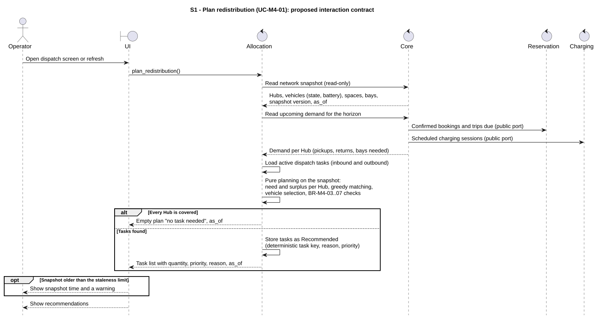
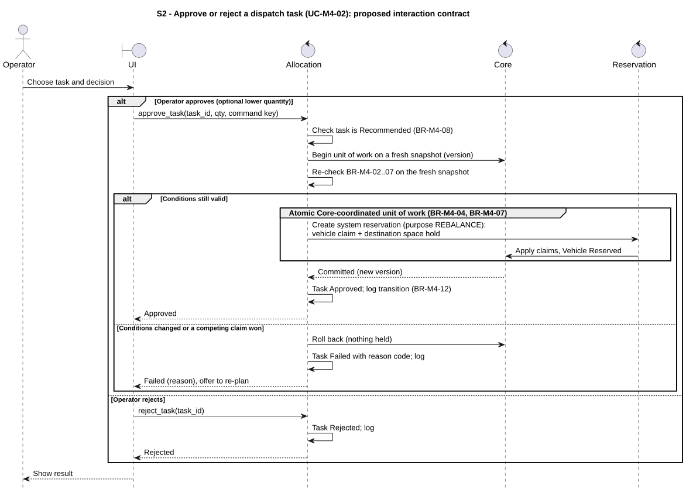
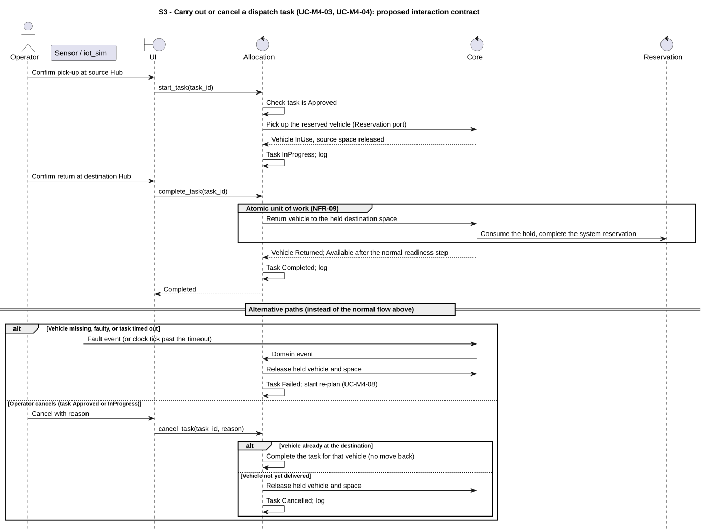
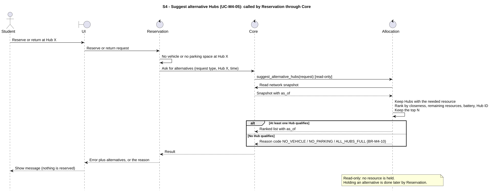
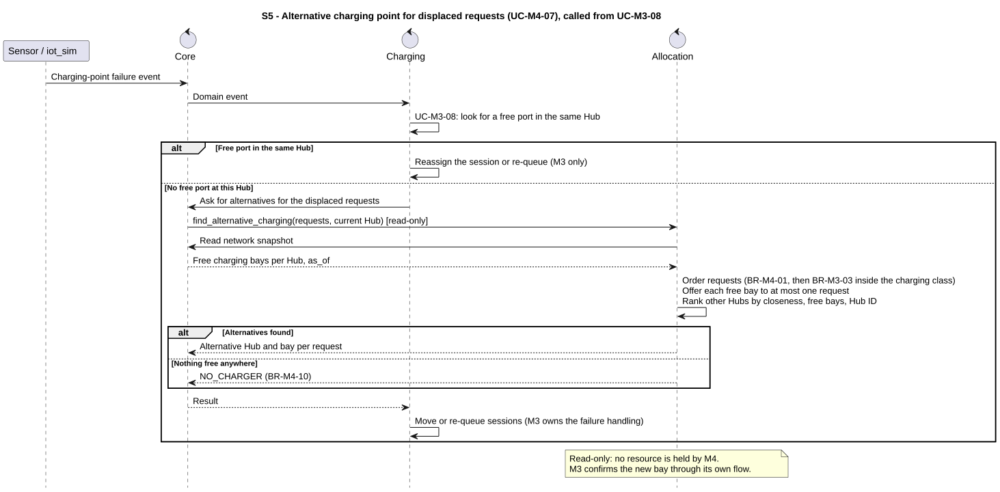

# M4 - Allocation interaction design

> Owner: M4 - 2412466 Huỳnh Minh Nhật. Date: 2026-10-22. **Proposed for team review**.

## Responsibility

The requirements baseline is [`fr-10-11-allocation.md`](../../requirements/fr-10-11-allocation.md). Responsibilities follow D-003 and D-012:
- **Core** owns hub, vehicle and charger state and coordinates every multi-owner write. Allocation never writes state directly.
- **Allocation (M4)** owns the dispatch tasks, the planning logic, the arbitration order and the alternative-lookup logic. Planning and lookup are read-only and work on a snapshot.
- **Reservation (M2)** owns reservations and parking holds. A dispatch uses a system-created reservation with purpose `REBALANCE`, so M2 stays the only owner of holds.
- **Charging (M3)** owns the handling of a failed charging point (UC-M3-08). M4 only supplies the cross-Hub lookup (UC-M4-07).
- Modules never call each other directly (NFR-22). Where a diagram shows `Core -> Reservation`, it means a public port reached through Core.

The IoT simulator is outside the system boundary (D-004). Time comes from the injectable clock (D-005).

## S1 - Plan redistribution

[Source](allocation-diagrams/s1-plan.puml). FR-10.1, FR-10.2, FR-10.3; UC-M4-01; BR-M4-03, BR-M4-05, BR-M4-06.

Input: the operator's request. Output: a list of `Recommended` tasks (or "no task needed") with `as_of`. The planning step is a **pure function** of the snapshot, the demand and the parameters, so M6 can run the same logic on a copy of the state without touching the operational state. Nothing in the real state changes during planning.

## S2 - Approve or reject a task

[Source](allocation-diagrams/s2-approve.puml). FR-10.4, FR-10.5, FR-11.M4.3; UC-M4-02; BR-M4-02, BR-M4-04, BR-M4-07, BR-M4-08.

The task is re-checked against a **fresh** snapshot, because the plan may be minutes old. The hold of the vehicles and of the destination space is one atomic unit of work (NFR-09): either both are held or nothing is. A competing claim that was committed first makes the approval fail with a reason, and the state is unchanged (NFR-08).

## S3 - Carry out or cancel a task

[Source](allocation-diagrams/s3-execute.puml). FR-10.5, FR-10.7; UC-M4-03, UC-M4-04; BR-M4-04, BR-M4-07, BR-M4-09.

Pick-up and return are confirmed by the operator (or reported by the simulator). A failure, a missing vehicle or a timeout releases the held vehicle and space and starts a re-plan. A cancel after the vehicle has reached the destination completes the task instead of moving the vehicle back.

## S4 - Suggest alternative Hubs

[Source](allocation-diagrams/s4-alt-hubs.puml). FR-10.6; UC-M4-05; BR-M4-10.

Called by Reservation through Core when a request cannot be served at the requested Hub. The result is read-only and carries `as_of`; displaying an alternative does not hold it. This matches M2's S3: a failed return stays recoverable and no destination hold is invented.

## S5 - Alternative charging point for displaced requests

[Source](allocation-diagrams/s5-alt-charging.puml). FR-11.M4.2; UC-M4-07 (called from UC-M3-08); BR-M4-01, BR-M4-10, BR-M4-11.

M3 first looks inside the Hub. Only when no free port exists does it ask M4. M4 orders the displaced requests (class order by BR-M4-01, order inside the charging class by BR-M3-03), offers each free bay to at most one request, and ranks other Hubs. M3 stays responsible for moving or re-queuing the sessions.

## Atomic boundary and failure behaviour

| Operation | One atomic write set | Failure behaviour |
|---|---|---|
| Approve task | Vehicle claim(s), `Reserved` state, destination space hold, task state `Approved`, log entry | Nothing held; task `Failed` with reason |
| Pick-up | Vehicle `InUse`, source space released, task `InProgress` | Unchanged; task stays `Approved` |
| Return | Vehicle at destination, destination occupancy, hold consumed, task `Completed` | Hold kept; task stays `InProgress` |
| Cancel or fail | Release of held vehicle and space, task state, log entry | No partial release |

Commands carry a command key so that a retry does not apply twice (same approach as M2).

## Not decided yet

Everything above is designed. The items below are **not decided** and are waiting for other owners.

| # | Item | Waiting for |
|---|---|---|
| 1 | Message names, parameters and result codes. Those used in the diagrams are placeholders, not existing API names; no Core API spec v1 exists in the repository yet. | M1 (Core API spec v1) |
| 2 | Public ports to read the snapshot and the demand of M2 and M3, and the unit-of-work port for atomic writes. | M1 |
| 3 | Whether a system reservation with purpose `REBALANCE` may use the normal pick-up and return of M2 without creating a student trip. | M2 |
| 4 | Shape of the request and answer of UC-M4-07 (displaced requests, free bays, order inside the charging class). | M3 |
| 5 | Reuse of the pure planning function on a copy of the state. | M6 |
