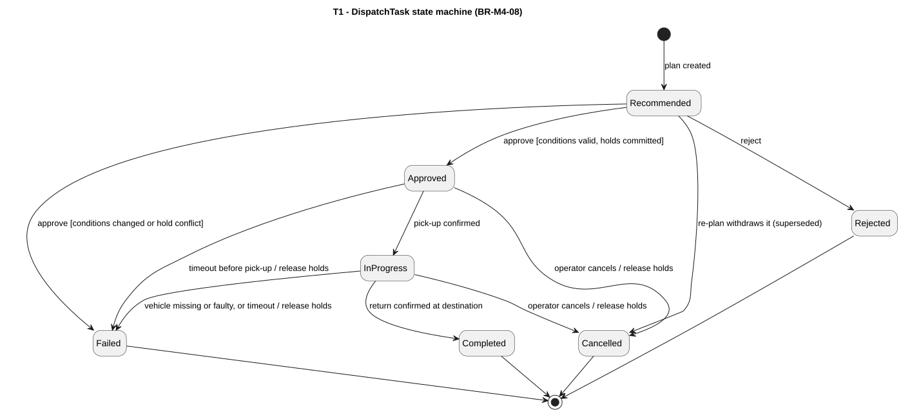

# M4 - DispatchTask state machine

> Owner: M4 - 2412466 Huỳnh Minh Nhật. Date: 2026-10-22. **Proposed for team review**.

[Source](allocation-diagrams/t1-dispatch-task-state.puml). BR-M4-08; NFR-08; NFR-25.

A dispatch task has a real life cycle with guards, so a state machine is included (rubric 3.3). Every transition is logged with time, previous and new state, trigger and actor (BR-M4-12).

| From | Trigger | Guard | To | Effect |
|---|---|---|---|---|
| (start) | Plan created | - | Recommended | Task stored with key and reason |
| Recommended | Approve | Conditions valid; holds committed | Approved | Vehicle and destination space held |
| Recommended | Approve | Conditions changed, or a hold conflicts | Failed | Nothing held; reason recorded |
| Recommended | Reject | - | Rejected | - |
| Recommended | Re-plan | Task superseded | Cancelled | Task withdrawn (reason `SUPERSEDED`) |
| Approved | Pick-up confirmed | - | InProgress | Vehicle `InUse` |
| Approved | Operator cancels | - | Cancelled | Holds released |
| Approved | Timeout | No pick-up in time | Failed | Holds released; re-plan |
| InProgress | Return confirmed | At destination | Completed | Location and occupancy updated |
| InProgress | Operator cancels | Vehicle not yet delivered | Cancelled | Holds released |
| InProgress | Fault or timeout | Vehicle missing or faulty, or too long | Failed | Holds released; re-plan |

Any other (state, event) pair is rejected with an error code and leaves the state unchanged (BR-M4-08, NFR-08). Terminal states: Completed, Rejected, Cancelled, Failed. Each valid transition and each invalid pair needs at least one test.
