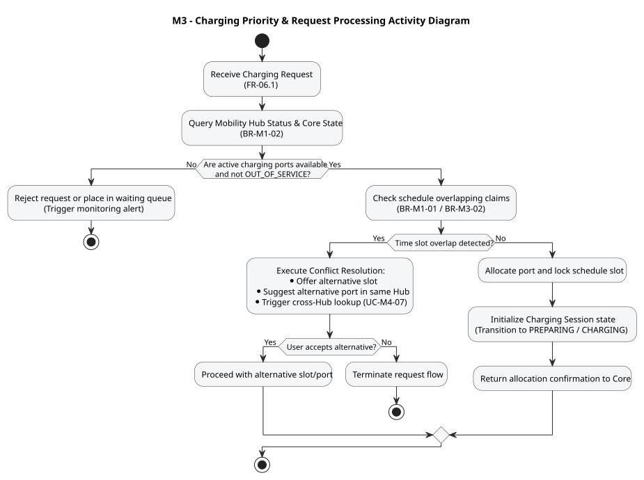

# M3 - Charging Activity Design

> Owner: M3 - Võ Thanh An. Date: 2026-11-06.

The diagrams use UML activity notation. Each has an editable `.puml` source and a generated `.svg`.

## Charging Priority & Request Processing

[Source](charging-diagrams/charging-activity-diagram.puml). Trace: FR-06.1, FR-06.2, FR-07.M3.2; UC-M3-01; BR-M3-01, BR-M3-02, BR-M1-01, BR-M1-02.

Main concern: operational workflow and decision logic executed when a vehicle requests a charging slot at a Mobility Hub. The algorithm prioritizes available ports, checks station capacity limits, handles conflicting bookings, and ensures strict exclusion of out-of-service infrastructure.
