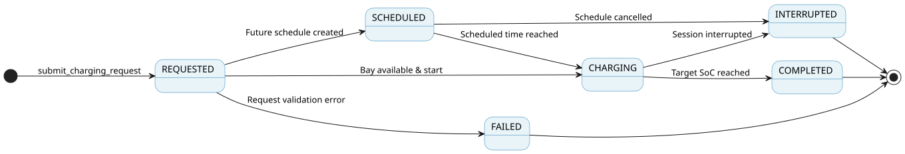

# M3 - Charging Session State Machine Design

> **Owner:** M3 - Võ Thanh An  
> **Date:** 2026-11-06  
> **Status:** Proposed for Team Review

This document defines the lifecycle and state transitions specific to an M3 charging session at a Mobility Hub. The state machine ensures correct session management, strict queue handling, and real-time synchronization with core services.

---

## 1. Charging Session State Machine Diagram

- **PlantUML Source:** [`charging-session-state-machine.puml`](charging-diagrams/charging-session-state-machine.puml)
- **Traceability:** FR-06.2, FR-07.M3.1; UC-M3-02; BR-M3-01, BR-M1-02.

---

## 2. Session State Transition Details

| Current State | Service Method / Trigger Event | Guard Condition / Rule | Next State | Claims Placed or Released |
| :------------ | :----------------------------- | :--------------------- | :--------- | :------------------------ |
| `(Start)` | `submit_charging_request` (immediate) | Vehicle already in a free bay | `CHARGING` | Claims placed (bay bound) |
| `(Start)` | `submit_charging_request` (scheduled) | `start_at` given | `SCHEDULED` | Claims placed (bay bound for the slot) |
| `(Start)` | `submit_charging_request` (queued) | No free bay (`bay is None`) | `QUEUED` | No claim placed yet |
| `QUEUED` | `optimize_queue` | Queue optimization / slot assignment | `SCHEDULED` | Claims placed (bay bound for the slot) |
| `QUEUED` | `cancel_charging_schedule` / cancel | User or system cancellation request | `CANCELLED` | No claims affected |
| `SCHEDULED` | `cancel_charging_schedule` / cancel | User or system cancellation request | `CANCELLED` | Claims released |
| `SCHEDULED` | `start_scheduled_session` | Scheduled time reached & bay ready | `CHARGING` | Claims already held; none placed |
| `CHARGING` | `finish_charging` / finish | Target SoC reached | `COMPLETED` | Claims released |
| `CHARGING` | `interrupt_charging` / interrupt | Point failure or user interruption | `INTERRUPTED` | Claims released |

---

## 3. System Interfacing & Claim Management

- **Resource Claim Management (D-017):** Module M3 independently places and releases its own resource claims during the charging lifecycle. Resource claims are placed when a bay is bound (entering `CHARGING` or `SCHEDULED`) and safely released when transitioning to terminal states (`COMPLETED`, `INTERRUPTED`, or `CANCELLED`).
- **Provider Port Integration (D-020):** Charging sessions and demand data are exposed to **Module M4** (Resource Allocation and Vehicle Dispatching) and **Module M6** (What-if Simulation and Coordination) exclusively via the `ChargingDemand` provider port (`ChargingDemandProvider`).
- **Private EV Onboarding:** Private Electric Vehicles (Private EVs) must be registered in the system using the `register_vehicle` interface before initiating a charging session state transition.

---

## 4. Key Design Rules

- **Point Failure Handling (BR-M3-02):** A point failure reaches M3 as the Core event `ChargingPointStatusChanged`, which moves the session to another bay or a later slot.
- **Core Telemetry:** State changes are instantaneously pushed to the core management engine to update hub availability metrics.