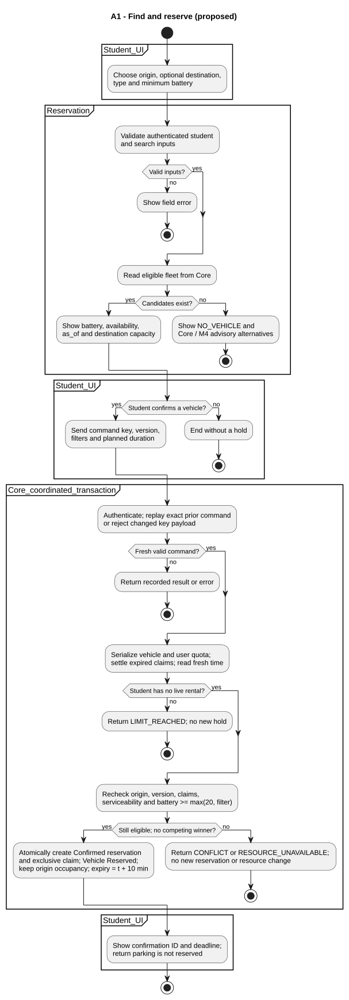
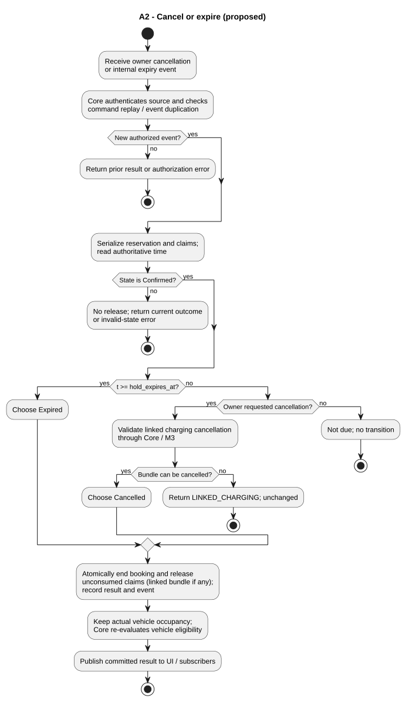
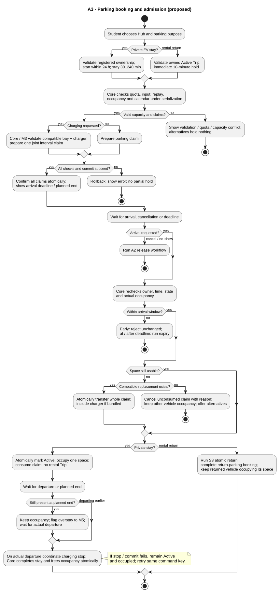

# M2 - Reservation activity diagrams

> Owner: 2452620 Đặng Tuấn Kiệt (M2). 2026-10-11. **Proposed for team review**.

These are UML activity diagrams authored in PlantUML, not flowcharts relabelled as UML. Initial/final nodes, actions, decisions with guards and responsibility partitions describe control flow. Concurrent requests are separate activity executions serialized at Core admission; a fork is deliberately not used to imply that a single Student makes two bookings.

The [requirements baseline](../../requirements/fr-02-05-07-reservation.md) defines all parameters (§3), stable UC/BR IDs (§8) and verification scenarios (§9). Core interactions are proposed; no existing API is asserted. Editable sources and SVG exports live beside this file under `reservation-diagrams/`.

## A1 - Find and reserve a rental vehicle

[PlantUML source](reservation-diagrams/a1-rental.puml). FR-02/03; UC-M2-01/02; BR-M2-01/02/03/04/06/07/08/13; V-M2-01/02/03/11/13.

Search is a snapshot. Confirmation checks the selected origin, fleet type, battery (at least 20% and the requested minimum), serviceability and student quota again. Competing reservations and redistribution use the same Core claim boundary. A stale observation or losing contender receives a conflict and can refresh; nothing is reserved by showing an alternative. Success is one Confirmed hold expiring ten minutes after confirmation, with no Trip or destination hold. The parked origin vehicle continues occupying its space.

## A2 - Cancel or expire an unconsumed hold

[PlantUML source](reservation-diagrams/a2-release.puml). FR-03/05/07 parking; UC-M2-03/07 and internal expiry; BR-M2-04/05/06/07/08/11/12/14; V-M2-04/07/09.

Expiry is an internal timed event, not an external actor. At `t >= hold_expires_at` it wins over a newly evaluated pickup/arrival; a pickup already committed before the deadline leaves Active and cannot be expired. Cancellation requires owner, Confirmed and `t < expiry`. A parked vehicle remains occupied even if the booking or charging commitment is cancelled. Linked charging cancellation must be coordinated through Core/M3. Vehicle faults use the incident transition in R1/R2, not an arbitrary Available assignment.

## A3 - Reserve and use parking

[PlantUML source](reservation-diagrams/a3-parking.puml). FR-05/07 parking and FR-04 return integration; UC-M2-05/06/07/08; BR-M2-01/03/04/06/08/10/11/12/13/15; V-M2-06/08/09/10.

Private parking uses a start within 24 hours, a 30..240-minute planned stay and arrival in `[start,start+10 min)`. Rental return parking is an immediate ten-minute hold for an owned Active Trip; it completes at return, although the fleet vehicle remains parked. Future calendar claims do not mean present occupancy. Exact endpoints do not overlap, but an actual overstay always blocks physical admission. Reassignment must atomically move the complete bay/charger claim; if unavailable, cancel the unconsumed booking with a reason and offer a new choice. Cancellation and no-show leave the arrival branch through A2, never through a fake departure.

## Reproduction

Use PlantUML 1.2026.2 with Java 17; see [behavioral report](../../report/05-behavioral-design.md) for exact render/validation commands and evidence. Edit `.puml` sources then regenerate `.svg`; do not edit generated images by hand.
