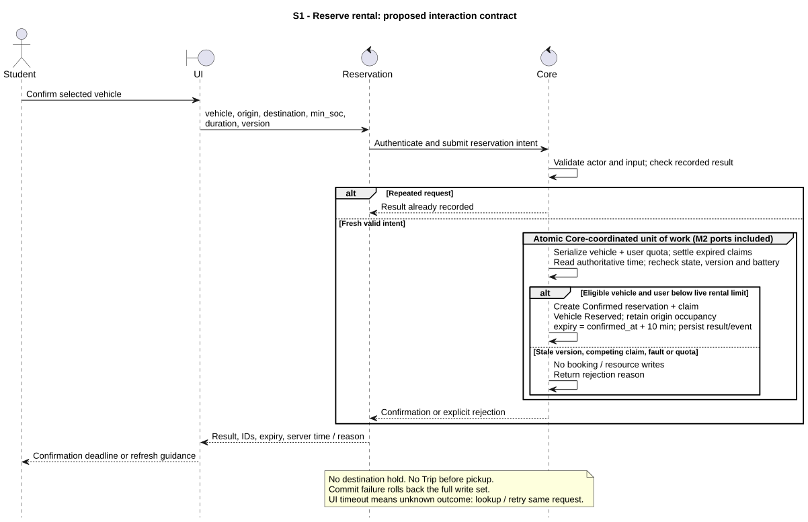
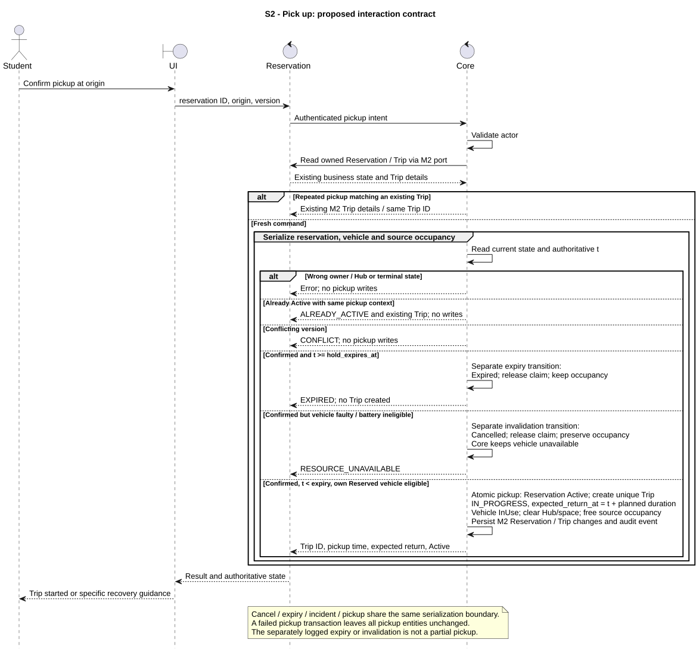
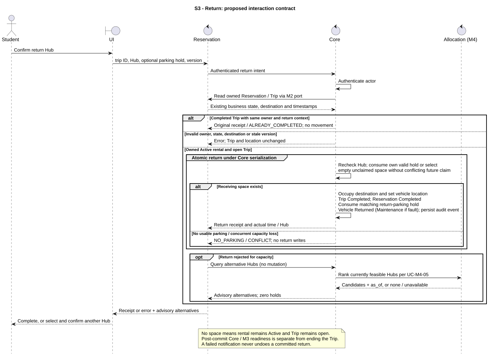

# M2 - Reservation interaction design

> Owner: M2 - 2452620 Đặng Tuấn Kiệt. Date: 2026-11-04. **Proposed for team review**. Core interactions follow the released Core API v1.1 and D-015 through D-020; M2 policy values remain subject to team review.

## Contract status and responsibility

The diagrams bind shared operations to the released [Core API v1.1](../architecture/core-api-spec.md). UI messages and M2 policy choices remain proposed; they do not define HTTP routes. The [requirements baseline](../../requirements/fr-02-05-07-reservation.md) defines parameters, UC/BR definitions and required data.

Student is the human actor. UI validates for convenience and sends commands; it cannot decide ownership, battery or success. Reservation owns rental/parking workflow and policy. Core owns shared resource state and provides the unit of work. M2 registers its tables at `install(core, app)`, reads its own records first, then orchestrates Core commands and M2 repository writes inside that unit of work (D-013/D-015/D-018). Core never calls an M2 reservation-read port. These are in-process components, not separate network services.

No database, scheduler or payment participant is invented. M4 appears only as an internal ranking provider reached through the Core provider registry, supported by UC-M4-05. M3/M5 receive post-commit domain events through Core. Direct access to another module's repository is forbidden (CONTRIBUTING §9).

## S1 - Reserve

[Source](reservation-diagrams/s1-reserve.puml). FR-03; UC-M2-02; NFR-16, NFR-18, BR-M2-02, BR-M2-03, BR-M2-04, BR-M2-05, BR-M1-01, NFR-06, NFR-09, BR-M4-02; V-M2-02/03/05/11/13.

Inputs: authenticated actor, vehicle/origin/destination IDs, requested minimum battery, planned duration, observed vehicle version. Output: stable result code, reservation ID/state, confirmed_at/hold_expires_at, server time and current resource version. The per-user quota guard must serialize independently of vehicle version so one user cannot reserve two different vehicles concurrently. The atomic commit retains origin occupancy and creates no Trip or destination hold. A deferred charging/dispatch request cannot take a committed student claim.

## S2 - Pick up

[Source](reservation-diagrams/s2-pickup.puml). FR-04; UC-M2-04; NFR-16, NFR-18, BR-M2-02, BR-M2-04, BR-M1-01, NFR-06, NFR-09, BR-M2-09, BR-M2-14, BR-M2-15; V-M2-02/04/05/07/11/13.

Inputs: reservation ID, origin Hub, expected version and trusted actor. Core permits this reservation's own Vehicle Reserved state/claim, but rejects any competing claim or fault. At exactly expiry, pickup is rejected; a separately logged valid expiry transition releases the claim and retains actual parked occupancy. Owner rejection never discloses another booking. An accepted fault or newly insufficient battery cancels the unconsumed booking as a separate invalidation transition; it cannot create a Trip or free the source space. Failure after any pickup write rolls back every pickup write, including the Trip.

## S3 - Return

[Source](reservation-diagrams/s3-return.puml). FR-04/05; UC-M2-05; NFR-16, NFR-18, BR-M1-01, NFR-06, NFR-09, BR-M2-09, BR-M2-10, BR-M2-11, BR-M4-02, BR-M2-14, BR-M2-15; V-M2-02/05/06/07/10/13.

Inputs: trip/destination IDs, optional parking booking ID, expected version and trusted actor. A valid own hold is consumable even if the count of unclaimed spaces is zero. Without a hold, choose a currently empty serviceable space with no future claim that indefinite fleet occupancy would violate. A faulty in-use vehicle may return to a Hub that can safely accept it; returning a vehicle is not authorizing another rental.

NO_PARKING, stale versions or invalid ownership leave the open Trip, Active rental and current location unchanged. Suggested Hubs are read-only query results with `as_of`; M4 failure does not undo the return error or create a hold. Student confirms another Hub in a fresh command. An expired hold is settled separately, and a fresh unheld-space check is allowed; it is never revived. A hold at a different destination is not consumed by accident: keep it until explicit cancellation/expiry and show a reminder.

## Atomic boundary and repeated requests

| Operation | One atomic write set | Failure behavior |
|---|---|---|
| Reserve rental | Confirmed booking, exclusive vehicle claim, Vehicle Reserved, user-quota serialization, audit record | None committed; original occupancy retained |
| Pickup | Active booking, unique Trip, due time, Vehicle InUse with cleared location, source occupancy release, audit event | All rolled back; no half-started Trip |
| Return | Trip completion, rental completion, destination occupancy/location, Vehicle Returned/Maintenance, matching parking-hold completion, audit event | Open trip and in-trip location retained |
| Cancel/expire | Terminal booking, unconsumed claim release, vehicle readiness reassessment, linked bundle release if appropriate, audit event | No partial resource release; actual occupancy unaffected |
| Parking arrival/departure | Claim conversion/occupancy, parking state/times; linked M3 changes through public ports; audit event | No partial arrival/departure or phantom free bay |
| Joint parking/charging confirmation | Parking booking, bay interval, charger interval and M3 schedule record via its port, audit event | Both confirmed or neither; no charger-only promise |

A repeated request reads the existing Reservation / Trip record owned by M2 and returns the recorded business outcome without another Trip or reservation. No separate command-result store or Core outcome-query API is required.

Persistent Pending is not needed: it is request validation before the atomic confirmation commit. A crash before commit leaves no live booking; after a crash following commit, M2 reads the existing Reservation / Trip record. Durably committed domain events may be retried after publication failure, deduplicated by event ID/version. Consumers must not be needed to complete an already committed capacity invariant.

The released Core uses a process-wide reentrant lock around each unit of work and one repository transaction. M2 repeats its own-record/quota checks inside that lock, obtains authoritative time from `core.queries.get_config().as_of`, and uses observed vehicle versions in commands. SQLite and the in-memory repository share this contract; this is not a multi-process locking guarantee. If a competing identical request returns VERSION_CONFLICT or INVALID_TRANSITION, reread M2 records before reporting failure (D-015). Retry identity is the reservation resource ID and its immutable booking fields, not a separate command key or result store.

## Concrete Core mapping and remaining integration contracts

- Reserve: `place_claim(VEHICLE, ..., RESERVATION, reservation_id, now, expiry, actor)` then `transition_vehicle(..., RESERVE, version, actor, TransitionCtx(claim_id=..., min_battery=...))`; add M2 Reservation through `uow.repository` and commit.
- Pickup: M2 checks owner, origin, deadline and booking state first; `PICKUP` requires its vehicle claim ID. Core validates the claim and frees origin occupancy; M2 calls `release_claim`, creates the unique Trip and marks the booking Active in the same unit of work.
- Return: `RETURN` (or `RETURN_FAULTY` for an accepted fault) with destination Hub / optional space claim. Core selects a safe space, including checking future claims; M2 completes Trip/Reservation in the same unit of work. Core, not M2, later decides readiness.
- Expiry belongs to M2 (D-017): mark only its booking Expired, release its RESERVATION claim and request `RELEASE_RESERVATION` where applicable. Core has no automatic claim-expiry sweep. An expired interval alone does not restore vehicle availability.
- Error mapping: VERSION_CONFLICT/CLAIM_CONFLICT -> CONFLICT; HUB_FULL/SPACE_NOT_FREE -> NO_PARKING; BATTERY_TOO_LOW -> RESOURCE_UNAVAILABLE; INVALID_TRANSITION -> INVALID_STATE; NOT_FOUND -> NOT_FOUND_OR_NOT_OWNED. M2 owns its quota/deadline errors. These are service outcomes, not an HTTP specification.
- D-020 assigns M2 the `ReservationDemand` and `HoldConsumer` Protocol/result types in `core.providers`. Callers M4/M6 review them; implementations follow in the integration phase. `HoldConsumer.consume_hold(holder_ref)` participates in an existing unit of work and must not commit independently.
- Core snapshots contain Core entities/claims, not M2 bookings or trip due times (D-018). Simulation must obtain these through `ReservationDemand` and copy them into its isolated module store; do not infer them from the vehicle snapshot alone.

M3 bundle cancellation/start/stop and M4 ranking/hold-consumption semantics still require their owners' integration review. The released unit-of-work, claim, time and Vehicle transition contracts are sufficient to implement the rental happy path. This design does not claim team approval of policy values or completion of those integrations.
