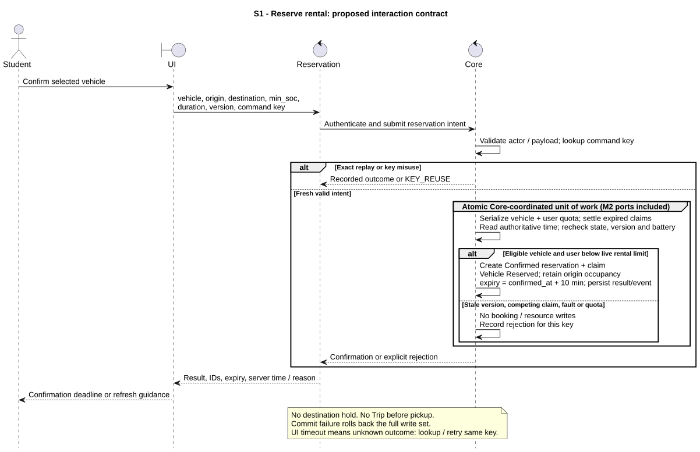
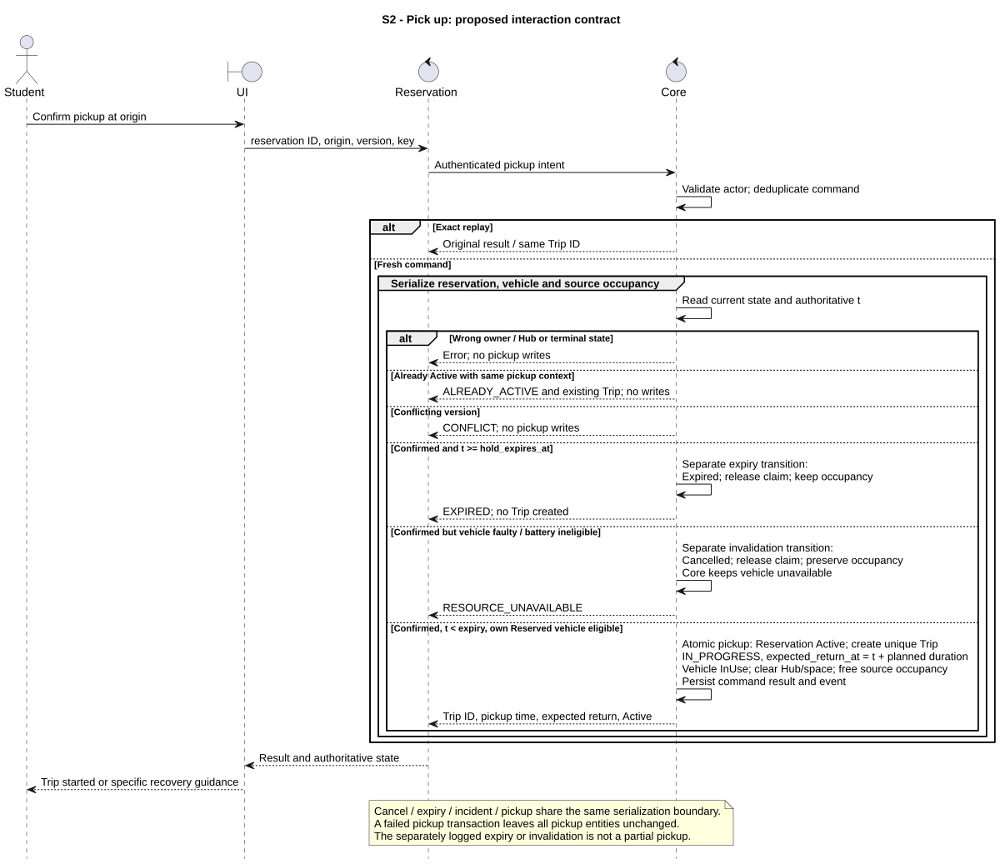
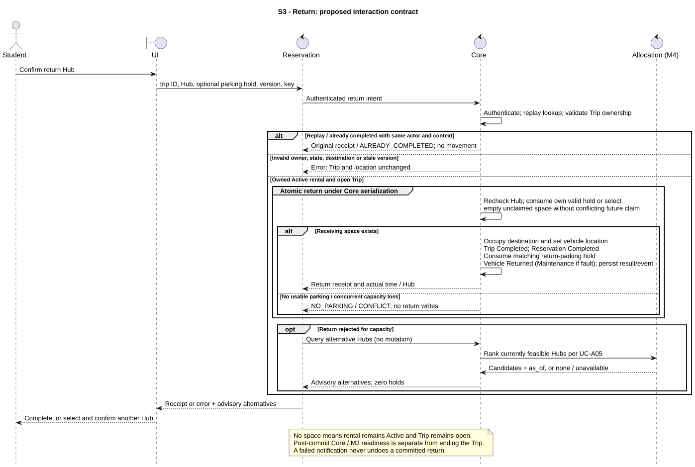

# M2 - Reservation interaction design

> Owner: M2 - 2452620 Đặng Tuấn Kiệt. Date: 2026-10-11. **Proposed for team review**.

## Contract status and responsibility

All messages below form a **proposed interaction contract**, not existing API names or routes. No Core API spec was found in fetched refs; reconcile with M1 v1 due 2026-10-19. The [requirements baseline](../../requirements/fr-02-05-07-reservation.md) records exact source revisions, parameters, UC/BR definitions and missing data.

Student is the human actor. UI validates for convenience and sends commands; it cannot decide ownership, battery or success. Reservation owns rental/parking workflow and policy. Core owns shared resource state and coordinates an atomic unit of work with public M2 policy/persistence ports. They are logical components of the proposed modular monolith, not separate network services. Core's internal transaction box includes M2 Reservation/Trip writes via those ports; it does not transfer their business ownership to M1.

No database, scheduler or payment participant is invented. M4 appears only as an internal ranking provider reached through the proposed Core facade, supported by UC-M4-05. M3/M5 receive post-commit domain events through Core. Direct access to another module's repository is forbidden (CONTRIBUTING §9).

## S1 - Reserve

[Source](reservation-diagrams/s1-reserve.puml). FR-03; UC-M2-02; BR-M2-01..08/13; V-M2-02/03/05/11/13.

Inputs: authenticated actor, vehicle/origin/destination IDs, requested minimum battery, planned duration, observed vehicle version and command key. Output: stable result code, reservation ID/state, confirmed_at/hold_expires_at, server time and current resource version. The per-user quota guard must serialize independently of vehicle version so one user cannot reserve two different vehicles concurrently. The atomic commit retains origin occupancy and creates no Trip or destination hold. A deferred charging/dispatch request cannot take a committed student claim.

## S2 - Pick up

[Source](reservation-diagrams/s2-pickup.puml). FR-04; UC-M2-04; BR-M2-01/02/04/06..09/14/15; V-M2-02/04/05/07/11/13.

Inputs: reservation ID, origin Hub, expected version, command key and trusted actor. Core permits this reservation's own Vehicle Reserved state/claim, but rejects any competing claim or fault. At exactly expiry, pickup is rejected; a separately logged valid expiry transition releases the claim and retains actual parked occupancy. Owner rejection never discloses another booking. An accepted fault or newly insufficient battery cancels the unconsumed booking as a separate invalidation transition; it cannot create a Trip or free the source space. Failure after any pickup write rolls back every pickup write, including the Trip and command-result row.

## S3 - Return

[Source](reservation-diagrams/s3-return.puml). FR-04/05; UC-M2-05; BR-M2-01/06..11/13..15; V-M2-02/05/06/07/10/13.

Inputs: trip/destination IDs, optional parking booking ID, expected version, command key and trusted actor. A valid own hold is consumable even if the count of unclaimed spaces is zero. Without a hold, choose a currently empty serviceable space with no future claim that indefinite fleet occupancy would violate. A faulty in-use vehicle may return to a Hub that can safely accept it; returning a vehicle is not authorizing another rental.

NO_PARKING, stale versions or invalid ownership leave the open Trip, Active rental and current location unchanged. Suggested Hubs are read-only query results with `as_of`; M4 failure does not undo the return error or create a hold. Student confirms another Hub in a fresh command. An expired hold is settled separately, and a fresh unheld-space check is allowed; it is never revived. A hold at a different destination is not consumed by accident: keep it until explicit cancellation/expiry and show a reminder.

## Atomic boundary and retry protocol

| Operation | One atomic write set | Failure behavior |
|---|---|---|
| Reserve rental | Confirmed booking, exclusive vehicle claim, Vehicle Reserved, user-quota serialization, audit and command result | None committed; original occupancy retained |
| Pickup | Active booking, unique Trip, due time, Vehicle InUse with cleared location, source occupancy release, result/event | All rolled back; no half-started Trip |
| Return | Trip completion, rental completion, destination occupancy/location, Vehicle Returned/Maintenance, matching parking-hold completion, result/event | Open trip and in-trip location retained |
| Cancel/expire | Terminal booking, unconsumed claim release, vehicle readiness reassessment, linked bundle release if appropriate, result/event | No partial resource release; actual occupancy unaffected |
| Parking arrival/departure | Claim conversion/occupancy, parking state/times; linked M3 changes through public ports; result/event | No partial arrival/departure or phantom free bay |
| Joint parking/charging confirmation | Parking booking, bay interval, charger interval and M3 schedule record via its port, result/event | Both confirmed or neither; no charger-only promise |

Core authenticates before replay lookup. Same `(actor,operation,key)` and payload hash returns the original result without reapplying guards against newer versions. Same key with a different payload fails KEY_REUSE. Same-key response loss does not justify a new booking. A natural uniqueness constraint on Trip.reservation_id also prevents repeated pickup with a new key. New-key repeated return yields ALREADY_COMPLETED without changing the historic destination. Entity status should be refreshed after replay.

Persistent Pending is not needed: it is request validation before the atomic confirmation commit. A crash before commit leaves no live booking; a crash after commit is recovered by command-result lookup. Durably committed domain events may be retried after publication failure, deduplicated by event ID/version. Consumers must not be needed to complete an already committed capacity invariant.

Proposed storage implementation (subject to D-002): database transactions plus unique/version constraints and a serialized per-user/admission guard. Vehicle versions alone cannot protect two new interval rows or the same user's quota; Core must serialize/check those predicate conflicts too. SQLite requires a suitable serialized write transaction; do not claim PostgreSQL row-lock semantics exist in SQLite. M1 chooses the mechanism and exposes a single consistent unit-of-work boundary.

## Outstanding M1/M3/M4/M7 confirmations

1. Public unit-of-work and policy ports for multi-owner atomic writes; read-only candidate and command-result queries.
2. Stable result-code mapping (design codes here are not an HTTP contract), accepted Vehicle transitions and version/time precision.
3. Calendar claims, current occupancy and coupled bay/charger transaction support; charging stop/cancel semantics.
4. Core-mediated M4 ranking and admission-priority integration without direct module imports.
5. Durable result/event replay and isolated simulation namespace. A snapshot must include future claims and due times; otherwise simulation would miss M2 conflicts.

No shared API or other owner's file is changed by this proposal. Before adopting a new Core interface, follow CONTRIBUTING's team-notice/DECISIONS protocol; this local draft is not such a published interface change.
