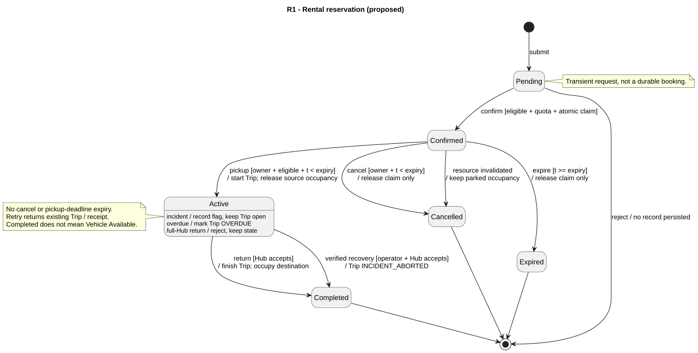
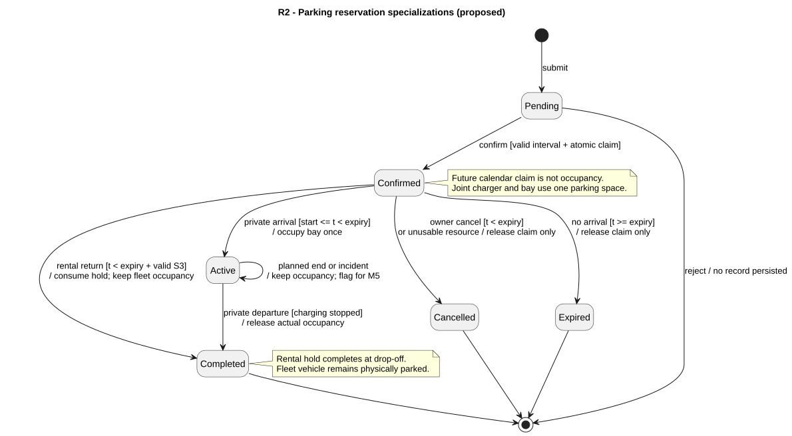

# M2 - Reservation state machines

> Owner: M2 - 2452620 Đặng Tuấn Kiệt. Date: 2026-10-11. **Proposed for team review**.

Canonical guards and parameter values: [requirements §§3-5](../../requirements/fr-02-05-07-reservation.md). UC-M2/BR-M2 IDs are stable under CONTRIBUTING section 5. M1's Vehicle state machine is absent; Vehicle names below are mapped to the timeline/M7 draft and need M1 validation. Title case here maps to M7 uppercase values (Active = ACTIVE, InUse = IN_USE), not different states.

## Meaning of the six states

| State | Rental meaning | Parking specialization |
|---|---|---|
| Pending | Transient request validation before commit; no durable Reservation, claim or Trip yet | Same validation stage before calendar/hold confirmation |
| Confirmed | Exclusive vehicle hold, pickup still permitted only before expiry | Future interval or immediate empty-space hold, not physical occupancy |
| Active | Vehicle picked up and Trip open | Private vehicle physically parked; rental-return parking skips Active and completes when the return is accepted |
| Completed | Trip ended by verified return or authorized recovery | Private vehicle actually departed, or rental return hold successfully consumed; fleet vehicle may still occupy the space |
| Cancelled | Unused booking cancelled by owner or invalidated by a resource fault | Unconsumed claim released; no occupancy deletion |
| Expired | Pickup deadline passed without pickup | Arrival deadline passed without arrival, even if future planned end is later |

The assignment's six states are retained. **Proposed refinement:** Pending is an ephemeral request state, not a database row visible to other users. Rejected Pending goes to the UML final node with no reservation persisted. This avoids adding a Rejected state or inventing a durable Pending cleanup policy. M1/M7 must confirm; if they require persistent Pending, add explicit processing expiry/recovery before implementation. Completed/Cancelled/Expired are terminal and retained for audit; UML final does not mean deleting the record.

## R1 - Rental reservation

[Source](reservation-diagrams/r1-rental.puml). FR-03/04; UC-M2-02..05; BR-M2-02/04..10/14/15; V-M2-02..07/10/13. Invalid requests and exact replays do not transition; the table is authoritative for detailed guards omitted from short labels.

| Current state | Event | Guard | Next state | Vehicle / parking / Trip effects | Invalid-operation result |
|---|---|---|---|---|---|
| No record | Submit | Valid session and request envelope | Pending (transient) | None | INVALID_INPUT / unauthorized; no record |
| Pending | Confirm | BR-M2-01/02/03/06 valid at Core commit | Confirmed | Create vehicle claim; Vehicle Reserved; keep origin occupancy; no Trip; expiry = t+10 min | Validation/conflict/quota failure discards request; nothing held |
| Pending | Reject / transaction fails | Any admission or commit failure | No record (request ends) | No durable business changes | Error; status lookup if response outcome unknown |
| Confirmed | Owner cancels | Owner, t < expiry, expected version wins | Cancelled | Release vehicle claim; keep origin occupancy; Core reassesses eligibility | Wrong owner rejected; race loser returns current state; do not undo pickup |
| Confirmed | Clock expiry | t >= expiry, still Confirmed at serialization | Expired | Release vehicle claim, retain origin occupancy, Core reassesses readiness | Early expiry no-op; Active is not expired |
| Confirmed | Pick up | Owner, correct Hub, t < expiry, own Reserved claim, sufficient battery/no fault, current version | Active | Create exactly one IN_PROGRESS Trip; due = actual pickup + planned duration; Vehicle InUse; clear current Hub/space and release source occupancy atomically | Wrong owner/Hub/state/version rejected; deadline runs distinct expiry; invalid resource runs distinct invalidation; no pickup effects |
| Confirmed | Core accepts pre-pickup fault or eligibility invalidation | Incident/battery observation accepted; same booking version | Cancelled | Reason RESOURCE_UNAVAILABLE; release claim, keep parked occupancy; vehicle unavailable per Core | Duplicate event no-op; stale events must not overwrite newer state |
| Active | Owner return | Open Trip; accepting destination and usable space; consistent version | Completed | Trip COMPLETED (OVERDUE also closes); occupy destination; Vehicle Returned or Maintenance; complete matching parking hold | Full/failed Hub or conflict leaves Active, open Trip and location unchanged |
| Active | Core accepts in-trip fault | Accepted incident associated with this Trip | Active | Flag incident; Trip remains open; resource unavailable for new rental; do not fabricate a parking location | Duplicate event no-op; never auto-expire or auto-release |
| Active | Authorized custody recovery | M5/Operator confirms actual receipt at an accepting Hub and Core validates occupancy | Completed | Trip INCIDENT_ABORTED; actual Hub/space/time recorded, Vehicle Maintenance; exactly one occupancy | No custody/location evidence or no capacity: keep Active/incident open; recovery outside Hub requires separate team design |
| Active | Overdue event | t > expected_return_at+60 min and open Trip | Active | Trip OVERDUE; M5 incident once; no vehicle release or fee | Equality is not overdue; duplicate event no-op |
| Active | Cancel or pickup-expiry event | Never a valid end of an actual Trip | Active | None | INVALID_STATE |
| Active | Repeated pickup | Same actor/reservation/pickup context | Active | Return existing Trip; no new pickup time or source release | Changed context rejected |
| Completed | Repeated return | Same actor and completed Trip/context | Completed | Original receipt / ALREADY_COMPLETED; no new location or timestamp | Different requested destination/payload rejected |
| Cancelled | Repeated cancel | Same owner/context | Cancelled | ALREADY_CANCELLED; no release repeated | Other mutation INVALID_STATE |
| Expired | Pickup/cancel/repeated expiry | Pickup and owner cancellation no longer allowed | Expired | Report EXPIRED; duplicate expiry no-op | No revival; new booking required |
| Any terminal | New lifecycle mutation | No valid outgoing business transition | Same terminal | No business effects | INVALID_STATE; exact command replay may return its historic result |
| Any | Unauthorized/malformed/unsupported event | Invalid identity, payload, type or transition | Unchanged | None | Explicit error; no data leak; same-key altered payload KEY_REUSE |

Incident ordering is precise: if pickup committed first, a subsequent fault belongs to the Active row; if fault committed first, pickup sees Cancelled/unavailable. Return and incident likewise serialize; an incident accepted after completed return may make the parked vehicle unavailable without reopening the completed Trip. `Vehicle Available` is never inferred solely from `Reservation Completed`.

## R2 - Parking reservation

[Source](reservation-diagrams/r2-parking.puml). FR-05/07 parking, FR-04 return hold; UC-M2-05..08; BR-M2-03..08/10..12/14/15; V-M2-06/08/09/10/13.

| Current state | Event | Guard | Next state | Space / charging effects | Invalid-operation result |
|---|---|---|---|---|---|
| No record / Pending | Confirm parking | Ownership, quota, valid interval and no conflicting claims/occupancy; bundle checks all pass | Confirmed | Create one parking claim and linked charger claim when requested, atomically | Invalid/conflict: no record, no partial claim |
| Confirmed | Owner cancel | t < expiry; bundle cancellation coordinated if linked | Cancelled | Release unconsumed claims only | LINKED_CHARGING for parking-only cancellation of a bundle; arrival race loser gets current state |
| Confirmed | Arrival deadline | t >= expiry | Expired | Release unconsumed bay/charger commitments; no occupancy created | Early expiry no-op; never expire Active stay |
| Confirmed | Private arrival | Owner; start <= t < expiry; current space usable or compatible joint reassignment succeeds | Active | Convert claim into one occupancy; preserve remaining calendar interval protection; no rental Trip | Early arrival unchanged; late expiry; unavailable replacement cancels unconsumed booking with reason, no phantom occupancy |
| Confirmed | Rental return | Matching owned Trip and Hub; t < expiry; S3 return validation succeeds | Completed | Consume hold into fleet occupancy in same return transaction; end return-parking booking; no parking departure timer | Rejected return leaves Confirmed until expiry; no space movement |
| Confirmed | Resource blocked before arrival | Core accepts blocking incident, no valid reassignment | Cancelled | Release only the affected booking's unconsumed claim; retain actual occupancies | Stale event no-op; replacement must move full bundle atomically |
| Active (private) | Planned end reached | t >= scheduled_end_time and vehicle still present | Active | Occupancy retained; overstay flag to M5; future admission rechecks capacity | No automatic completion, fine or departure |
| Active (private) | Owner departure | Matching occupancy, authorized evidence, active charging stopped through Core/M3 | Completed | Record actual ended_at; remove occupancy and remaining claim once; release charger as appropriate atomically | Charging-stop failure or conflict keeps Active/occupied |
| Active (private) | Charger/vehicle incident | Accepted incident | Active | M3 handles session failure; keep parking occupancy until actual departure/recovery | Never free bay solely because charging is Failed/Completed |
| Active (private) | Cancel or arrival expiry | Not permitted to represent actual departure | Active | None | INVALID_STATE; use departure |
| Active / Completed | Duplicate arrival / departure | Same actor/context | Unchanged | Return prior arrival/departure result; no duplicate occupancy/release | Changed payload KEY_REUSE or invalid state |
| Terminal | New action | No valid outgoing lifecycle transition | Unchanged | None | INVALID_STATE / EXPIRED; historic replay allowed |

## Entity distinctions and capacity invariants

- **Reservation** represents a student's commitment. **Trip** records actual rental custody and movement. **Vehicle** represents operational condition/location, and Core is authoritative. A private parking stay has no rental Trip.
- `Reservation Active` pairs with Trip IN_PROGRESS or OVERDUE; an incident flag may coexist. Terminal Trip COMPLETED or INCIDENT_ABORTED pairs with rental Reservation Completed. Only an accepted custody-ending action sets the latter.
- Private parking uses Active to mean physically parked. Rental-return parking bypasses Active because its service ends at accepted drop-off; subsequent fleet occupancy belongs to Core's vehicle location until later pickup/dispatch.
- A resource can have future claims without being currently occupied. Current `AVAILABLE/RESERVED/OCCUPIED` labels alone cannot store its future calendar. Current occupancy and claims referring to the same vehicle/bay are not added as two occupied spaces.
- At every committed state: actual occupied spaces <= Hub capacity; at most one current occupant per space and per vehicle; no overlapping confirmed claims for a space/charger; a charger belongs to exactly one same-Hub bay in this proposal. Late physical departure never satisfies these invariants by pretending the space is empty.

## Race and boundary review

| Inputs/events | Expected serialized result |
|---|---|
| Pickup at expiry-1 ms | Allowed only if Core evaluates it before expiry and all other guards pass |
| Pickup at expiry or expiry+1 ms | Expired; no grace and no Trip |
| Cancel and pickup before expiry | First valid committed transition wins; loser cannot reverse it |
| Sweep after deadline, pickup arrives first | Pickup detects deadline itself; sweep lag never extends hold |
| Two parking intervals [09:00,10:00) / [10:00,11:00) | No calendar overlap; second actual admission still requires first occupant's departure |
| One remaining bay: parking vs charging vs redistribution | Shared Core admission; one owner; no priority may double-allocate or evict a confirmed student claim |
| Fault during trip, then full-Hub return | Reservation stays Active; incident and open Trip retained; operator recovery still requires actual receiving capacity |
| Response lost after pickup/return commit | Same-key replay returns same Trip/receipt; no duplicate entity or repeated occupancy change |

These are reviewed design outcomes, not implementation test results. Core/API and M7 schema reconciliation remain prerequisites to implementing them.
