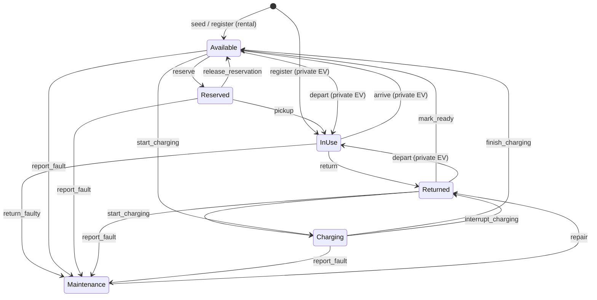

# Vehicle State Machine

**Owner:** M1 — Đoàn Nhật Minh (2452738)
**Status:** v1.0 · 2026-11-04 (released with the Core API spec v1.0; private EVs away from a Hub are InUse; checked against the module PRs after their round-2 fixes; a change follows D-006)
**Implements:** `BR-M1-03` (`docs/requirements/fr-01-core.md`) · **Tested by:** NFR-08

## 1. Scope

This document defines the states and allowed transitions of one `Vehicle` entity (rental or private EV). `core` is the only module that changes `Vehicle.state`. Other modules ask for a transition through the Core API (`core-api-spec.md`); `core` checks it against this table. State names are the ones in `BR-M1-03` and in the ERD draft (`AVAILABLE`, `RESERVED`, `IN_USE`, `RETURNED`, `CHARGING`, `MAINTENANCE`).

Reservations, charging sessions and tasks have their own state machines, owned by M2, M3 and M4. They are not described here.

## 2. States

| State | Meaning | Where the vehicle is | Counts as rentable |
|---|---|---|---|
| Available | Parked, charged enough, no claim on it. | In one parking space of a Hub. | Yes |
| Reserved | A confirmed reservation holds it for a student. | Still in its origin space (the space stays occupied until pickup). | No |
| InUse | On a trip (rental), or a private EV that is away from every Hub. | Not at a Hub (no Hub, no space). | No |
| Returned | Back at a Hub, waiting for the readiness check. | In one parking space of the destination Hub. | No |
| Charging | Connected to a charging point. | In the charging bay (D-007). | No |
| Maintenance | Faulty or blocked; operators must clear it. | In a space of a Hub (kept occupied). | No |

Rule for location (supports `BR-M1-02`): every state except InUse has exactly one parking space; InUse has none. The rule holds for rental and private vehicles alike. For a private EV, InUse only means "not at any Hub": the system does not track where it is (assumption A-01, no trip tracking).

## 3. Diagram

## 4. Transition table

Every pair (state, event) that is not in this table is rejected with `INVALID_TRANSITION` and nothing changes (`BR-M1-03`, NFR-08).

| # | From | Event | To | Guard | Normally requested by |
|---|---|---|---|---|---|
| T1 | Available | `reserve` | Reserved | Battery ≥ `ctx.min_battery` (M2 passes the larger of its own floor, 20 %, and the student's request) and above `LOW_BATTERY_THRESHOLD`; `ctx.claim_id` names an `ACTIVE` claim on the vehicle that covers now (it was placed without overlap, `BR-M1-01`). | M2 |
| T2 | Reserved | `release_reservation` | Available | Reservation cancelled, expired or invalidated. | M2 |
| T3 | Reserved | `pickup` | InUse | `ctx.claim_id` names an `ACTIVE` claim on this vehicle whose interval still covers now (M2: `t < hold_expires_at`; at the end instant it is too late). Frees the origin space. | M2, M4 (system reservation) |
| T4 | InUse | `return` | Returned | The destination Hub has a free space, or the caller holds a claim on a free space there (M2's return-parking hold) (`BR-M1-02`). Occupies it. | M2, M4 |
| T5 | InUse | `return_faulty` | Maintenance | Same as T4, and a fault is reported with the return. | M2 |
| T6 | Returned | `mark_ready` | Available | Battery above `LOW_BATTERY_THRESHOLD` (a vehicle at exactly the threshold is still "low", as in M3 and M5); no fault. | core (after return), M3 |
| T7 | Returned | `start_charging` | Charging | A charging point of the same Hub is free for the interval and the vehicle sits in its bay (`BR-M1-01`, `BR-M1-02`). | M3 |
| T8 | Available | `start_charging` | Charging | Same as T7 (private EV charging; operator-ordered charging of a rental vehicle). | M3 |
| T9 | Charging | `finish_charging` | Available | Target battery reached. | M3 |
| T10 | Charging | `interrupt_charging` | Returned | Session interrupted (charger failure, preemption). The vehicle goes through the readiness check again. | M3 |
| T11 | Available, Reserved, Returned, Charging | `report_fault` | Maintenance | Operator or sensor event. A Reserved vehicle must have its reservation released by M2 in the same unit of work. | M5, M7 (operator override), iot_sim |
| T12 | Maintenance | `repair` | Returned | Operator confirms. In the same call `core` then applies T6 when its guard passes, so the vehicle ends up Available (two log records, two events). | M5 (operator), M7 (operator override) |
| T13 | InUse | `arrive` | Available | **Private EV only.** The destination Hub is not in maintenance and has a free space, or the caller holds a claim on a free space there (the parking reservation; it becomes the occupancy). Occupies the space (`BR-M1-02`). | M2, iot_sim (sensor `SPACE_OCCUPIED`) |
| T14 | Available | `depart` | InUse | **Private EV only.** Frees its space. A vehicle that is Charging, Reserved or in Maintenance cannot depart. | M2, iot_sim (sensor `SPACE_FREED`) |
| T15 | Returned | `depart` | InUse | Same as T14. A private EV whose charging was interrupted can still leave. | M2, iot_sim |

Special case: `report_fault` while a rental vehicle is InUse does not change the state. It sets `fault_flag`, and the trip ends with T5. The fault is logged (NFR-25). A private EV that is InUse is away from every Hub, so `core` rejects `report_fault` for it with `INVALID_TRANSITION`.

Who may use which event: the rental events (`reserve`, `release_reservation`, `pickup`, `return`, `return_faulty`) are for fleet vehicles only; `arrive` and `depart` are for private EVs only. `core` rejects the other combination with `INVALID_TRANSITION`. `arrive` and `depart` need a caller that may change occupancy (an operator, M2 or iot_sim).

## 5. Rules for every transition

1. **One writer.** Only `core` writes `Vehicle.state`, inside the transaction of the calling operation (NFR-09).
2. **Version check.** The request carries `expected_version`. A different current version is rejected with `VERSION_CONFLICT` (optimistic locking, D-002).
3. **Log.** Each executed transition writes a log record (UTC timestamp from the injectable clock, entity, previous state, new state, event, actor) and publishes a `VehicleStateChanged` event (NFR-25, D-005).
4. **No change on rejection.** A rejected request writes nothing except an optional rejection log line.

## 6. Test derivation (for M8)

| Technique | What to derive |
|---|---|
| State-transition testing | One test per row T1–T15 (valid), plus one test per invalid (state, event) pair: 6 states × 13 events = 78 pairs. 18 are valid transitions (T11 covers four pairs, T14 and T15 are two pairs of `depart`), 1 is the special case (InUse, `report_fault`: accepted, only sets `fault_flag`), so 59 are invalid. |
| Boundary values | Battery at `LOW_BATTERY_THRESHOLD` −1, exactly, +1 for T1 and T6, and the same three values around `ctx.min_battery` for T1; hold expiry at `t = hold_expires_at − 1 s`, exactly, +1 s for T3. |
| Decision table | Guard combinations of T4 (space free / not free) and T7 (point free / not free, vehicle in bay / not). |

Recount these numbers whenever the table changes.

## 7. Decisions behind this version

1. **Private EVs (D-016).** A private EV is a normal `Vehicle` with `ownership = PRIVATE`; there is no separate class (see `class-diagram-core.md` §5, point 1). Registered by the student (A-05, `FR-07.M3.1`), it starts InUse: away from every Hub, as a vehicle on the road. `arrive` (T13) parks it and makes it Available; `depart` (T14, T15) frees the space and makes it InUse again. While parked it can charge (T7, T8, T9, T10) or go to Maintenance. It never uses the rental events. This keeps the location rule of §2 without an exception for private EVs. "Available" for a private EV only means "parked and not charging"; the charge level does not matter, because nobody rents it. M2 and M3 only have to know that `occupy_space` now also changes the vehicle state from InUse to Available (and `free_space` the other way). The 66-pair table became 78 pairs.
2. **Low-battery lockout (`BR-M5-05`).** A rental vehicle at or below `LOW_BATTERY_THRESHOLD` is not given a new reservation (guard of T1). M2 treats the lockout (`RENTAL_POOL_LOCKOUT`, ≤ 15 %) as an eligibility filter, not a state, and M5 says the vehicle is "removed from the active rental pool and prioritized for charging". So no new state is needed; the threshold lives in the config of `core` (`get_config()`), as M3, M5 and `nfr.md` note 3 already assume.
3. **Where `mark_ready` is triggered.** Decided: `core` does not apply it by itself after `return` (T4). The module that ends the trip (M2, or M4 for a dispatch task) calls `mark_ready` (T6) in the same unit of work when the vehicle is above the battery threshold; otherwise M3 starts charging (T7). `repair` is the only event that chains to it (point 5).
4. **Missing vehicle.** A vehicle that is InUse and overdue or lost (`INC-USR-01`): no state of its own. M2 marks the Trip `OVERDUE` (`BR-M2-15`) or `INCIDENT_ABORTED` (`BR-M2-14`) and the vehicle stays InUse until a verified return; M5 opens the incident. Add a state only if M5 needs it.
5. **Operator back to service (M7 `UC-M7-02`).** Decided in the draft: `repair` (T12) goes on to `mark_ready` (T6) in the same unit of work when T6's guards hold (battery above the threshold, no fault). M7's example `Maintenance → Available` then works with one operator action. With a battery at or below the threshold the vehicle stays Returned and goes to charging (T7). To confirm in the review.
