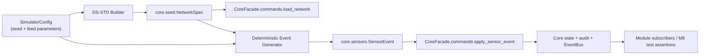

# IoT Simulator Design — M8

> **Owner:** M8 · **Baseline:** Core API v1.1, D-004, D-007, D-008, D-020  
> **Implementation:** `src/iot_sim/`  
> **Tests:** `tests/iot_sim/`  
> **Data source:** `docs/requirements/reference-dataset.md` (DS-STD)

## 1. Purpose and boundaries

The IoT simulator is a deterministic producer of synthetic sensor data for development, testing, and demonstrations. It is not a second domain model or a database seeder.

**The simulator owns:**
- DS-STD numeric configuration and deterministic entity IDs in its `NetworkSpec` builder.
- Seeded distributions for fleet battery and vehicle type.
- Synthetic sensor event generation and event ordering.
- Reproducible test/demo inputs.

**Core owns:**
- Entity definitions and validation (`core.seed`, `core.sensors`).
- Persistence and operational state.
- State transitions, invariants, audit logs, and rejected-event publication.
- Authorization of sensor intake and network loading.

**Hard boundary:** `iot_sim` calls `core.commands.load_network(...)` and `core.commands.apply_sensor_event(...)`. It must never import a repository implementation, issue SQL, mutate Core entities, or write directly to storage (CONTRIBUTING 9.13, NFR-10, NFR-22).

## 2. Architecture



The implementation is in-process because the project is a modular monolith (A-08). The simulator's service actor is `Actor("iot-simulator", Role.OPERATOR, "iot_sim")`; Core permission checks allow this system module to load the seed and send sensor events. The REST service token remains available for a future externalized simulator process, but the current minimal implementation does not need an HTTP client.

## 3. Dataset mapping (DS-STD)

The builder `build_network_spec(seed) -> NetworkSpec` uses the authoritative reference dataset:

| Entity / property | DS-STD | Builder representation |
|---|---:|---|
| Hubs | 10 | `HubSpec` rows H01–H10 |
| Parking spaces | 400 | `HubSpec.space_count` |
| Charging points | 61 | `HubSpec.charging_point_count` |
| Rental vehicles | 250 | `HubSpec.vehicles` |
| Student accounts | 1,000 | `UserSpec(Role.STUDENT)` |
| Operator accounts | 5 | `UserSpec(Role.OPERATOR)` |
| Private EVs | 100 | `NetworkSpec.private_vehicles` |
| Fleet vehicle types | 50/30/20% | 125 e-bikes, 75 e-scooters, 50 electric motorcycles |
| Fleet battery | 60/25/15% | 150 above 70%, 62 from 30–70%, 38 below 30% |

Battery values within each band are generated from a local `random.Random(seed)` instance and rounded to one decimal place. The same seed produces an equal `NetworkSpec`. The builder does not generate real credentials: seeded accounts have `password_hash=None` and cannot log in.

Vehicle and space IDs are stable and unique. Core derives parking-space and charging-point IDs from Hub IDs during `load_network`. Fleet vehicles are placed by Core into non-charging spaces first; charging bays remain free.

## 4. Minimal event feed (due 06/11)

`iter_minimal_events(spec, start_at, config)` yields events in strictly increasing timestamp order:

1. One `BATTERY_LEVEL` event per fleet vehicle (250 events), with a deterministic drain between configured minimum and maximum percentage points.
2. A deterministic subset of private EVs emits `SPACE_OCCUPIED` followed by `SPACE_FREED` for a known free, non-charging space. Each pair returns the seeded network to its original parking occupancy after exercising both transitions.

Each event has:
- Unique deterministic `event_id` (`IOT-<seed>-<sequence>`).
- Stable source (`iot_sim:battery` or `iot_sim:parking`).
- Core `SensorEventType` string.
- Entity ID and type-appropriate value.
- Timezone-aware UTC timestamp.

The feed does not fabricate fleet arrivals/departures: Core explicitly rejects a sensor attempting to move a fleet vehicle. The parking feed only models private EV occupancy, consistent with `core.sensors` and the state machine.

## 5. Full feed extension (due 08/11)

The full feed extends the same deterministic event abstraction with:
- `HEARTBEAT` events for sensor/Hub liveness.
- `CHARGER_FAULT` true/false pairs for failure and recovery.
- `VEHICLE_FAULT` events for selected vehicles.
- Peak-hour event profiles aligned with D-008 (morning flow toward campuses, evening flow toward dormitories).
- Configurable event rate and time window.

The full feed must not simulate workflows owned by M2–M5. For example, charging-session interruption and incident creation are performed by M3/M5 subscribers reacting to Core events, not by the simulator writing their records.

## 6. Public Python API

| Function / type | Responsibility |
|---|---|
| `SimulatorConfig` | Explicit seed and validated event parameters |
| `build_network_spec(seed)` | Build a Core-owned `NetworkSpec` from DS-STD |
| `iter_minimal_events(spec, start_at, config)` | Yield deterministic Core `SensorEvent` objects |
| `seed_core(core, seed)` | Call `core.commands.load_network` with the simulator actor |
| `apply_events(core, events)` | Apply sequentially through `core.commands.apply_sensor_event` |
| `run_minimal_feed(core, seed, start_at, config)` | Convenience wrapper for the minimal feed |

All random behavior is local to a seeded RNG. No global random state, hidden clock, network access, or persistent simulator state is used.

## 7. Failure and validation behavior

- Invalid simulator configuration raises `ValueError` before any Core call.
- A naive timestamp is rejected by the generator; all event timestamps must be timezone-aware.
- Core validates event shape, type, value, target existence, ownership, and state consistency.
- A rejected sensor event returns `Err`, leaves operational state unchanged, and causes Core to log/publish `SensorEventRejected` (NFR-10).
- The caller must retain every result; it must not silently drop a rejected event.
- Re-seeding a non-empty Core store is rejected by Core. The simulator must not clear or overwrite existing state.

## 8. Determinism and invariants

- Dataset generation: same seed → equal `NetworkSpec`.
- Event generation: same seed, same `NetworkSpec`, same `start_at`, same config → equal ordered events.
- IDs are unique within one feed.
- Event timestamps are monotonic.
- After the paired private occupancy feed, the count of occupied spaces returns to its initial value.
- `core.check_invariants()` must return an empty list after a successful seed and feed.
- No direct operational-store writes are permitted (NFR-12 applies to M6 simulation; the analogous simulator boundary is enforced by the public Core commands).

## 9. Operational usage

Example from repository root after installing the project dependencies and setting the required Core secret in the local environment:

```python
from datetime import UTC, datetime

from core.facade import CoreFacade
from iot_sim import SimulatorConfig, run_minimal_feed, seed_core

core = CoreFacade()
seed_result = seed_core(core, seed=20261106)
# Check the Result before continuing.
feed_results = run_minimal_feed(
    core,
    seed=20261106,
    start_at=datetime(2026, 11, 6, 8, 0, tzinfo=UTC),
    config=SimulatorConfig(seed=20261106, private_arrival_count=5),
)
# Inspect Err results; do not silently ignore rejected events.
```

For the full application, `main.seed_network` already expects `iot_sim.build_network_spec(seed) -> NetworkSpec` when `SEED_ON_START=true`. This implementation satisfies that integration point.

## 10. Traceability

| Requirement / decision | Design response |
|---|---|
| FR-01 / NFR-07 | DS-STD Hub, space, charger, and vehicle totals are loaded through Core |
| FR-09 / NFR-10 | Sensor failures are submitted through Core sensor intake; Core rejects invalid events safely |
| NFR-13 | Seeded local RNG, stable IDs, ordered timestamps and deterministic tests |
| NFR-18 | Config validation before event generation; Core validates external event payloads |
| NFR-22 | Imports point into `core`; no imports from other feature modules |
| CONTRIBUTING 9.13 | Simulator is the only fabricated sensor-data source and uses only Core's public state-update interface |
| D-004 / D-007 / D-008 | Sensor events, charging-bay mapping, and peak-hour flow conventions |
