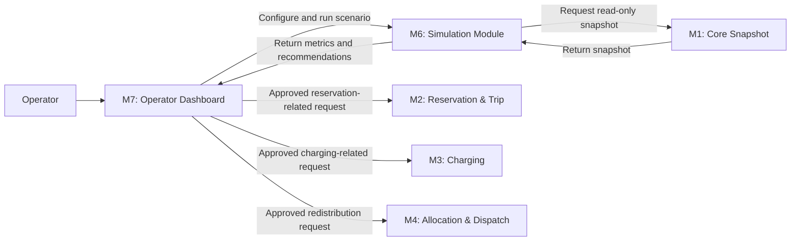
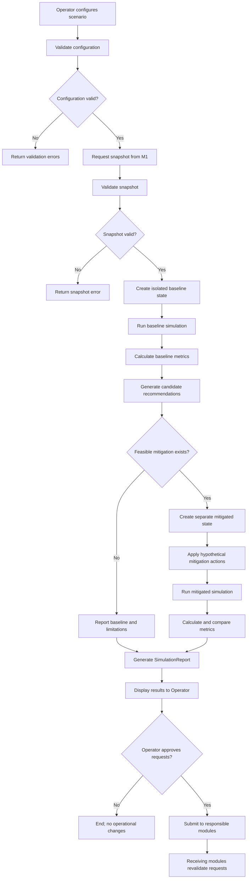
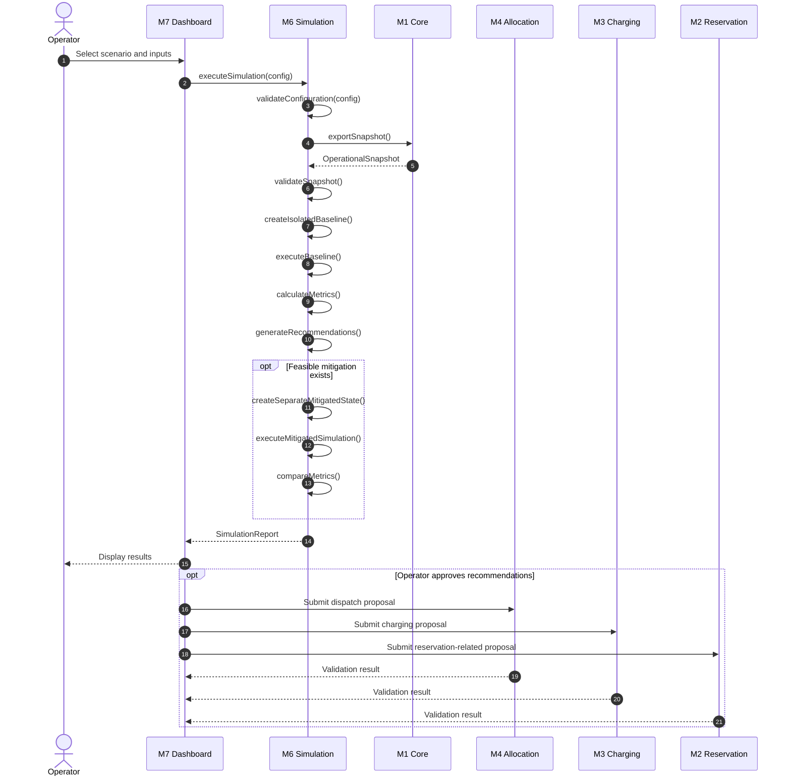

# M6: What-if Simulation & Coordination Design Specification

**Project:** Smart E-Mobility Hub  
**Course:** Software Engineering — HK261  
**Module:** M6 — What-if Simulation & Coordination Design  
**Functional Requirement:** FR-12  
**Phase:** Phase 1 — System Design  
**Owner:** M6  
**Document Version:** 1.0  
**Status:** Proposed Design — Pending Team Review

> **Traceability note:** FR-12 is the assigned functional requirement for M6. Other NFR, BR, and design-decision identifiers must be cross-checked against the team's consolidated requirements and decision log before being added.

---

## 1. Overview and Architectural Role

### 1.1. Purpose

The What-if Simulation and Coordination module enables system operators to evaluate hypothetical operational situations before applying changes to the real Smart E-Mobility Hub system deployed across the VNU-HCM Urban Area.

The module simulates changes in vehicle demand, parking occupancy, charging workload, charging-point availability, and vehicle distribution. It calculates operational impact metrics and generates coordination recommendations to support operator decision-making.

The module supports five standard scenarios:

1. Peak-Hour Demand Surge.
2. Hub at Capacity.
3. Charging Surge.
4. Charging-Point Failure.
5. Vehicle Imbalance.

The simulation results are estimates based on the initial system state, configured parameters, and modeled business rules. They are not guaranteed predictions of real-world outcomes.

### 1.2. Scope and Responsibilities

The M6 module is responsible for:

- Accepting and validating simulation configurations.
- Retrieving an operational state snapshot from M1 (Core).
- Creating isolated simulation states.
- Executing hypothetical events over a configurable time horizon.
- Calculating and comparing operational impact metrics.
- Generating constraint-checked coordination recommendations.
- Producing structured simulation reports for operators.
- Submitting explicitly approved recommendations through interfaces agreed upon with the responsible modules, if this capability is included in the integrated system.

M6 does not directly modify the real operational state, execute real vehicle dispatches, or change production charging sessions during simulation.

### 1.3. Design Principles

**Principle 1 — Strict State Isolation**

All hypothetical state changes occur within an isolated simulation environment. The original snapshot and live operational entities must remain unchanged.

Each simulation run has its own mutable state so that concurrent runs cannot interfere with one another.

**Principle 2 — Discrete-Time Simulation**

The simulator advances the state in discrete time steps.

Proposed defaults:

- Time step: 5 minutes.
- Simulation horizon: 60–360 minutes.
- The horizon must be a positive multiple of the selected time step.

These values are design defaults and may be adjusted after team review.

**Principle 3 — Decoupled Integration**

M6 interacts with other modules through agreed interfaces:

- **M1 — Core:** Provides the operational state snapshot.
- **M2 — Reservation & Trip:** Defines reservation and vehicle-return constraints.
- **M3 — Charging & Smart Scheduling:** Defines charging-session and scheduling constraints.
- **M4 — Allocation & Dispatching:** Validates vehicle redistribution and dispatch proposals.
- **M7 — UI/UX:** Provides scenario configuration and result visualization.
- **M8 — Testing & QA:** Supports reproducible test data and integration testing.

**Principle 4 — Reproducibility**

When stochastic events are used, the configuration includes a random seed. The same snapshot, configuration, seed, and simulation rules should produce equivalent results.

**Principle 5 — Advisory Recommendations**

Recommendations are hypothetical and advisory. Operator approval does not guarantee execution: the receiving operational module must validate the request against the current real state before performing any action.

---

## 2. Use-Case Model

### 2.1. Functional Interaction Diagram

The following diagram illustrates the principal interactions between the Operator, M6, and the other modules. It is a functional interaction diagram rather than a formal UML use-case diagram.



### 2.2. Primary Use Case

**Use Case ID:** UC-M6-01  
**Name:** Run What-if Simulation and Review Recommendations  
**Primary Actor:** Operator

**Preconditions**

1. The Operator can access the simulation interface.
2. M1 can provide a consistent operational snapshot.
3. The selected scenario and its configuration satisfy the validation rules.

**Main Flow**

1. The Operator selects one of the five scenarios.
2. The Operator configures the simulation parameters.
3. M6 validates the configuration.
4. M6 retrieves a snapshot from M1.
5. M6 validates the snapshot and creates an isolated simulation state.
6. The simulator executes the baseline scenario.
7. M6 calculates baseline impact metrics.
8. M6 identifies operational problems and generates candidate recommendations.
9. If applicable, M6 creates a separate state from the same initial snapshot and evaluates the feasible mitigation actions.
10. M6 calculates mitigated metrics.
11. M6 compares baseline and mitigated outcomes.
12. M6 returns a simulation report to the Operator.
13. The Operator reviews the results and recommendations.
14. If the integrated system supports approval and submission, the Operator may approve selected recommendations.
15. The responsible operational modules revalidate approved requests before execution.

**Alternative Flows**

- Invalid configuration: return validation errors without starting the simulation.
- Invalid or unavailable snapshot: reject the simulation and return a descriptive error.
- Simulation failure: report the failure without modifying real operational state.
- No actionable recommendations: return the baseline results and explain why mitigation was not applied.
- Operator rejects a recommendation: do not submit it for operational execution.
- Receiving module rejects an outdated or infeasible recommendation: report the rejection and request a new evaluation if necessary.

**Postconditions**

- A simulation report is returned after successful execution.
- Baseline and mitigated results reference the same initial snapshot.
- Simulation execution leaves the real operational state unchanged.
- Only explicitly approved and successfully revalidated requests may result in real operational actions.

---

## 3. Scenario Definition and Configurable Input Specification

### 3.1. Common Configuration

All scenarios share a common configuration structure.

```json
{
  "simulation_id": "SIM_001",
  "scenario_id": "SCENARIO_01_DEMAND_SURGE",
  "time_horizon_minutes": 120,
  "time_step_minutes": 5,
  "random_seed": 42,
  "parameters": {}
}
```

| Field | Type | Description |
|---|---|---|
| `simulation_id` | String | Unique identifier for the simulation run. |
| `scenario_id` | Enum/String | Identifier of the selected scenario. |
| `time_horizon_minutes` | Integer | Total simulated duration; proposed range 60–360 minutes. |
| `time_step_minutes` | Integer | Simulation step; proposed default 5 minutes. |
| `random_seed` | Integer | Seed for reproducible stochastic event generation. |
| `parameters` | Object | Scenario-specific configuration. |

**Validation rules**

- The scenario identifier must be supported.
- All mandatory parameters must be present.
- The time horizon and time step must be positive, and the horizon must be divisible by the time step.
- All referenced entity IDs must exist in the snapshot.
- Numeric values must satisfy their configured ranges.
- Invalid configurations must be rejected before any simulation state is changed.
- Scenario-specific validation must be applied only to the relevant parameters.

The proposed ranges in this document are initial design defaults, not finalized team-wide business rules.

### 3.2. SC-01 — Peak-Hour Demand Surge

**Purpose:** Evaluate whether the current fleet can satisfy a sudden increase in student rental demand.

**Configurable inputs**

| Parameter | Type | Proposed default / validation |
|---|---|---|
| `target_hub_ids` | List of strings | Required; all hubs must exist. |
| `surge_multiplier` | Float | Proposed default 1.5; range 1.0–5.0. |
| `duration_minutes` | Integer | Proposed range 15–240; must fit within the simulation horizon. |
| `destination_bias` | Map | Optional distribution of destination demand; probabilities must sum to 1 when provided. |

**Simulation behavior**

1. Increase rental demand at selected hubs during the configured period.
2. Generate hypothetical rental requests using the configured demand multiplier.
3. Process requests according to vehicle eligibility and the agreed allocation policy.
4. Record fulfilled and unmet rental requests.
5. Update simulated vehicle states and subsequent return events.
6. Identify hubs experiencing shortages and hubs with eligible surplus vehicles.

**Expected recommendations**

- Redistribute eligible vehicles from surplus hubs to shortage hubs.
- Prioritize resources according to the allocation policy agreed with M4.
- Identify shortages that cannot be resolved using available vehicles.

A multiplier of 1.0 represents baseline demand. The destination distribution must use an agreed default if `destination_bias` is omitted.

### 3.3. SC-02 — Hub at Capacity

**Purpose:** Evaluate parking-capacity risks and rejected vehicle returns.

**Configurable inputs**

| Parameter | Type | Proposed default / validation |
|---|---|---|
| `target_hub_id` | String | Required; hub must exist. |
| `incoming_return_rate` | Float | Proposed unit: return attempts per 10 minutes; must be greater than zero. |
| `occupancy_warning_threshold` | Float | Proposed default 0.90; configurable within 0.80–0.95. |
| `neighbor_hub_radius_km` | Float | Proposed default 2.0 km; configurable within 0.5–5.0 km. |

**Simulation behavior**

1. Generate hypothetical return attempts according to the configured rate.
2. Process each return against the available parking capacity.
3. Record accepted and rejected returns.
4. Trigger a warning when the occupancy threshold is reached.
5. Identify alternative hubs with sufficient parking capacity.
6. Evaluate whether proposed redirection or redistribution is feasible.

**Expected recommendations**

- Recommend alternative hubs for eligible incoming returns.
- Recommend redistribution when operationally feasible.
- Warn operators if no suitable alternative capacity is available.

The warning threshold does not replace the hub's physical capacity. Occupancy must never exceed the actual capacity in the simulated state.

### 3.4. SC-03 — Charging Surge

**Purpose:** Evaluate charging congestion, queue waiting time, and low-battery risks.

**Configurable inputs**

| Parameter | Type | Proposed default / validation |
|---|---|---|
| `target_hub_ids` | List of strings | Required; all hubs must exist. |
| `soc_trigger_threshold` | Float | Proposed default 0.20; range 0.05–0.40. |
| `initial_low_battery_count` | Integer | Non-negative; cannot exceed the eligible fleet size. |
| `charging_demand_multiplier` | Float | Proposed default 2.0; range 1.0–5.0. |
| `max_queue_depth` | Integer | Proposed default 5; must be at least 1. |

**Simulation behavior**

1. Identify eligible vehicles with low battery or generate additional charging requests.
2. Apply the agreed charging priority policy.
3. Assign requests to compatible available charging points.
4. Update charging sessions and battery levels over time.
5. Record queue length, waiting time, and critical battery conditions.
6. Evaluate alternative charging points and feasible scheduling options.

**Expected recommendations**

- Prioritize vehicles based on battery condition and upcoming reservation requirements.
- Reschedule flexible charging sessions when permitted by M3's rules.
- Redirect eligible requests to alternative charging points.
- Warn operators when remaining charging capacity is insufficient.

Charging-point power ratings and vehicle compatibility must be respected. A simulation parameter must not override the actual capabilities of a charging point.

### 3.5. SC-04 — Charging-Point Failure

**Purpose:** Evaluate the impact of charging-point failures on charging capacity and vehicle readiness.

**Configurable inputs**

| Parameter | Type | Proposed default / validation |
|---|---|---|
| `failed_point_ids` | List of strings | Required; all IDs must exist. |
| `failure_onset_offset_min` | Integer | Proposed default 0; must satisfy \(0 \leq t < T\). |
| `estimated_mttr_min` | Integer | Proposed default 30 minutes; must be positive. |
| `fallback_policy` | Enum | `FLEET_FIRST` or `FCFS`, subject to M3 agreement. |

**Simulation behavior**

1. Start with the charging-point states from the snapshot.
2. Mark selected charging points as failed at the configured time.
3. Prevent new charging sessions from starting at failed points.
4. Apply the agreed failure behavior to ongoing sessions.
5. Model recovery after the estimated repair duration, if recovery is included.
6. Reassign eligible requests to functioning charging points when feasible.
7. Record affected sessions, queue changes, waiting time, and battery risks.

**Expected recommendations**

- Reassign eligible charging sessions.
- Prioritize vehicles required for upcoming trips.
- Report sessions at risk of delay.
- Warn operators when available charging capacity is insufficient.

The failure and recovery behavior must follow the agreed simulation model. A failed point must remain unavailable until the modeled recovery event occurs.

### 3.6. SC-05 — Vehicle Imbalance

**Purpose:** Evaluate vehicle shortages and surpluses across Mobility Hubs.

**Configurable inputs**

| Parameter | Type | Proposed default / validation |
|---|---|---|
| `surplus_hub_ids` | List of strings | Required; all hubs must exist. |
| `deficit_hub_ids` | List of strings | Required; all hubs must exist. |
| `truck_capacity` | Integer | Proposed range 5–20 vehicles per trip. |
| `transit_delay_minutes` | Integer | Proposed range 10–60 minutes. |

The surplus and deficit hub lists must not contain the same hub.

**Simulation behavior**

1. Identify eligible surplus vehicles and estimated demand deficits.
2. Determine feasible source-destination pairs.
3. Calculate the number of vehicles that can be transferred.
4. Respect source-hub reserves, vehicle eligibility, destination capacity, transportation capacity, and travel time.
5. Apply transfers to the sandbox state only when their modeled completion events occur.
6. Recalculate impact metrics after redistribution.

**Expected recommendations**

- Transfer eligible vehicles from surplus hubs to shortage hubs.
- Prioritize transfers that reduce unmet demand without creating new critical shortages.
- Report shortages that cannot be resolved within the configured constraints.

The simulator must not assume that all surplus vehicles can be moved immediately or without cost or delay.

---

## 4. Simulation Logic and State Evolution

### 4.1. Execution Workflow



The mitigated simulation is optional when no actionable recommendations exist. All mitigation actions are applied only within the isolated simulation state.

### 4.2. Sequence Diagram



The final submission interfaces are subject to agreement with M2, M3, and M4. If the integrated project does not implement recommendation approval or submission, the module should display advisory recommendations without claiming to execute them.

### 4.3. State-Evolution Model

Let:

- \(S_t\) be the simulated state at time \(t\).
- \(E_t\) be the hypothetical events processed during the current time step.
- \(A_t\) be the mitigation actions applied during the mitigated run.
- \(\Delta t\) be the simulation time step.

The state transition is:

\[
S_{t+\Delta t}=F(S_t,E_t,A_t,\Delta t)
\]

For the baseline run:

\[
A_t=\varnothing
\]

For the mitigated run, \(A_t\) contains feasible hypothetical mitigation actions scheduled for that time step.

At each time step, the engine:

1. Identifies events scheduled for the current simulation time.
2. Applies scenario-specific demand changes and failure events.
3. Processes rental, return, charging, and redistribution events.
4. Updates vehicle, parking, and charging-point states.
5. Validates the resulting state.
6. Records relevant metrics, events, and rejected operations.
7. Advances the simulation clock.

Events with identical timestamps must be processed in a deterministic order.

### 4.4. State Invariants

The simulator must maintain the following invariants:

- Parking occupancy is non-negative and never exceeds physical parking capacity.
- A vehicle cannot be assigned to incompatible simultaneous operational activities.
- Vehicles in maintenance or other ineligible states cannot be dispatched.
- Failed charging points cannot accept new charging sessions.
- Charging assignments must respect equipment capacity and vehicle compatibility.
- Vehicle transfers must respect source-hub reserve requirements and destination capacity.
- Reservation and charging transitions must follow the rules agreed with M2 and M3.
- All simulated changes occur only within the isolated simulation state.

If an event violates a constraint, it must be rejected, deferred, or recorded as an unmet operational request according to the agreed business rules.

### 4.5. State Isolation and Reproducibility

For each simulation:

1. Retrieve an initial snapshot from M1.
2. Validate and preserve the original snapshot as immutable input.
3. Create a mutable simulation state that does not share mutable entity references with the original snapshot.
4. Create separate baseline and mitigated states from the same initial snapshot.
5. Record the snapshot ID, configuration, and random seed in the simulation report.
6. Discard the simulation state after completion unless the implementation explicitly supports safe result retention.

The implementation and integration tests must verify isolation. A method name or documentation statement alone is not sufficient evidence of state isolation.

---

## 5. Impact Metrics and Mathematical Definitions

The simulator calculates four primary metrics. Each metric is calculated for the baseline and, when applicable, the mitigated run.

### 5.1. Vehicle Shortage Rate

**Purpose:** Measure the percentage of valid rental requests that cannot be fulfilled because suitable vehicles are unavailable.

For hub \(h\):

\[
S_r(h)=\frac{U_h}{R_h}\times100\%
\]

Where:

- \(U_h\): Number of unmet valid rental requests at hub \(h\).
- \(R_h\): Total valid rental requests at hub \(h\).

If \(R_h=0\), the metric is reported as `N/A`.

A lower shortage rate indicates better demand fulfillment.

### 5.2. Hub Overflow / Return Rejection Rate

**Purpose:** Measure the percentage of valid return attempts rejected because the destination hub lacks available parking capacity.

For hub \(h\):

\[
O_r(h)=\frac{J_h}{A_h}\times100\%
\]

Where:

- \(J_h\): Number of rejected valid return attempts.
- \(A_h\): Total valid return attempts.

If \(A_h=0\), the metric is reported as `N/A`.

A lower rejection rate indicates better parking-capacity availability.

### 5.3. Average Charging Queue Waiting Time

**Purpose:** Measure the average time between a charging request and the start of the charging session.

Let \(V_s\) be the set of vehicles whose charging sessions start during the measurement period.

\[
W_{\mathrm{avg}}=
\frac{1}{|V_s|}
\sum_{v\in V_s}
\left(t_{\mathrm{start}}(v)-t_{\mathrm{request}}(v)\right)
\]

Where:

- \(t_{\mathrm{request}}(v)\): Time when vehicle \(v\) requests charging.
- \(t_{\mathrm{start}}(v)\): Time when its charging session starts.
- \(|V_s|\): Number of vehicles whose charging sessions start during the measurement period.

The result is expressed in minutes.

If no charging session starts during the measurement period, the metric is `N/A`. Requests still waiting at the end of the simulation must be reported separately.

### 5.4. Critical Battery Depletion Count

**Purpose:** Count vehicles whose battery state of charge falls below the configured critical threshold while not charging at the end of the simulation.

Using a proposed critical threshold of 20%:

\[
N_{\mathrm{crit}}=
\left|\left\{
v\in V:
SoC(v)<0.20
\land
State(v)\neq\mathrm{Charging}
\right\}\right|
\]

Where:

- \(V\): Set of vehicles included in the simulation.
- \(SoC(v)\): Battery state of charge, represented as a value from 0 to 1.
- \(State(v)\): Simulated vehicle state at the end of the measurement period.

The 20% threshold is a proposed design default and must be aligned with the team's battery and charging rules.

The report may additionally count vehicles that entered a critical battery condition at any point during the simulation. This must be distinguished from the end-of-horizon metric.

### 5.5. Baseline and Mitigated Comparison

For each metric, the report includes:

- Baseline value.
- Mitigated value, if a mitigation run was performed.
- Absolute change.
- Interpretation of the change.
- Threshold status, where applicable.

For metrics where lower values are better:

\[
\Delta M=M_{\mathrm{baseline}}-M_{\mathrm{mitigated}}
\]

A positive value indicates improvement.

For example, if the baseline shortage rate is 30% and the mitigated rate is 15%, the improvement is 15 percentage points.

When a metric is `N/A`, the engine must not calculate an invalid difference. The report must distinguish modeled improvements from guaranteed real-world outcomes.

---

## 6. Coordination-Recommendation Generation

### 6.1. General Approach

The recommendation engine uses explainable, rule-based logic.

It:

1. Identifies operational problems from the simulated results.
2. Generates candidate coordination actions.
3. Checks candidate actions against resource and business constraints.
4. Estimates the impact of feasible actions through a separate mitigated simulation.
5. Ranks recommendations by operational priority.
6. Returns the recommendation rationale and supporting metrics.

### 6.2. Recommendation Data Structure

Each recommendation should contain:

| Field | Description |
|---|---|
| `recommendation_id` | Unique identifier. |
| `simulation_id` | Related simulation. |
| `recommendation_type` | Category of the proposed action. |
| `source_hub_id` | Source hub, where applicable. |
| `destination_hub_id` | Destination hub, where applicable. |
| `resource_ids` | Relevant vehicle, parking, or charging-point identifiers. |
| `proposed_action` | Description of the action. |
| `quantity` | Number of vehicles or requests, where applicable. |
| `trigger_reason` | Condition that generated the recommendation. |
| `supporting_metrics` | Relevant metric values. |
| `target_module` | Responsible operational module. |
| `feasibility_status` | Feasible, infeasible, or requires validation. |
| `approval_status` | Pending, approved, or rejected. |

Recommendations are advisory until approved by an authorized Operator.

### 6.3. Rule R1 — Vehicle Redistribution

**Trigger:** A hub experiences unmet rental demand while another hub has eligible surplus vehicles.

Proposed initial threshold for testing: shortage rate greater than 25%. This is a configurable design default, not a finalized business rule.

The proposed transfer quantity is:

\[
Q=\min\left(
EligibleSurplus(H_s),
Deficit(H_d),
TransferCapacity
\right)
\]

Where:

- \(H_s\): Source hub.
- \(H_d\): Destination hub.
- \(EligibleSurplus(H_s)\): Number of vehicles available after preserving the source hub's required reserve.
- \(Deficit(H_d)\): Estimated additional vehicles required at the destination.
- \(TransferCapacity\): Number of vehicles that can be feasibly transferred under the modeled constraints.

**Constraints**

- Source hub must retain its required operational reserve.
- Destination hub must have sufficient parking capacity.
- Vehicles must be eligible for transfer.
- Transportation capacity and travel time must be respected where modeled.
- Transfers must not conflict with committed reservations or other operations.

**Recommendation type:** `VEHICLE_REDISTRIBUTION`  
**Target module:** M4 — Allocation & Dispatching.

If transportation constraints are not modeled, this limitation must be disclosed in the report.

### 6.4. Rule R2 — Hub Capacity Relief

**Trigger:** Hub occupancy reaches the configured warning threshold.

A proposed default is 90% occupancy.

The engine identifies candidate alternative hubs and checks their available parking capacity.

**Recommendation type:** `ALTERNATIVE_RETURN_HUB`  
**Target module:** M2 for return-flow recommendations, or M4 when vehicle redistribution is required.

A candidate hub must not be recommended solely because it is geographically close; available capacity and operational eligibility must also be checked.

### 6.5. Rule R3 — Charging Congestion

**Trigger:** Charging queue length exceeds a configurable threshold or charging capacity is reduced by a failure.

A proposed initial queue threshold is five waiting requests, subject to confirmation with M3.

Potential actions include:

- Reassign eligible charging requests.
- Prioritize vehicles with critical battery conditions.
- Reschedule flexible charging sessions.
- Redirect vehicles to alternative compatible charging points.

**Recommendation type:** `CHARGING_RESCHEDULE`  
**Target module:** M3 — Charging & Smart Scheduling.

The engine must respect charging-point availability, power limits, vehicle compatibility, and upcoming reservation needs.

Charging deferral must follow the agreed charging policy. A battery percentage alone must not automatically determine whether charging is safe to defer.

### 6.6. Rule R4 — Charging-Point Failure Recovery

**Trigger:** A charging-point failure causes affected sessions to become unavailable, delayed, or infeasible.

Potential actions include:

- Reassigning eligible requests to functioning charging points.
- Prioritizing vehicles needed for upcoming trips.
- Identifying sessions at risk of missing their required completion time.
- Reporting insufficient remaining charging capacity.

**Recommendation type:** `CHARGING_FAILURE_RECOVERY`  
**Target module:** M3 — Charging & Smart Scheduling.

### 6.7. Rule R5 — Fleet Balance Improvement

**Trigger:** One or more hubs have surplus vehicles while other hubs experience shortages relative to their target levels.

The engine identifies feasible source-destination pairs and ranks transfers based on their expected contribution to demand fulfillment.

**Recommendation type:** `FLEET_BALANCING`  
**Target module:** M4 — Allocation & Dispatching.

The recommendation must respect vehicle eligibility, source reserves, destination capacity, and modeled transfer constraints.

### 6.8. Recommendation Ranking

Feasible recommendations should be ranked in the following order:

1. Prevent operational constraint violations and protect critical vehicle readiness.
2. Reduce unmet rental demand.
3. Reduce parking-capacity problems.
4. Reduce critical charging delays.
5. Improve vehicle distribution.
6. Minimize unnecessary transfers and operational changes.

The initial implementation should use transparent priority rules and deterministic tie-breaking rather than a complex optimization algorithm.

### 6.9. Validation and Approval

Before submitting a recommendation:

1. Verify that the recommendation is supported by simulation results.
2. Check that referenced resources exist.
3. Check feasibility under the modeled constraints.
4. Confirm that the Operator has approved the recommendation.
5. Submit through the agreed interface to the responsible operational module.

The receiving module must validate the request against the current real operational state. If the state has changed, the request may be rejected or require revalidation.

M6 must not directly modify Core state or bypass the operational modules.

---

## 7. Interface Contract with M1 — Core Snapshot

### 7.1. Purpose

M6 requires a consistent representation of the operational state at the beginning of a simulation.

M1 remains the authoritative owner of the real operational state. M6 consumes a read-only snapshot and creates its own isolated simulation state.

The interface name and data schema below are proposals and must be agreed upon with M1.

### 7.2. Proposed Interface

```python
from typing import Any, Protocol


class CoreSnapshotInterface(Protocol):
    """Proposed read-only snapshot interface supplied by M1."""

    def export_snapshot(self) -> dict[str, Any]:
        """
        Return a consistent snapshot of the operational state.

        The returned data must not expose mutable references
        to live Core domain objects.
        """
        ...
```

### 7.3. Illustrative Snapshot Schema

```json
{
  "snapshot_id": "SNAPSHOT_001",
  "timestamp": "2026-10-26T01:00:00Z",
  "hubs": [
    {
      "hub_id": "HUB_BK_CS2",
      "total_capacity": 50,
      "occupied_spaces": 35,
      "vehicles": [
        {
          "vehicle_id": "EB_101",
          "type": "E_BIKE",
          "state": "AVAILABLE",
          "soc": 0.85
        }
      ],
      "charging_points": [
        {
          "point_id": "CP_01",
          "status": "AVAILABLE",
          "power_kw": 11.0
        }
      ]
    }
  ]
}
```

This is an illustrative contract proposal, not a claim that the current Core implementation uses this exact schema.

The final field names, state values, relationships, and data types must be consistent with M1's domain model and the team's agreed interface specification.

### 7.4. Snapshot Validation

Before simulation, M6 validates:

- Snapshot identifier and timestamp.
- Uniqueness of entity IDs.
- Valid hub capacities and occupancy.
- Valid vehicle states and battery values.
- Valid charging-point states and power ratings.
- Referential consistency between hubs, vehicles, parking spaces, and charging points.
- Existence of all entities referenced by the scenario configuration.
- Availability of required reservation and charging information, where the scenario depends on it.

An invalid snapshot must cause the simulation to fail safely with a descriptive error.

### 7.5. State Isolation Contract

1. M1 provides a consistent snapshot.
2. M6 validates the snapshot.
3. M6 creates its own isolated mutable state.
4. Baseline and mitigated runs use separate states derived from the same initial snapshot.
5. Simulation results are returned as reports and recommendations, not as replacements for Core state.
6. Real operational changes are submitted only through approved interfaces of the responsible modules.

The isolation guarantee must be verified through implementation and integration tests.

---

## 8. Simulation Output and Report Structure

### 8.1. SimulationReport

The simulator returns a structured report containing:

| Field | Description |
|---|---|
| `simulation_id` | Unique simulation identifier. |
| `scenario_id` | Executed scenario. |
| `snapshot_id` | Identifier of the initial snapshot. |
| `configuration` | Validated simulation parameters. |
| `execution_status` | Success or failure status. |
| `baseline_metrics` | Metrics from the baseline run. |
| `mitigated_metrics` | Metrics from the mitigated run, when applicable. |
| `metric_comparison` | Absolute changes and interpretations. |
| `event_log` | Relevant simulated events and rejected operations. |
| `recommendations` | Generated coordination recommendations. |
| `assumptions` | Modeling assumptions affecting results. |
| `errors` | Validation or execution errors, where applicable. |

### 8.2. Operator Dashboard

The dashboard should display:

- Selected scenario and configuration.
- Simulation execution status.
- Baseline and mitigated metric comparisons.
- Vehicle shortages and parking-capacity risks by hub.
- Charging congestion and critical battery conditions.
- Recommendations and their rationale.
- Feasibility and approval status.
- Snapshot timestamp or identifier.
- Relevant assumptions and limitations.

The UI must clearly distinguish hypothetical simulation results from the current operational state.

### 8.3. Report Export

The system should support exporting simulation results in a structured format agreed upon with M7.

The exported report should include the scenario configuration, snapshot identifier, metrics, recommendations, and assumptions so that results can be reviewed and reproduced.

---

## 9. Design Assumptions and Constraints

The following assumptions require team confirmation before implementation.

**A-01 — Simulated Operational Data**

Vehicle, parking, and charging-point states are managed by the software system and its simulated data sources. No physical hardware is required.

**A-02 — Snapshot Availability**

M1 provides a consistent snapshot through the agreed Core interface.

**A-03 — Charging Behavior**

The simulation uses charging constraints and scheduling behavior agreed upon with M3.

**A-04 — Demand Modeling**

Stochastic demand and event generation use a configurable random seed.

**A-05 — Recommendation Execution**

M6 generates advisory recommendations. Real operational actions are handled by the responsible modules.

**A-06 — Mitigation Evaluation**

Baseline and mitigated runs start from the same initial snapshot and use equivalent scenario inputs. Differences should be attributable to modeled mitigation actions and their resulting state evolution.

**A-07 — Configurable Thresholds**

Thresholds in this document are proposed defaults until approved by the team. They must not be treated as finalized business rules without confirmation.

**A-08 — Modeling Limitations**

Simulation outcomes depend on the completeness of the snapshot, configured inputs, and modeled behavior. Results are estimates rather than guarantees.

**A-09 — Operational Revalidation**

A recommendation may become infeasible after the snapshot is taken. Receiving modules must revalidate requests before real execution.

**A-10 — Scope Restrictions**

The simulation does not introduce pricing, billing, or incentive policies outside the agreed project scope.

---

## 10. Testing Strategy and Acceptance Criteria

Detailed test cases will be developed during implementation and traced to FR-12 and the team's agreed test-case identifiers.

### 10.1. Configuration Validation

- Reject unsupported scenario identifiers.
- Reject missing mandatory parameters.
- Reject numeric values outside configured ranges.
- Reject references to nonexistent hubs, vehicles, or charging points.
- Reject invalid simulation horizons and time steps.
- Reject inconsistent scenario configurations.

### 10.2. State Isolation

- Verify that baseline execution does not modify the original snapshot.
- Verify that mitigated execution does not modify the original snapshot.
- Verify that baseline and mitigated runs use separate mutable states.
- Verify that failed simulation execution does not alter operational state.
- Verify that concurrent simulation runs do not share mutable sandbox state.

### 10.3. Scenario Testing

| Scenario | Test conditions | Expected behavior |
|---|---|---|
| S1 — Demand Surge | Normal demand, increased demand, no available vehicles. | Demand changes according to configuration; unmet requests are recorded correctly. |
| S2 — Hub at Capacity | Available parking, warning threshold reached, full hub. | Occupancy remains within capacity; rejected returns and alternatives are handled correctly. |
| S3 — Charging Surge | Normal charging demand, queue congestion, critical battery conditions. | Scheduling respects charging constraints; waiting time and pending requests are calculated correctly. |
| S4 — Charging-Point Failure | Failure at start, failure during execution, recovery. | Failed points become unavailable at the correct time; feasible alternatives are considered. |
| S5 — Vehicle Imbalance | Sufficient surplus, insufficient surplus, transfer constraints. | Redistribution respects vehicle eligibility, capacity, and modeled travel time. |

### 10.4. Metrics and Recommendation Testing

- Verify metric calculations against manually calculated examples.
- Verify that zero denominators result in `N/A`.
- Verify that pending charging requests are disclosed.
- Verify that recommendations are generated only when their conditions are met.
- Verify that infeasible recommendations are rejected or clearly marked.
- Verify that recommendations include supporting metrics and reasons.
- Verify that approved requests are routed to the agreed module interfaces.
- Verify that receiving modules can reject recommendations that are no longer feasible.

### 10.5. Acceptance Criteria

The M6 module is ready for integration when:

1. All five standard scenarios can be configured and executed.
2. Invalid configurations and invalid snapshots are handled safely.
3. Simulation state is isolated from the real operational state.
4. Baseline and mitigated results can be compared when mitigation is applicable.
5. All four primary impact metrics are calculated correctly.
6. Recommendations include sufficient information for review and feasibility validation.
7. The integration contract with M1 is agreed upon.
8. Charging and allocation constraints are reviewed with M3 and M4.
9. Test cases cover normal, invalid, boundary, conflict, state-isolation, and failure conditions.

These are design acceptance criteria. Actual implementation readiness must be confirmed by passing tests during later phases.

---

## 11. Phase 1 Deliverables and Integration Dependencies

### 11.1. M6 Phase 1 Deliverables

The M6 design package consists of:

1. Scenario definitions and configurable-input specifications.
2. Simulation logic and state-evolution flow.
3. M6-specific use-case and interaction diagrams.
4. Mathematical definitions of the primary impact metrics.
5. Coordination-recommendation generation rules.
6. Proposed Core snapshot interface contract.
7. Simulation report structure.
8. Testing strategy and acceptance criteria.

### 11.2. Integration Dependencies

| Dependency | Responsible module | Required agreement |
|---|---|---|
| Core state snapshot | M1 | Snapshot schema, consistency, and isolation contract. |
| Reservation and trip behavior | M2 | Reservation constraints and return-related recommendation support. |
| Charging behavior | M3 | Charging-point compatibility, queue policy, and session transitions. |
| Vehicle redistribution | M4 | Dispatch request format, feasibility checks, and transfer constraints. |
| UI and report visualization | M7 | Configuration fields, report structure, and approval workflow. |
| Integration testing | M8 | Test traceability, reproducible test data, and state-isolation verification. |

### 11.3. Design Review Checklist

Before implementation begins, the team should confirm:

- [ ] The five scenario definitions and parameter ranges.
- [ ] The simulation time horizon and time-step defaults.
- [ ] The snapshot interface with M1.
- [ ] The vehicle and reservation constraints with M2 and M4.
- [ ] The charging model and charging-point constraints with M3.
- [ ] The report and UI fields with M7.
- [ ] The test strategy and state-isolation checks with M8.
- [ ] The final NFR, BR, and design-decision identifiers used in traceability.
- [ ] Which proposed thresholds are accepted as team-wide defaults.
- [ ] Whether recommendation approval and submission are in the implemented project scope.

**Phase 1 Completion Goal:** The M6 design must be sufficiently specified for implementation to begin without ambiguity about scenario inputs, state isolation, metric definitions, recommendation behavior, and module integration responsibilities.

---

**End of M6 Phase 1 Design Specification**
