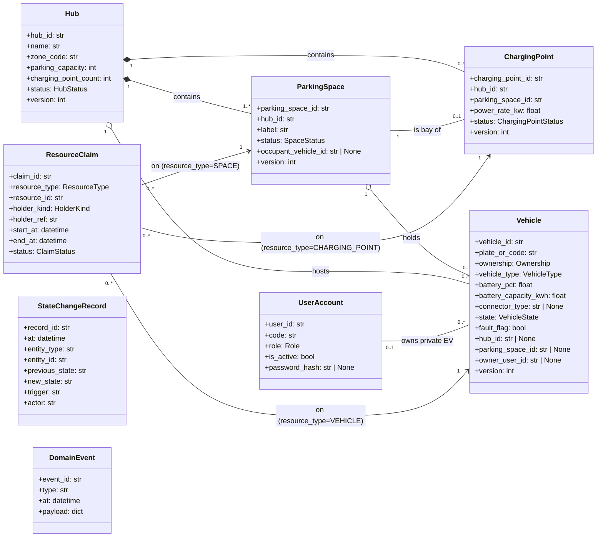

# Core Class Diagram

**Owner:** M1 — Đoàn Nhật Minh (2452738)
**Status:** v1.0 · 2026-11-04 (released with the Core API spec v1.0; a private EV away from every Hub is `IN_USE`; checked against the module PRs after their round-2 fixes; the sync with M7's ERD is still open, see §2.1 and §5)
**Related:** `docs/requirements/fr-01-core.md` (BR-M1-01 to 03), `vehicle-state-machine.md`, `core-api-spec.md`, D-002, D-003, D-005, D-007

## 1. Scope

The domain model and the main services of `src/core/`. It shows what `core` owns (Hub, ParkingSpace, ChargingPoint, Vehicle, claims, the state-change log, events) and the interfaces other modules use. Reservation, ChargingSession, Task, Incident and SimulationRun belong to M2–M6 and appear only as references by ID.

## 2. Domain model



Enumerations:

| Enum | Values |
|---|---|
| `VehicleState` | `AVAILABLE`, `RESERVED`, `IN_USE`, `RETURNED`, `CHARGING`, `MAINTENANCE` (see `vehicle-state-machine.md`) |
| `HubStatus` | `ACTIVE`, `WARNING`, `CRITICAL`, `MAINTENANCE` (set by M5 under `BR-M5-01`, `BR-M5-02`; stored in `core`) |
| `SpaceStatus` | `AVAILABLE`, `OCCUPIED`, `MAINTENANCE` (a future hold is a `ResourceClaim`, not a status; the ERD draft's `RESERVED` becomes a claim) |
| `ChargingPointStatus` | `AVAILABLE`, `CHARGING`, `OUT_OF_SERVICE`, `MAINTENANCE` (the ERD draft's `SCHEDULED` becomes a claim) |
| `Ownership` | `FLEET`, `PRIVATE` |
| `VehicleType` | `E_BIKE`, `E_SCOOTER`, `E_MOTORCYCLE` |
| `ResourceType` | `VEHICLE`, `SPACE`, `CHARGING_POINT` |
| `HolderKind` | `RESERVATION`, `CHARGING_SESSION`, `DISPATCH_TASK` (the three claims named in `BR-M1-01`) |
| `ClaimStatus` | `ACTIVE`, `RELEASED`, `EXPIRED` |
| `Role` | `STUDENT`, `OPERATOR` (A-06) |

Design notes:

1. **Current occupancy and future claims are separate.** `ParkingSpace.occupant_vehicle_id` says who is parked now. `ResourceClaim` says who has the right to use a resource during an interval. `BR-M1-01` is enforced on claims; `BR-M1-02` on occupancy. This answers point 1 of the ERD's "Left for Phase 1", and matches M2's proposal (a "current occupancy" distinct from a future claim). A private EV has an occupancy only from arrival to departure (M2 `UC-M2-08`): arrival turns its claim into an occupancy, departure removes it.
2. **A charging point is a bay.** `ChargingPoint.parking_space_id` is mandatory and unique (D-007). A vehicle being charged has `parking_space_id` equal to the bay.
3. **Claims point to holders by reference.** `holder_ref` is the ID of the reservation, charging session or task in the owning module. `core` does not import those modules.
4. **Optimistic locking.** `version` on Hub, ParkingSpace, ChargingPoint and Vehicle (D-002). Claims are immutable except for `status`.
5. **Hub counters are derived,** not stored: `HubQueries` computes `occupied`, `free_spaces`, `charging_in_use` and `available_vehicles` from the spaces, points and vehicles when it builds a `HubView`, so they cannot drift (NFR-07).
6. **Hub status is stored,** set by M5 (`BR-M5-01`, `BR-M5-02`), as in M7's ERD (`Hub.status`). `core` does not refuse a claim because a Hub is `CRITICAL`; M2 reads the status and rejects the new parking reservation (`UC-M2-06`).

### 2.1 Names compared with M7's ERD draft v1.1

The class diagram leads and M7 aligns `erd.md` with it. Differences found when comparing the two:

| Class diagram | ERD draft v1.1 | Proposal |
|---|---|---|
| `Hub.parking_capacity`, `Hub.charging_point_count` | `total_parking_capacity`, `total_charging_points` | Keep ours; M7 renames. |
| `ParkingSpace.label`; `ChargingPoint` has no code field | `space_label`, `point_code` | Use `label` on both; add a code field to `ChargingPoint` if M7 needs it for the UI. |
| `Vehicle.state`, `ownership`, `battery_pct`, `hub_id`, `parking_space_id` | `status`, `ownership_type`, `battery_level_pct`, `current_hub_id`, `current_parking_space_id` | Keep ours; M7 renames. |
| `SpaceStatus` without `RESERVED` | has `RESERVED` | Remove it; a hold is a `ResourceClaim` (note 1). |
| `ChargingPointStatus` without `SCHEDULED` | has `SCHEDULED` | Remove it; a scheduled use is a claim of `holder_kind = CHARGING_SESSION`. |
| `ResourceClaim`, `StateChangeRecord` | "Left for Phase 1" items 1 and 4 | Added to the ERD in Phase 1. |
| (not in `core`) | `Reservation`, `Trip`, `ChargingSession`, `RedistributionTask`, `Incident`, `SimulationRun` | Owned by M2–M6; `core` refers to them by ID only (`holder_ref`). |

## 3. Services and interfaces

```mermaid
classDiagram
    direction TB

    class CoreFacade {
        <<interface>>
        +queries: HubQueries
        +commands: StateCommands
        +snapshots: SnapshotService
        +events: EventBus
        +unit_of_work() UnitOfWork
    }
    class HubQueries {
        <<interface>>
        +list_hubs() list~HubView~
        +get_hub(hub_id) HubView
        +find_vehicles(filter) list~VehicleView~
        +list_spaces(hub_id) list~SpaceView~
        +list_charging_points(hub_id) list~ChargingPointView~
        +get_claims(resource_id, window) list~ClaimView~
        +get_config() CoreConfig
    }
    class StateCommands {
        <<interface>>
        +transition_vehicle(cmd) VehicleView
        +place_claim(cmd) ClaimView
        +release_claim(claim_id, actor) ClaimView
        +register_vehicle(cmd) VehicleView
        +occupy_space(cmd) SpaceView
        +free_space(cmd) SpaceView
        +set_charging_point_status(cmd) ChargingPointView
        +set_hub_status(cmd) HubView
        +apply_sensor_event(event, actor) Result~SensorResult~
        +load_network(spec, actor) Result~NetworkSummary~
    }
    class SnapshotService {
        <<interface>>
        +export_snapshot() OperationalSnapshot
    }
    class UnitOfWork {
        <<interface>>
        +commit()
        +rollback()
    }
    class VehicleStateMachine {
        +allowed(state, event) VehicleState | None
        +check(vehicle, event, ctx) Result~Transition~
        +apply(vehicle, event, ctx) Result~TransitionOutcome~
    }
    class InvariantChecker {
        +check(repo) list~Violation~
    }
    class ClaimPolicy {
        +overlaps(existing, start, end) bool
    }
    class Clock {
        <<interface>>
        +now() datetime
    }
    class EventBus {
        +publish(event)
        +subscribe(type, handler)
    }
    class Repository {
        <<interface>>
        +get(entity_type, id)
        +query(entity_type, predicate)
        +add(entity)
        +update(entity, expected_version)
        +begin()
        +commit()
        +rollback()
        +savepoint() object
        +version() int
        +changed_since(keys, version) list
    }
    class SqlRepository
    class InMemoryRepository

    class AuthService {
        +login(code, password) Result~LoginResult~
        +authenticate(token) Result~Principal~
        +issue_service_token(module, user_id) str
    }
    class ProviderRegistry {
        +register(port, provider)
        +call(port, work) Result
    }
    class SensorIntake {
        +apply(event, actor) Result~SensorResult~
    }
    class NetworkLoader {
        +load(spec, actor) Result~NetworkSummary~
    }

    CoreFacade *-- HubQueries
    CoreFacade *-- ProviderRegistry
    CoreFacade ..> AuthService : builds
    StateCommands ..> SensorIntake : uses
    StateCommands ..> NetworkLoader : uses
    CoreFacade *-- StateCommands
    CoreFacade *-- SnapshotService
    CoreFacade *-- EventBus
    CoreFacade ..> UnitOfWork : opens
    StateCommands ..> VehicleStateMachine : uses
    StateCommands ..> ClaimPolicy : uses
    StateCommands ..> InvariantChecker : after commit (tests, simulation)
    StateCommands ..> Clock : uses
    StateCommands ..> Repository : reads / writes
    StateCommands ..> EventBus : publishes
    SnapshotService ..> Repository : read-only
    SqlRepository ..|> Repository
    InMemoryRepository ..|> Repository
```



Design notes:

1. **One facade for other modules.** Other modules import only `CoreFacade` and its view/command types; domain classes and repositories stay internal (NFR-22, D-003). The one possible exception is M6, which may also import the snapshot types and the read-only rules (see note 4).
2. **State machine as a table.** `VehicleStateMachine` is a data-driven transition table, so tests can loop over every (state, event) pair (NFR-08).
3. **Clock is injected** (D-005), so reservation expiry and the 5-second and 10-minute rules are testable.
4. **Two repository implementations.** `SqlRepository` for the live store. `SqlRepository` (SQLite, SQLAlchemy Core tables in `repository/schema.py`) is the persistent store. `InMemoryRepository` can be loaded from a snapshot, so a What-if run never holds a connection to the operational store (NFR-12). It is also the test double for unit tests of `core` and of the modules. Same interface, so the same domain code runs on both. M6 builds its own simulation state and may reuse this repository and the state machine; the architecture review decides (`architecture-diagram.md` §11, point 7).
5. **Unit of work.** Operations that touch several entities (pickup, return) run inside one `UnitOfWork` and either all apply or all roll back (NFR-09). M2 and M4 open it through the facade; they do not manage transactions themselves. Their own tables (Reservation, Trip, task) are registered with `CoreFacade.register_entity` and written through `UnitOfWork.repository` inside the same unit (`core-api-spec.md` §5.2).
6. **Events.** `core` publishes `VehicleStateChanged`, `SpaceOccupancyChanged`, `ChargingPointStatusChanged`, `HubStatusChanged`, `ClaimPlaced`, `ClaimReleased`. M3, M4 and M5 subscribe; they do not import each other (D-003).

7. **Provider ports.** For the few calls that go from `core` to another module (demand data, alternative Hubs or bays, consuming a reservation hold), `core` owns the interfaces `DemandSource`, `AlternativeHubProvider`, `AlternativeChargingProvider` and `HoldConsumer` (`core-api-spec.md` §6.1). The other module registers an implementation, so imports still point into `core`. Not drawn above to keep the diagram readable.

8. **Repeated requests.** `core` keeps no store of past command results. A repeated pickup or return is recognised by M2 from its own Reservation / Trip record, before it calls `core` (M2 PR #11: "no separate command-result store or Core outcome-query API is required"). If two identical requests arrive at once, `core` lets one win (version check, state machine) and M2 re-reads its record to answer the other.

## 4. Package layout (proposal)

```
src/core/
  domain/        entities, enums, VehicleStateMachine, ClaimPolicy, InvariantChecker
  repository/    Repository (interface), sql.py, memory.py
  services/      queries.py, commands.py, snapshot.py, unit_of_work.py
  events/        bus.py, event types
  api/           FastAPI routers (read endpoints for UI), pydantic schemas
  __init__.py    exports CoreFacade and the public view / command types only
```

## 5. Decisions behind this version

1. **Private EVs as `Vehicle` or a separate class.** This draft keeps one `Vehicle` with `ownership` (as the ERD draft does) and adds `connector_type` for the M3 profile (`FR-07.M3.1`). Alternative: a `PrivateVehicle` subclass if fields diverge. Decided: one `Vehicle` (D-016); M7 builds the ERD the same way. Linked to the state of a private EV that is away from every Hub: it is `IN_USE` (draft decision, `vehicle-state-machine.md` §7, point 1), so the single-table choice needs no exception in the location rule. The assignment only asks that private EVs can reserve parking and schedule charging; registering the vehicle in `core` is our assumption A-05.
2. **Who stores `HubStatus`.** `core` stores it, M5 sets it through `set_hub_status`. If M5 would rather keep it derived, the field moves out of `Hub`.
3. **`UserAccount`.** Shown here only because `Role` is needed for authorization. The seeded account store may move to a separate `auth` package inside `core`.
4. **Claim granularity for parking.** One claim per space per interval is assumed. A "any free space at this Hub" hold, if M2 needs it, is resolved to a concrete space when the claim is placed.
5. **Who may hold a claim.** `BR-M1-01` names three holders (reservation, charging session, dispatch task). M2's data proposal lists only "reservation or dispatch-task owner". A charging session also needs a claim on its charging point and bay (M2's bundle goes through M3). Decided: `CHARGING_SESSION` stays (D-017).
6. **ERD alignment.** The differences in §2.1 (names, statuses, `ResourceClaim`, `StateChangeRecord`) are for M7 to apply in `erd.md`, after the design review.
