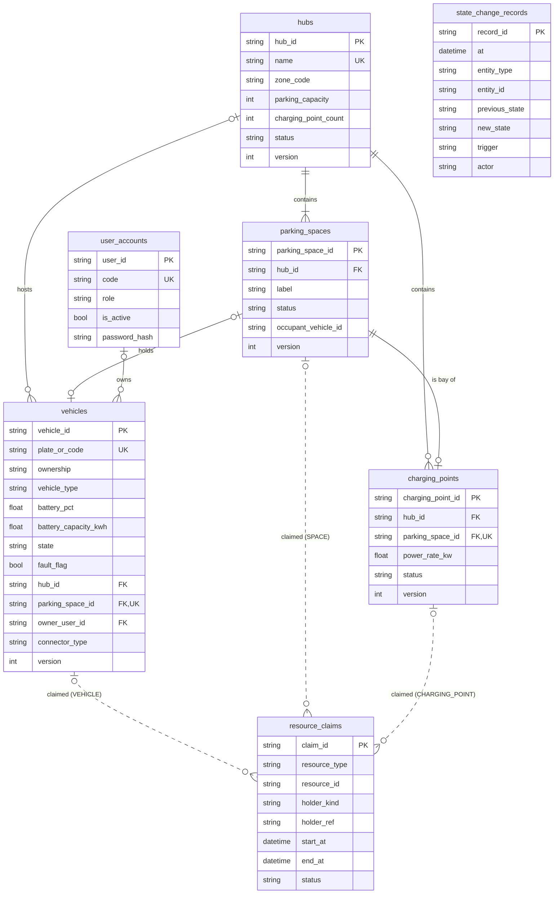
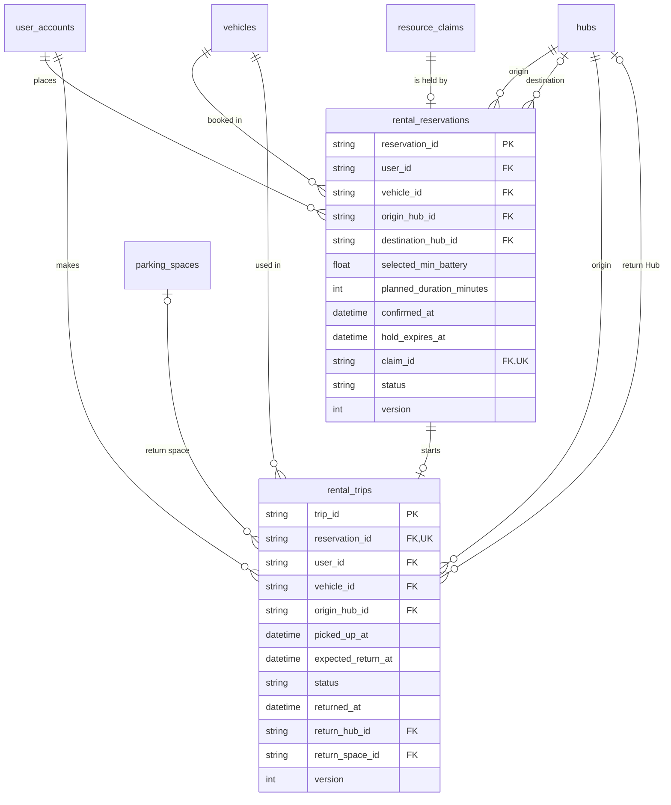
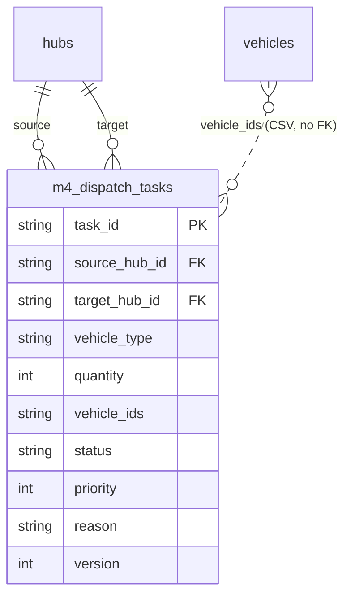
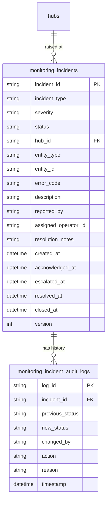

# Entity-Relationship Diagram

> Owner: M7 (Nguyễn Trung Kiên) · Date: 2026-11-09 · Reviewer: M5 (Đỗ Hoàng Việt)
> Replaces the Phase 0 draft `erd-entities-draft.md`.
> Sources: `class-diagram-core.md` and the code of `core`; the code of M2, M3, M4 and M5 on their open branches; M5's `incident-data-model.md`. IDs such as `D-xxx` and `BR-...` are in `docs/DECISIONS.md` and `docs/requirements/`.

## 1. What is covered

The system uses one SQLite database. `core` creates the shared tables, and each module registers its own tables in the same database (D-018). Table names below are the names used in the code.

| Part | Source | Status |
|---|---|---|
| `core` (7 tables) | Class diagram and code on `develop` | Final |
| M2 | Code on `origin/feat/reservation-booking-flow` | Provisional (rental only) |
| M4 | Code on `origin/feat/allocation-phase2` | Provisional |
| M5 | Code on `origin/feat/monitoring-incident` | Provisional |
| M3 | Code on `origin/feat/charging-phase2` keeps the queue in memory | No tables |
| M6 | Code keeps results in memory | No tables |

## 2. How to read the diagrams

- `PK` primary key, `FK` foreign key, `UK` unique. `FK, UK` means both.
- `||` exactly one, `|o` or `o|` zero or one, `|{` one or more, `o{` zero or more. The symbol next to a table says how many rows of that table relate to one row of the other table. Example: `hubs ||--|{ parking_spaces` means a space belongs to exactly one Hub, and a Hub has at least one space.
- A solid line is a foreign key. A dashed line is a reference with no foreign key in the database.
- Enumerated values are listed in Section 6.

## 3. core

*Figure 3.4 — Data model of `core`.*

- `vehicles.hub_id` and `vehicles.parking_space_id` are both null exactly while the vehicle is `IN_USE` (away from every Hub). `owner_user_id` is null for fleet vehicles. `connector_type` is only for private EVs.
- `parking_spaces.occupant_vehicle_id` has no foreign key in the database. The real link is `vehicles.parking_space_id` (unique). `core` keeps both sides equal.
- `resource_claims` points to a vehicle, space or charging point with `resource_type` and `resource_id`, and to the owner module with `holder_kind` and `holder_ref`. None of these is a foreign key, so `core` does not depend on module tables (D-003, D-017). `core` checks that the resource exists.
- `state_change_records` has no line: `entity_type` and `entity_id` can name any entity.
- Hub counters (occupied, free, charging in use, available vehicles) are not stored. They are computed when a Hub is read.
- Not drawn: `domain_events`, `meta`, `change_log`. `domain_events` is created by `schema.py`, but no code writes to it. M1 decided that events are not stored and that M7 may drop this table (`architecture-diagram.md`, Section 11, point 6). `meta` and `change_log` hold a commit counter for snapshots and locking.

## 4. Module tables

### 4.1 M2: rental reservation and trip

*Figure 3.5 — M2 tables.*

- A reservation holds exactly one claim (`claim_id`, not null, unique). M2 places the claim and creates the reservation in one unit of work, and releases the claim at pick-up. `claim_id` keeps pointing to the released claim.
- `destination_hub_id` is null if the student chose no destination. `returned_at`, `return_hub_id` and `return_space_id` are all null until the vehicle is returned.
- `PENDING` is not stored. M2's state machine treats it as a short state of the request with no record. The code stores five statuses.
- Parking reservations (FR-05, FR-07 parking side) are planned and not in the tables yet.

### 4.2 M4: dispatch task

*Figure 3.6 — M4 table.*

- M4 calls the entity `DispatchTask`. The Phase 0 draft called it `RedistributionTask`.
- `vehicle_ids` is one text column with vehicle IDs separated by commas. A task moves many vehicles, and a vehicle can be in many tasks over time, so a separate table of task and vehicle pairs would normally be used. The database cannot check these IDs. This is recorded as a deviation.
- On approval M4 places claims on the vehicles and one destination space with `holder_kind = DISPATCH_TASK` and `holder_ref = task_id`. M4's design text still says "a system reservation with purpose `REBALANCE`", which the code does not do.

### 4.3 M5: incident ticket and audit log

*Figure 3.7 — M5 tables.*

- These two tables are coded in `src/monitoring/schema.py` and match M5's `incident-data-model.md`.
- Nullable: `error_code`, `assigned_operator_id`, `resolution_notes`, `acknowledged_at`, `escalated_at`, `resolved_at`, `closed_at`, and `reason` in the audit log.
- `entity_type` and `entity_id` name the failed component and have no foreign key. `reported_by` is free text. `assigned_operator_id` has no foreign key in the code.
- M5's document has two mistakes against `core`: it calls the Hub table `core_hubs` (it is `hubs`), and its `HubMetricsSnapshot` uses the old names `total_parking_capacity` and `total_charging_points`. The code uses `hubs` and computes the metrics (`HubMetricsView`) with `core`'s names without storing them, so they are not drawn.

## 5. Not drawn

- **M3:** the code keeps a queue of `ChargingRequest` in memory, with no table and no status field. Its `station_id` is `core`'s `charging_point_id`. M3's state machine (2026-11-06) lists `AVAILABLE`, `PREPARING`, `CHARGING`, `COMPLETED`, `FAULTED`, `CANCELLED`, its report adds `SUSPENDED`, and the timeline lists `Requested`, `Scheduled`, `Charging`, `Completed`, `Interrupted`, `Failed`. A `charging_session` table is expected.
- **M6:** `m6-simulation-design.md` and `src/simulation` keep each run in memory. The draft tables `simulation_run` and `coordination_recommendation` have no basis and were dropped.

## 6. Enumerated values

| Column | Values |
|---|---|
| `hubs.status` | `ACTIVE`, `WARNING`, `CRITICAL`, `MAINTENANCE` |
| `parking_spaces.status` | `AVAILABLE`, `OCCUPIED`, `MAINTENANCE` |
| `charging_points.status` | `AVAILABLE`, `CHARGING`, `OUT_OF_SERVICE`, `MAINTENANCE` |
| `vehicles.ownership` | `FLEET`, `PRIVATE` |
| `vehicles.vehicle_type` | `E_BIKE`, `E_SCOOTER`, `E_MOTORCYCLE` |
| `vehicles.state` | `AVAILABLE`, `RESERVED`, `IN_USE`, `RETURNED`, `CHARGING`, `MAINTENANCE` |
| `resource_claims.resource_type` | `VEHICLE`, `SPACE`, `CHARGING_POINT` |
| `resource_claims.holder_kind` | `RESERVATION`, `CHARGING_SESSION`, `DISPATCH_TASK` |
| `resource_claims.status` | `ACTIVE`, `RELEASED`, `EXPIRED` |
| `user_accounts.role` | `STUDENT`, `OPERATOR` |
| `rental_reservations.status` | `CONFIRMED`, `ACTIVE`, `COMPLETED`, `CANCELLED`, `EXPIRED` |
| `rental_trips.status` | `IN_PROGRESS`, `COMPLETED`, `OVERDUE`, `INCIDENT_ABORTED` |
| `m4_dispatch_tasks.status` | `RECOMMENDED`, `APPROVED`, `IN_PROGRESS`, `COMPLETED`, `CANCELLED`, `REJECTED`, `FAILED` |
| `monitoring_incidents.incident_type` | `CHARGING_POINT_FAILURE` (`INC-HW-01`), `PARKING_SENSOR_FAULT` (`INC-HW-02`), `HUB_CAPACITY_FULL` (`INC-CAP-01`), `HUB_VEHICLE_DEFICIT` (`INC-CAP-02`), `BATTERY_CRITICAL_FAULT` (`INC-BAT-01`), `TELEMETRY_CONNECTION_LOSS` (`INC-COMM-01`), `OVERDUE_VEHICLE` (`INC-USR-01`) |
| `monitoring_incidents.severity` | `LOW`, `MEDIUM`, `HIGH`, `CRITICAL` |
| `monitoring_incidents.status` | `OPEN`, `IN_PROGRESS`, `ESCALATED`, `RESOLVED`, `CLOSED` |
| `monitoring_incident_audit_logs.action` | `CREATE`, `ACKNOWLEDGE`, `ESCALATE`, `RESOLVE`, `CLOSE` |

A space has no `RESERVED` status and a charging point has no `SCHEDULED` status. A future hold is a row of `resource_claims`.

## 7. Rules the diagram does not show

| Rule | Checked by |
|---|---|
| Foreign keys; one plate per vehicle; one label per space in a Hub; one vehicle per space; one charging point per space (D-007); ranges such as battery 0 to 100 | The database |
| A vehicle's `hub_id` and `parking_space_id` are both set or both null; `PRIVATE` if and only if `owner_user_id` is set | The database (CHECK) |
| A vehicle is at a Hub exactly when its state is not `IN_USE`; a `CHARGING` vehicle is in a charging bay | `core` (`InvariantChecker`) |
| `parking_capacity` equals the number of spaces; `charging_point_count` equals the number of charging points; a charging point's bay is in its own Hub | `core` (`InvariantChecker`) |
| Occupied spaces do not exceed capacity (`BR-M1-02`); two active claims on one resource never overlap (`BR-M1-01`) | `core` (`InvariantChecker`) |
| Vehicle state changes follow the transition table (`BR-M1-03`) | `core` (`VehicleStateMachine`) |
| A `HIGH` or `CRITICAL` ticket that stays `OPEN` for 5 minutes becomes `ESCALATED` (`BR-M5-04`) | M5 (the code has an `escalate` route but no timer) |

## 8. Check against the class diagram and the code

- The eight entities of `class-diagram-core.md` (Section 2) have the same attributes in `entities.py` and the same columns in `schema.py`. Seven are drawn. `DomainEvent` is a class only, because events are not stored.
- The operations in Section 3 of the class diagram exist in `src/core` under the same names.
- M2, M4 and M5 were compared with their code.

## 9. Changes from the Phase 0 draft

- `core`: columns renamed as in the class diagram (`parking_capacity`, `label`, `state`, `battery_pct`), and no `RESERVED` or `SCHEDULED` status.
- Added `resource_claims` and `state_change_records`. Dropped `Hub.location_description`, `UserAccount.full_name`, `ChargingPoint.point_code`, `email` and `has_private_ev`, which are not in the class diagram or the code.
- M2: `Reservation` and `Trip` replaced by `rental_reservations` and `rental_trips`, as coded.
- M4: `RedistributionTask` and `RedistributionTaskVehicle` replaced by `m4_dispatch_tasks`.
- M5: `Incident` replaced by the two `monitoring_*` tables.
- Dropped `ChargingSession`, `SimulationRun` and `CoordinationRecommendation` (no table in the code).

## 10. Open points

1. Confirm that `PENDING` is not stored. M2 asked M1 and M7.
2. M4: keep `vehicle_ids` as a comma-separated column, or ask for a table of task and vehicle pairs.
3. M4: the design says `REBALANCE`, the code uses `DISPATCH_TASK` claims.
4. M5: the code answers the table name (`hubs`), the foreign key on `assigned_operator_id` (none) and whether the metrics are stored (no). `incident-data-model.md` should be updated to match.
5. M3: no table and no session status in the code, `station_id` instead of `charging_point_id`, and its documents list different session states.
6. M2: add the parking-reservation fields when they are in the code.
7. M1: `domain_events` is created but never written. Remove it or store events.
8. M1: `architecture-diagram.md` (Section 6) still lists the Phase 0 table names of M4, M5 and M6.
