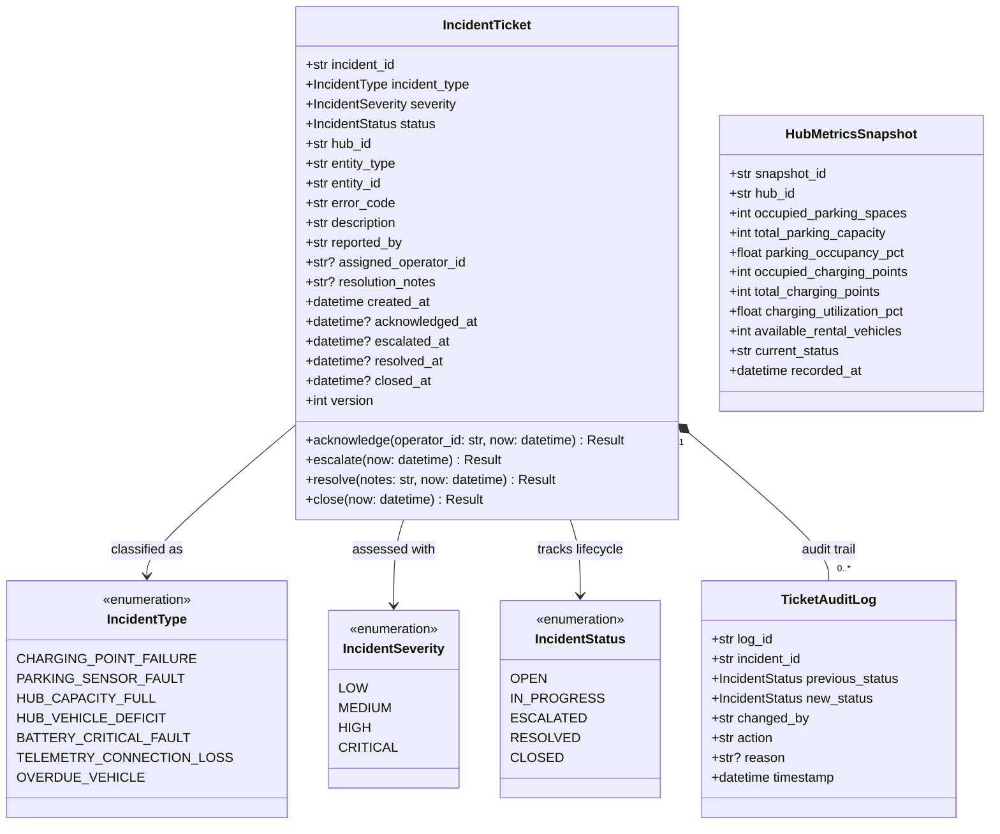

---

## Enumerations Specification

### 1 `IncidentType` Mapping Table
To guarantee absolute consistency between requirements and code, enum values map 1-to-1 to the M5 Incident Taxonomy codes:

| Enum Literal | Taxonomy Code | Category | Default Severity | Description |
|---|---|---|---|---|
| `CHARGING_POINT_FAILURE` | `INC-HW-01` | Hardware / Charger | `CRITICAL` | Charger socket power breakdown or internal circuitry fault. |
| `PARKING_SENSOR_FAULT` | `INC-HW-02` | Hardware / Sensor | `MEDIUM` | Parking slot sensor heartbeat loss or occupancy state conflict. |
| `HUB_CAPACITY_FULL` | `INC-CAP-01` | Capacity / Parking | `HIGH` | Hub reaches 100% capacity; vehicle return blocked. |
| `HUB_VEHICLE_DEFICIT` | `INC-CAP-02` | Capacity / Vehicle | `MEDIUM` | Rental vehicle inventory falls below 2 units at key hubs. |
| `BATTERY_CRITICAL_FAULT` | `INC-BAT-01` | Vehicle / Battery | `HIGH` | Rental vehicle battery falls to or below 15% SoC threshold. |
| `TELEMETRY_CONNECTION_LOSS`| `INC-COMM-01` | Network / Telemetry | `CRITICAL` | Loss of telemetry feed from hub gateway for $> 30$ seconds. |
| `OVERDUE_VEHICLE` | `INC-USR-01` | User / Operational | `LOW` | Trip exceeds planned reservation window by $> 60$ minutes. |

### 2 `IncidentSeverity`
- `LOW`: Informational or minor discrepancy; no immediate service disruption.
- `MEDIUM`: Degraded redundancy; non-blocking failure (e.g., individual sensor mismatch).
- `HIGH`: Service disruption impacting availability (e.g., Hub full, critical battery).
- `CRITICAL`: Safety or infrastructure hazard (e.g., charging hardware electrical fault, gateway disconnection).

### 3 `IncidentStatus` (Ticket Lifecycle)
$$\text{OPEN} \longrightarrow \text{IN\_PROGRESS} \longrightarrow \text{RESOLVED} \longrightarrow \text{CLOSED}$$
$$\downarrow$$
$$\text{ESCALATED} \longrightarrow \text{IN\_PROGRESS}$$

---

## 2. Entity Specifications

### 2.1 Entity `IncidentTicket`
* **Table Name:** `monitoring_incidents` (Registered via `TableSpec` per `D-018`)
* **Primary Key:** `incident_id` (VARCHAR(36))

| Column Name | SQL Type | Nullable | Description & Constraints |
|---|---|---|---|
| `incident_id` | `VARCHAR(36)` | `NOT NULL` | Unique ticket identifier (e.g., UUID or `TICK-20261106-XXXX`). |
| `incident_type` | `VARCHAR(32)` | `NOT NULL` | String representation of `IncidentType`. |
| `severity` | `VARCHAR(16)` | `NOT NULL` | `LOW`, `MEDIUM`, `HIGH`, `CRITICAL`. |
| `status` | `VARCHAR(16)` | `NOT NULL` | Current lifecycle state (Default: `OPEN`). |
| `hub_id` | `VARCHAR(16)` | `NOT NULL` | Foreign key referencing `core_hubs.hub_id`. |
| `entity_type` | `VARCHAR(32)` | `NOT NULL` | Target resource kind (`ChargingPoint`, `Vehicle`, `ParkingSpace`, `Hub`). |
| `entity_id` | `VARCHAR(36)` | `NOT NULL` | ID of the specific failed component. |
| `error_code` | `VARCHAR(32)` | `NULL` | Raw hardware / protocol diagnostic error code. |
| `description` | `TEXT` | `NOT NULL` | Detailed incident description and trigger context. |
| `reported_by` | `VARCHAR(64)` | `NOT NULL` | Reporter identifier (`SYSTEM_IOT_INTAKE`, `SYSTEM_SCHEDULER`, or user ID). |
| `assigned_operator_id`| `VARCHAR(36)` | `NULL` | UserAccount ID of operator handling ticket. |
| `resolution_notes` | `TEXT` | `NULL` | Mandatory notes recorded prior to ticket closure. |
| `created_at` | `TIMESTAMP` | `NOT NULL` | Creation timestamp in UTC (`D-005`). |
| `acknowledged_at` | `TIMESTAMP` | `NULL` | Timestamp when operator claimed ticket. |
| `escalated_at` | `TIMESTAMP` | `NULL` | Timestamp when auto-escalated under `BR-M5-04`. |
| `resolved_at` | `TIMESTAMP` | `NULL` | Timestamp when fix was verified. |
| `closed_at` | `TIMESTAMP` | `NULL` | Final sign-off timestamp. |
| `version` | `INTEGER` | `NOT NULL` | Optimistic concurrency control counter (Default: 1). |

### 2.2 Entity `TicketAuditLog`
* **Table Name:** `monitoring_incident_audit_logs`
* **Primary Key:** `log_id` (VARCHAR(36))

| Column Name | SQL Type | Nullable | Description |
|---|---|---|---|
| `log_id` | `VARCHAR(36)` | `NOT NULL` | Unique log entry ID. |
| `incident_id` | `VARCHAR(36)` | `NOT NULL` | FK to `monitoring_incidents.incident_id`. |
| `previous_status` | `VARCHAR(16)` | `NOT NULL` | Status prior to transition. |
| `new_status` | `VARCHAR(16)` | `NOT NULL` | Status resulting from transition. |
| `changed_by` | `VARCHAR(64)` | `NOT NULL` | Operator username or `SYSTEM_ESCALATION_DAEMON`. |
| `action` | `VARCHAR(32)` | `NOT NULL` | Transition verb (`ACKNOWLEDGE`, `ESCALATE`, `RESOLVE`, `CLOSE`). |
| `reason` | `TEXT` | `NULL` | Contextual comment or escalation justification. |
| `timestamp` | `TIMESTAMP` | `NOT NULL` | UTC timestamp of transition event. |

---

## 3. Module Registration Code Pattern (`src/monitoring/` Preview for Phase 2)

Per decision **`D-018`**, Module M5 will register these schemas during start-up in `src/monitoring/install.py`:

```python
from sqlalchemy import Table, Column, String, Integer, Text, DateTime, ForeignKey, MetaData
from core.repository.base import TableSpec

metadata = MetaData()

incident_table = Table(
    "monitoring_incidents",
    metadata,
    Column("incident_id", String(36), primary_key=True),
    Column("incident_type", String(32), nullable=False),
    Column("severity", String(16), nullable=False),
    Column("status", String(16), nullable=False, default="OPEN"),
    Column("hub_id", String(16), nullable=False, index=True),
    Column("entity_type", String(32), nullable=False),
    Column("entity_id", String(36), nullable=False, index=True),
    Column("error_code", String(32), nullable=True),
    Column("description", Text, nullable=False),
    Column("reported_by", String(64), nullable=False),
    Column("assigned_operator_id", String(36), nullable=True),
    Column("resolution_notes", Text, nullable=True),
    Column("created_at", DateTime, nullable=False),
    Column("acknowledged_at", DateTime, nullable=True),
    Column("escalated_at", DateTime, nullable=True),
    Column("resolved_at", DateTime, nullable=True),
    Column("closed_at", DateTime, nullable=True),
    Column("version", Integer, nullable=False, default=1),
)

audit_table = Table(
    "monitoring_incident_audit_logs",
    metadata,
    Column("log_id", String(36), primary_key=True),
    Column("incident_id", String(36), ForeignKey("monitoring_incidents.incident_id"), nullable=False, index=True),
    Column("previous_status", String(16), nullable=False),
    Column("new_status", String(16), nullable=False),
    Column("changed_by", String(64), nullable=False),
    Column("action", String(32), nullable=False),
    Column("reason", Text, nullable=True),
    Column("timestamp", DateTime, nullable=False),
)

def register_monitoring_entities(core_facade) -> None:
    core_facade.register_entity(TableSpec(name="monitoring_incidents", table=incident_table))
    core_facade.register_entity(TableSpec(name="monitoring_incident_audit_logs", table=audit_table))
```

