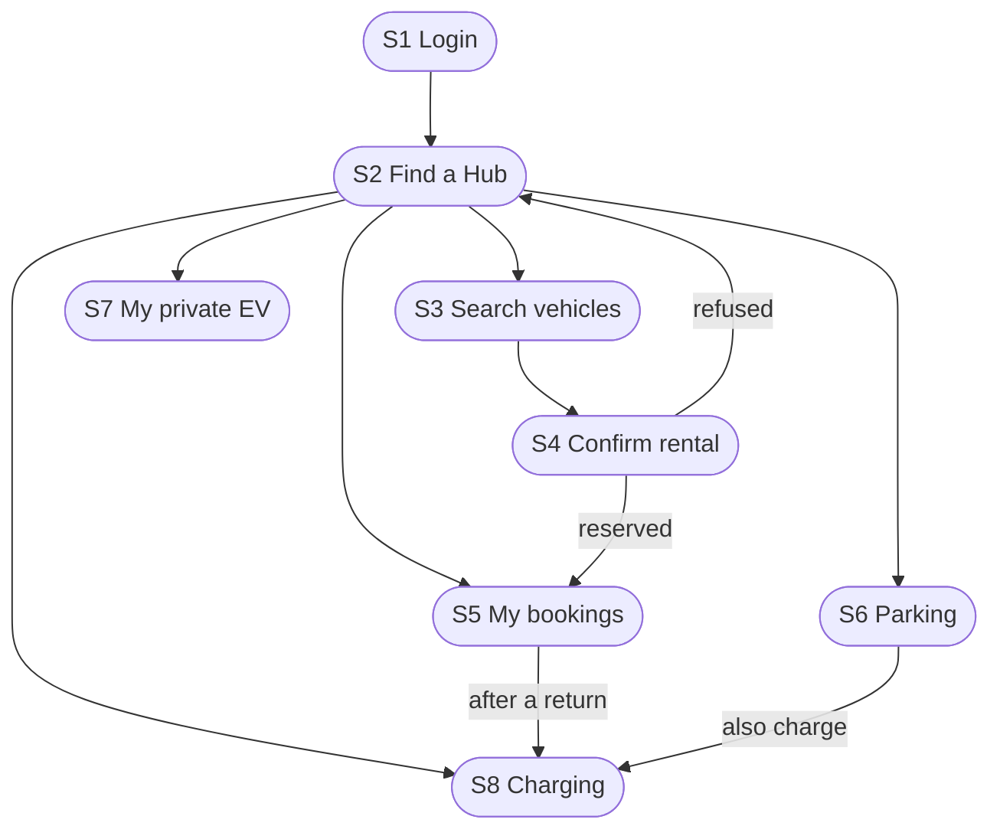
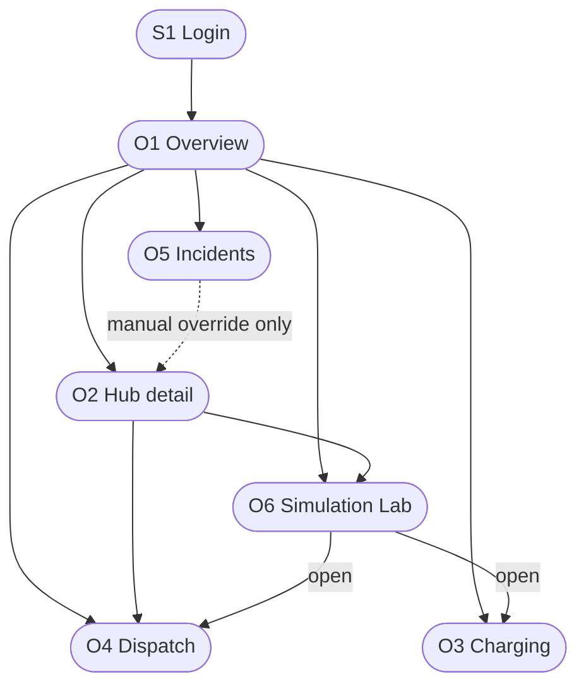

# UI Flow Diagrams

> Owner: M7 (Nguyễn Trung Kiên) · Date: 2026-11-09 · Revised for Phase 3: 2026-11-25 · Reviewer: M5 (Đỗ Hoàng Việt)
> One diagram for each actor. Screens `S1` to `S9` are in `wireframes-student.md`, `O1` to `O6` in `wireframes-operator.md`.
> A box is a screen. A dashed box is a screen that is only in the requirements, not in the code yet. A line is a move from one screen to another. The commands on each screen and what happens when they are refused are in the tables. `iot_sim` has no screen.

## 1. Student

*Student flows.*

After login the student lands on S2. My bookings and Logout are in the header of every screen. The main path is S2, S3, S4, S5. After a return the student can go on to charging for that vehicle (`FR-06.1`). A parking booking with the charging box ticked continues in S8, because parking and charging are booked together (`BR-M2-12`).

| Screen | Commands | Use cases | Backend | If refused |
|---|---|---|---|---|
| S3, S4 | Search, `reserve` | `UC-M2-01`, `UC-M2-02` | Implemented (M2 routes) | Error block with M2's cause and code |
| S5 | Pick up | `UC-M2-04` | Implemented | Expired: make a new reservation |
| S5 | Return | `UC-M2-05` | Implemented | No space: the trip stays open (nearby Hubs planned) |
| S5 | Cancel | `UC-M2-03` | Implemented | Offered only before pick-up |
| S5 | Hold a return space | `UC-M2-06` | Implemented | No free space: other Hub |
| S6 | Reserve, arrive, leave, cancel parking | `UC-M2-06` to `UC-M2-08` | Implemented | No free space, too early, deadline passed |
| S7 | Register a private EV | `UC-M3-04` | Implemented (M3 route) | Duplicate plate: error block |
| S8 | Request charging now or at a time | `UC-M3-01`, `UC-M3-02` | Implemented (M3 route) | Error block with M3's cause |
| S8 | Change, cancel charging | `UC-M3-03`, `UC-M3-05` | Implemented | No port free: other time, port or Hub |

## 2. Operator

*Operator flows.*

After login the operator lands on O1. The tab bar and the alert strip are on every screen, so each tab screen is one click from the others, and a Hub in `WARNING` or `CRITICAL` is always one click away (NFR-20). O2 is not a tab: it opens from a Hub card or the alert strip. In M5's flow the system restores a resource itself when the device is healthy again, so the dotted line from O5 to O2 is only for a manual override. Simulation never changes real state: a recommendation goes to the owning module only after the operator approves it, and that module can refuse it. O6 is Planned except the demand-surge scenario, which exists in M6's code.

| Screen | Commands | Use cases | Backend | If refused |
|---|---|---|---|---|
| O1, O2 | View, filter; change the state of a vehicle, point or Hub | `UC-M7-01`, `UC-M7-02`, `UC-M7-07` | Implemented (core commands) | Version conflict: the page is read again |
| O3 | View the queue of a Hub | `UC-M7-03` | Implemented (M3 route, read-only) | Error block with M3's cause |
| O3 | Optimize the queue; start, finish, stop a session | `UC-M7-04` | Implemented | M3's cause |
| O4 | Plan, approve, pick-up, delivery, cancel | `UC-M7-05`, `UC-M7-06` | Implemented | Task `FAILED` or request refused, with the reason on the card |
| O4 | Reject, settings | `UC-M4-02`, `UC-M4-09` | Implemented | M4's cause |
| O5 | Acknowledge, resolve, close | `UC-M7-08` | Implemented | Action hidden when the status does not allow it |
| O6 | Run the demand surge on a copy | `UC-M7-09` | Implemented (M6 route) | M6's message for an invalid input |
| O6 | Five scenarios, approve or reject a recommendation, export | `UC-M7-09`, `UC-M7-10` | Implemented | M4 may refuse an approved recommendation |

## 3. Behaviour shared by the flows

- **Session.** The token is kept in a cookie and lasts 60 minutes by default. When it is no longer valid, any screen goes to S1 and returns to the same screen after login.
- **Role.** A student cannot reach O1 to O6. After login each role goes to its own home screen.
- **Retries.** The pages call the modules inside the same process (D-026), so a command does not time out on a network. A repeated rental command is answered by M2 from its own records instead of acting twice (D-015). No timeout rule exists for the operator's commands.
- **Refresh.** Parts of a page are re-read by polling every 3 seconds, so a change appears within 5 seconds (NFR-01).
- **Empty, loading and error states.** Every list and form has them (M8 tests them).
- **Events.** The UI never talks to `iot_sim` and gets no push. `core` publishes events inside the process after a commit and does not store them, so the UI re-reads the state and shows `as_of`.
