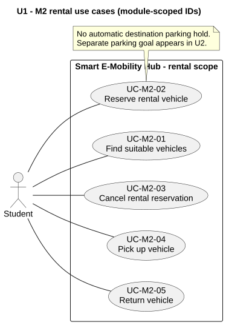
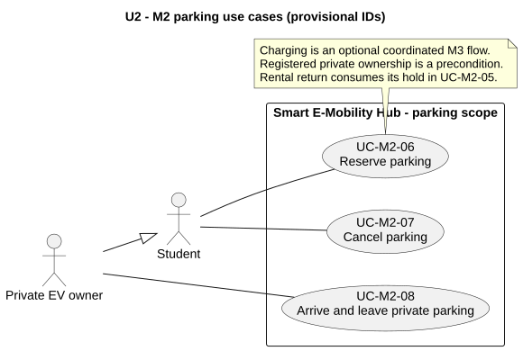

# 2. Requirements Analysis

<!-- BEGIN M2: Reservation & Trip -->
## M2 contribution - Reservation & Trip

> Author: 2452620 Đặng Tuấn Kiệt. Date: 2026-11-04. **Proposed for team review**.
> This section contains only M2's contribution. Other modules' requirements and the consolidated system-wide Phase 0 artifacts are not claimed complete.

### Actors, goals and scope

The Student searches for fleet vehicles, reserves an immediate pickup, starts a trip and returns to an accepting Mobility Hub. A Private EV Owner is a Student role that reserves parking, arrives and departs without creating a rental Trip. Operator is an external actor for incident recovery; the simulated sensor/event source crosses the boundary through Core. Internal modules and the expiry scheduler are implementation components, not use-case actors.

M2 covers FR-02 (search and battery/availability), FR-03 (reserve/cancel), FR-04 (pickup/return), FR-05 (parking), and FR-07's private-parking slice. M3 owns charging and private charging-profile registration. Core owns shared resource state. Allocation supplies advisory alternatives and resource priorities; Monitoring owns incident handling; UI presents user actions and authoritative results. Payment, fines, GPS, route planning and physical hardware operation are excluded.

### Functional requirements and use cases

The [M2 requirements baseline](../requirements/fr-02-05-07-reservation.md) is authoritative for input/output contracts, acceptance criteria (§4), business rules (§5) and complete use-case specifications (§6). It supplies the missing M2 Phase 0 foundation specifically for Phase 1 review.

| Requirement | Student goal / use cases | Observable acceptance outcome |
|---|---|---|
| FR-02 | UC-M2-01 Find suitable vehicles | Filtered fleet candidates with battery/state/as_of; invalid inputs rejected; empty results and alternatives explained |
| FR-03 | UC-M2-02 Reserve; UC-M2-03 Cancel | One exclusive ten-minute hold, concurrency/quota checks, owner-only cancellation before pickup |
| FR-04 | UC-M2-04 Pick up; UC-M2-05 Return | Exactly one Trip, atomic origin release/destination occupancy; failed return keeps Trip open |
| FR-05 | UC-M2-06 Reserve parking; UC-M2-07 Cancel; UC-M2-08 Arrive/depart; UC-M2-05 consumes rental return hold | Exclusive interval/space claim and no overcapacity; expiry/cancellation never erases actual occupancy |
| FR-07 parking | UC-M2-06/07/08 with private ownership | Private profile validated, no rental Trip, joint bay/charger confirmation counts one space |

Editable PlantUML sources accompany each SVG. These scoped diagrams feed the [draft system overview](../requirements/use-case-diagrams/uc-overview.svg). The [actor analysis](../requirements/stakeholder-actor-analysis.md) records current participation and UI-view overlap. The overview groups module goals; the actor analysis specifies individual participation.

### Business constraints and parameter rationale

The **canonical parameter register is baseline §3**. The proposed rental is immediate with a ten-minute hold and zero grace: M2 allows pickup only at `t < hold_expires_at`; equality means expiry. Each student may hold one live rental and one live parking reservation. Rental confirmation does not automatically reserve a destination space; an Active renter may separately request a ten-minute immediate return-space hold.

Private parking can start within 24 hours, with a default two-hour stay (30..240 minutes), and arrival in `[start,start+10 min)`. Intervals use half-open overlap rules; actual occupancy overrides calendar optimism. Overstay keeps occupancy and triggers monitoring instead of an automatic release. A rental's planned duration defaults to 30 minutes (5..120); expected return is calculated at actual pickup. M5's overdue condition is strictly more than 60 minutes beyond that time, without fines or forced completion.

Rental minimum battery is proposed at 20%, distinct from M5's <=15% rental-pool lockout and <=15% low-battery incident, M3's <=15% charging urgency and M6's <20% depletion metric. UTC storage/ICT display follows D-005; server time at the serialized command boundary is authoritative.

The rules prioritize consistency over pretending that future arrivals or departures are certain. A charging point requires its associated parking bay; one vehicle is counted once. M3 urgency reorders eligible waiting requests, never takes a confirmed student's resource. RedistributionTask and student Reservation share the released Core ResourceClaim mechanism (D-017) while retaining separate ownership and lifecycles.

### Quality requirements and traceability

This design addresses NFR-06/07/08/09 (uniqueness, capacity, valid transitions, atomicity), NFR-12/13 (simulation isolation/determinism), NFR-16/18 (authorization/validation), NFR-21/22 (clear errors/module boundaries), and NFR-25/26 (audit/traceability). NFR-02/03 latency remain implementation/measurement targets, not demonstrated results.

Baseline §9 provides FR -> UC -> BR -> diagram -> V-M2 scenario traceability, with equivalence partitions, boundary values, race conditions, retries, failures, shared bays and simulation isolation. M8 assigns official TC IDs and execution evidence later. UC-M2/BR-M2 identifiers are stable; retired BR numbers are not reused.

<!-- END M2: Reservation & Trip -->

<!-- BEGIN M4: Resource Allocation & Dispatching -->
## M4 contribution - Resource Allocation & Dispatching

> Author: 2412466 Huỳnh Minh Nhật. Date: 2026-10-22. **Proposed for team review**.
> This section contains only M4's contribution (FR-10 and the allocation side of FR-11).

### Actors, goals and scope

The **Operator** keeps every Hub supplied with vehicles and free parking: the operator reviews recommended moves, approves or rejects them and confirms pick-up and return. The **Student** never calls allocation directly; the reservation module asks for alternative Hubs on the student's behalf. The **System / Scheduler** settles competing requests and re-plans after events. The **Sensor / event source** (simulated by `iot_sim`) reports movements and failures. The **Charging module (M3)** asks for an alternative charging point when a Hub has none free.

Out of scope for this module: reservations (M2), charging sessions and the handling of a failed charging point (M3, D-012), incidents (M5), what-if simulation (M6), route planning and payment. Staff move the vehicles in real life; the system records it.

### Functional requirements and use cases

The [M4 requirements file](../requirements/fr-10-11-allocation.md) is authoritative for the requirement text, the eight business rules (BR-M4-01 to BR-M4-06, BR-M4-08 and BR-M4-10; the other numbers are not used) and the nine use-case specifications.

| Requirement | Goal / use cases | Observable outcome |
|---|---|---|
| FR-10.1 to FR-10.3 | UC-M4-01 View redistribution recommendations | Hub balance and a list of dispatch tasks with quantity, priority and reason |
| FR-10.4, FR-10.5 | UC-M4-02 Approve, reject or adjust; UC-M4-03 Carry out; UC-M4-04 Cancel | Vehicle and destination space held atomically, or nothing held; everything released on cancel or failure |
| FR-10.6 | UC-M4-05 Suggest alternative Hubs | Ranked Hubs, or a reason code when none qualifies |
| FR-10.7 | UC-M4-08 Re-plan after an event | Task list matches the new state; no duplicate tasks |
| FR-11.M4.1 | UC-M4-06 Settle competing requests | Exactly one request gets the resource; others get a reason |
| FR-11.M4.2 | UC-M4-07 Find an alternative charging point | Alternative Hub or bay for requests displaced in UC-M3-08 |
| FR-11.M4.3 | UC-M4-02, UC-M4-03 | Capacity is never exceeded |

### Business rules and constraints

The central rule is BR-M4-01, the priority order between classes of requests (operator incident order, confirmed reservation soon, vehicle that must return, charging, rebalancing, walk-in); inside the charging class M3's BR-M3-03 decides. The other rules protect shared resources: a confirmed reservation is never cancelled for a lower class (BR-M4-02), only suitable vehicles are moved (BR-M4-03), the destination space is held first (BR-M4-04), the source keeps a safety stock (BR-M4-05), one vehicle cannot be in two overlapping claims (core rule BR-M1-01), and a task follows a fixed life cycle (BR-M4-08).

### Quality requirements and traceability

Relevant quality requirements are NFR-04 (network plan within 5 s), NFR-06 (no double allocation), NFR-07 (capacity), NFR-08 and NFR-09 (valid and atomic changes), NFR-13 (same input, same result) and NFR-25 (logging). Each use case carries a `Trace:` line to its requirements and rules, and each rule carries the requirements that cite it.

### Evidence, uncertainties and review ownership

Rule IDs and use-case IDs follow D-011. Key interface and architectural uncertainties were settled with the release of Core API spec v1.0 and decisions D-016, D-017 and D-020: provider ports (`ReservationDemand`, `ChargingDemand`, `AlternativeHubProvider`, `AlternativeChargingProvider`), dispatch claims (`HolderKind.DISPATCH_TASK`), and the vehicle transition lifecycle. Full traceability between requirements, business rules and test cases is maintained in `docs/requirements/fr-10-11-allocation.md`.
<!-- END M4: Resource Allocation & Dispatching -->
