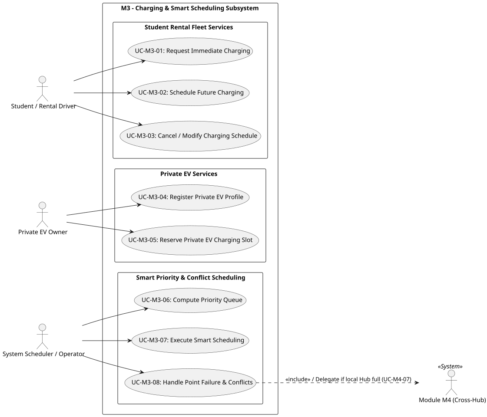
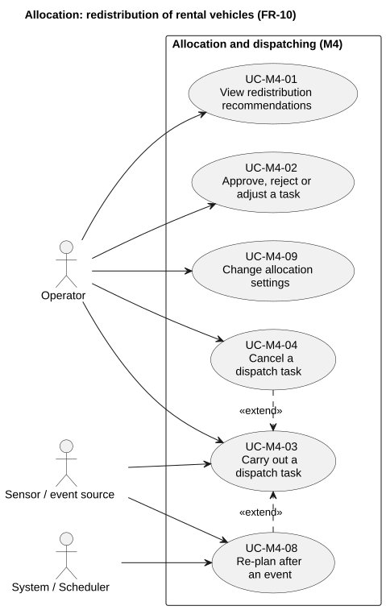
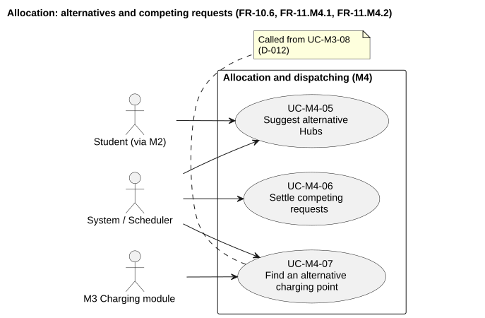

# 2. Requirements Analysis

<!-- BEGIN M2: Reservation & Trip -->
## M2 contribution - Reservation & Trip

> Author: 2452620 Đặng Tuấn Kiệt. Date: 2026-11-04. **Proposed for team review**.
> This section records the intended M2 requirements. The [implemented subset and deviations](08-implementation.md#44-deviations-and-implementation-limitations) are tracked separately.

### Actors, goals and scope

The Student searches for fleet vehicles, reserves an immediate pickup, starts a trip and returns to an accepting Mobility Hub. A Private EV Owner is a Student role that reserves parking, arrives and departs without creating a rental Trip. Operator is an external actor for incident recovery; the simulated sensor/event source crosses the boundary through Core. Internal modules and the expiry scheduler are implementation components, not use-case actors.

M2 covers FR-02 (search and battery/availability), FR-03 (reserve/cancel), FR-04 (pickup/return), FR-05 (parking), and FR-07's private-parking slice. M3 owns charging and private charging-profile registration. Core owns shared resource state. Allocation supplies advisory alternatives and resource priorities; Monitoring owns incident handling; UI presents user actions and authoritative results. Payment, fines, GPS, route planning and physical hardware operation are excluded.

### Functional requirements and use cases

The [M2 requirements baseline](../requirements/fr-02-05-07-reservation.md) is authoritative for input/output contracts, acceptance criteria (§4), business rules (§5) and complete use-case specifications (§6). It supplies the missing M2 Phase 0 foundation specifically for Phase 1 review.

| Requirement | Student goal / use cases | Observable acceptance outcome |
|---|---|---|
| FR-02 | UC-M2-01 Find suitable vehicles | Filtered fleet candidates with battery/state/as_of; invalid inputs rejected; empty results and alternatives explained |
| FR-03 | UC-M2-02 Reserve; UC-M2-03 Cancel | One exclusive ten-minute hold, concurrency/quota checks, owner-only cancellation before pickup |
| FR-04 | UC-M2-04 Pick up; UC-M2-05 Return | Exactly one Trip, atomic origin release/destination occupancy; failed return keeps Trip open |
| FR-05 | UC-M2-06 Reserve parking; UC-M2-07 Cancel; UC-M2-08 Arrive/depart; UC-M2-05 consumes rental return hold | Exclusive interval/space claim and no overcapacity; expiry/cancellation never erases actual occupancy |
| FR-07 parking | UC-M2-06/07/08 with private ownership | Private profile validated, no rental Trip, joint bay/charger confirmation counts one space |

Editable PlantUML sources accompany each SVG. These scoped diagrams feed the [draft system overview](../requirements/use-case-diagrams/uc-overview.svg). The [actor analysis](../requirements/stakeholder-actor-analysis.md) records current participation and UI-view overlap. The overview groups module goals; the actor analysis specifies individual participation.

### Business constraints and parameter rationale

The **canonical parameter register is baseline §3**. The proposed rental is immediate with a ten-minute hold and zero grace: M2 allows pickup only at `t < hold_expires_at`; equality means expiry. Each student may hold one live rental and one live parking reservation. Rental confirmation does not automatically reserve a destination space; an Active renter may separately request a ten-minute immediate return-space hold.

Private parking can start within 24 hours, with a default two-hour stay (30..240 minutes), and arrival in `[start,start+10 min)`. Intervals use half-open overlap rules; actual occupancy overrides calendar optimism. Overstay keeps occupancy and triggers monitoring instead of an automatic release. A rental's planned duration defaults to 30 minutes (5..120); expected return is calculated at actual pickup. M5's overdue condition is strictly more than 60 minutes beyond that time, without fines or forced completion.

Rental minimum battery is proposed at 20%, distinct from M5's <=15% rental-pool lockout and <=15% low-battery incident, M3's <=15% charging urgency and M6's <20% depletion metric. UTC storage/ICT display follows D-005; server time at the serialized command boundary is authoritative.

The rules prioritize consistency over pretending that future arrivals or departures are certain. A charging point requires its associated parking bay; one vehicle is counted once. M3 urgency reorders eligible waiting requests, never takes a confirmed student's resource. RedistributionTask and student Reservation share the released Core ResourceClaim mechanism (D-017) while retaining separate ownership and lifecycles.

### Quality requirements and traceability

This design addresses NFR-06/07/08/09 (uniqueness, capacity, valid transitions, atomicity), NFR-12/13 (simulation isolation/determinism), NFR-16/18 (authorization/validation), NFR-21/22 (clear errors/module boundaries), and NFR-25/26 (audit/traceability). NFR-02/03 latency remain implementation/measurement targets, not demonstrated results.

Baseline §9 provides FR -> UC -> BR -> diagram -> V-M2 scenario traceability, with equivalence partitions, boundary values, race conditions, retries, failures, shared bays and simulation isolation. The [M2 test catalog](../testing/test-cases/reservation.md) maps the implemented rental service, API and demand provider to TC-M2-001 through TC-M2-026 and records execution evidence. UC-M2/BR-M2 identifiers are stable; retired BR numbers are not reused.

<!-- END M2: Reservation & Trip -->

<!-- BEGIN M3: Charging & Smart Scheduling -->

## M3 contribution - Charging & Smart Scheduling

> **Author:** Võ Thanh An (M3)  
> **Date:** 2026-11-17 (revised to match the Phase 3 implementation)  
> **Status:** Revised after implementation; open items are listed in `docs/report/08-implementation.md` §4.4

---

### Problem Analysis & Operational Needs

The charging infrastructure at Mobility Hubs faces two primary engineering challenges: **operational disruptions caused by resource contention** and **the risk of local electrical grid overload** during peak hours. The requirements analysis for Module M3 addresses these technical bottlenecks through three core dimensions:

1. **User Demographics & Access Control (Fleet vs. Private):**
   Internal rental electric vehicles serving students require immediate, plug-and-play charging (`FR-06.1`) to optimize vehicle turnaround time. Conversely, private EV owners (`FR-07.M3`) demand guaranteed access and reserved power slots (`FR-07.M3.2`). Failing to separate these user models creates queuing congestion that disrupts fleet availability.

2. **Hardware Interoperability & Safety Interlocks:**
   Private EVs feature diverse connector standards (CCS2, Type 2), battery capacities, and maximum C-rates. Without a registration mechanism (`FR-07.M3.1`) that stores these parameters with the owner, connecting an incompatible vehicle risks equipment damage or circuit breaker trips. M3 therefore registers each private vehicle with its connector type, battery capacity and owner before it can request a slot.

3. **Grid Capacity Limits & Dynamic Scheduling Algorithms:**
   Traditional First-Come, First-Served (FCFS) queuing fails in EV charging environments: a vehicle at 80% SoC should not block a port required by a vehicle at 5% SoC needed for an upcoming trip. Consequently, requirements `FR-11.M3.1` and `FR-11.M3.2` replace FCFS with dynamic priority ranking and earliest-slot binding.

---

### Requirements Rationale & Structural Mapping

#### 1. Session Control Requirements (`FR-06`, `FR-07`)

- **Risk of Omission:** Allowing users to occupy charging bays indefinitely without validation or time bounds leads to stalled sessions (fully charged vehicles remaining plugged in).
- **Analytical Resolution:** `FR-06.3` lets the owner (or an operator) modify a `SCHEDULED` request to a new time slot, or cancel a `SCHEDULED` or `QUEUED` request. A modification must start no earlier than the current time and needs a free bay for the new slot; a cancellation releases the bay and vehicle claims immediately, so unused capacity returns to the available Hub pool (`AVAILABLE`). A minimum notice period for modify/cancel is not enforced in the current implementation (see §4.4 of the implementation report).

#### 2. Planning & Conflict Resolution Requirements (`FR-11`)

- **Risk of Omission:** When a charging point becomes unavailable (`OUT_OF_SERVICE` or `MAINTENANCE`), failing to trigger automated reassignment (`FR-11.M3.3`) stalls active sessions and breaks the downstream travel schedule.
- **Analytical Resolution:** M3 subscribes to the Core event `ChargingPointStatusChanged`. For each affected request it interrupts the charging session, releases its claims, and resubmits it so that it is rebound through the fallback cascade (local bay $\rightarrow$ later time window $\rightarrow$ cross-Hub via M4).

---

### Requirements Traceability & Behavioral Mapping

Functional requirements are mapped to the system's Use-Case architecture to ensure complete coverage:

- **Traceability Matrix:**

| Requirement (FR) | Solved Technical Problem                                        | Mapped Use Case | Enforced Business Rule (BR)                                   |
| :--------------- | :-------------------------------------------------------------- | :-------------- | :------------------------------------------------------------ |
| **FR-06.1**      | Immediate session initialization for returned rental EVs.       | `UC-M3-01`      | `BR-M3-01` (Port availability verification)                   |
| **FR-06.2**      | Mitigating peak-hour station congestion via advance scheduling. | `UC-M3-02`      | `BR-M3-01` (Future capacity reservation through claims)       |
| **FR-06.3**      | Preventing power capacity waste when travel plans change.       | `UC-M3-03`      | N/A (Releasing allocated claims)                              |
| **FR-07.M3.1**   | Recording connector type, capacity and owner of a private EV.   | `UC-M3-04`      | N/A (Persisting vehicle specs through Core)                   |
| **FR-07.M3.2**   | Reserving a charging slot for a registered private EV.          | `UC-M3-05`      | `BR-M3-01` (Securing the bay for the requested interval)      |
| **FR-11.M3.1**   | Overcoming FCFS limitations; prioritizing depleted batteries.   | `UC-M3-06`      | `BR-M3-03` (Priority ranking and low-battery override)        |
| **FR-11.M3.2**   | Using free capacity: binding waiting requests to the earliest slot. | `UC-M3-07`  | `BR-M3-03` (Requests are bound in priority order)             |
| **FR-11.M3.3**   | Ensuring high availability during charging-point failures.      | `UC-M3-08`      | `BR-M3-02` (Fallback reallocation, see below)                 |

---

### Analysis of Business Rules Rationale

#### BR-M3-01: Port Approval & Faulty Equipment Isolation

- **Analytical Rationale:** From an electrical safety standpoint, a bay that is `OUT_OF_SERVICE` or in `MAINTENANCE` must never receive a new session. `BR-M3-01` excludes such bays from the bay search, so the scheduler only considers available bays whose interval is free of other claims (Core `ResourceClaim`, D-017). The vehicle must also not hold an overlapping claim.

#### BR-M3-02: Tiered Conflict Resolution Strategy (Fallback Cascade)

- **Analytical Rationale:** Station overload cannot be resolved through outright service rejection. The fallback mechanism escalates operational costs progressively:
  1. _Local Port Swap (Zero transit cost):_ Binding the request to another free bay at the same Hub for the requested time.
  2. _Time Window Shift (Low operational impact):_ Trying later start times every 15 minutes for up to 2 hours. If no slot exists, the request stays `QUEUED` and `optimize_queue` (`UC-M3-07`) retries it when capacity is freed.
  3. _M4 Delegation (High cost - physical vehicle relocation):_ When the current Hub has no slot within the window, `optimize_queue` asks M4 (`ALTERNATIVE_CHARGING`, `UC-M4-07`) for another Hub. M4 only suggests; M3 checks the suggested bay again and binds the request there as `SCHEDULED`. If M4 finds nothing or is not available, the request stays `QUEUED`.

#### BR-M3-03: Dynamic Priority Ranking & Low Battery Override

- **Analytical Rationale:** Queued requests are ordered by (1) the emergency flag, (2) whether the vehicle has a booking at that Hub within the next hour (from the `RESERVATION_DEMAND` port), (3) the lowest current SoC, (4) the earliest request time. If the reservation port returns an error, M3 falls back to the battery-only order instead of failing.
- **Emergency Override Threshold:** A request is an emergency when SoC $\le$ the configured low-battery threshold (15%, `LOW_BATTERY_THRESHOLD`). Deep discharge risk grows sharply below this level, so these requests go to the front of the queue.

---

### Quality Attribute Trade-offs

- **Performance vs. Complexity (NFR-04):** Ranking the queue is a single sort, $\mathcal{O}(N \log N)$, with at most one reservation-port call per Hub, so recomputing it stays well inside the 5-second target.
- **Consistency vs. Throughput (NFR-08/09):** Each queued request is bound in its own unit of work. A failure on one request leaves the others unchanged, and a commit never leaves half-placed claims, at the cost of one commit per request.
- **Safety:** Cutting power to a faulty socket (relay trip) belongs to M5 (`BR-M5-03`). M3 reacts to the resulting status event and moves the affected sessions.
- **Authorization (NFR-16):** Students act only on their own requests and sessions; queue, demand and optimize endpoints require the operator role.
<!-- END M3: Charging & Smart Scheduling -->

<!-- BEGIN M4: Resource Allocation & Dispatching -->
## M4 contribution - Resource Allocation & Dispatching

> Author: 2412466 Huỳnh Minh Nhật. Date: 2026-10-22. **Proposed for team review**.
> This section contains only M4's contribution (FR-10 and the allocation side of FR-11).

### Actors, goals and scope

The **Operator** keeps every Hub supplied with vehicles and free parking: the operator reviews recommended moves, approves or rejects them and confirms pick-up and return. The **Student** never calls allocation directly; the reservation module asks for alternative Hubs on the student's behalf. The **System / Scheduler** settles competing requests and re-plans after events. The **Sensor / event source** (simulated by `iot_sim`) reports movements and failures. The **Charging module (M3)** asks for an alternative charging point when a Hub has none free.

Out of scope for this module: reservations (M2), charging sessions and the handling of a failed charging point (M3, D-012), incidents (M5), what-if simulation (M6), route planning and payment. Staff move the vehicles in real life; the system records it.

### Functional requirements and use cases

The [M4 requirements file](../requirements/fr-10-11-allocation.md) is authoritative for the requirement text, the eight business rules (BR-M4-01 to BR-M4-06, BR-M4-08 and BR-M4-10; the other numbers are not used) and the nine use-case specifications.

| Requirement | Goal / use cases | Observable outcome |
|---|---|---|
| FR-10.1 to FR-10.3 | UC-M4-01 View redistribution recommendations | Hub balance and a list of dispatch tasks with quantity, priority and reason |
| FR-10.4, FR-10.5 | UC-M4-02 Approve, reject or adjust; UC-M4-03 Carry out; UC-M4-04 Cancel | Vehicle and destination space held atomically, or nothing held; everything released on cancel or failure |
| FR-10.6 | UC-M4-05 Suggest alternative Hubs | Ranked Hubs, or a reason code when none qualifies |
| FR-10.7 | UC-M4-08 Re-plan after an event | Task list matches the new state; no duplicate tasks |
| FR-11.M4.1 | UC-M4-06 Settle competing requests | Exactly one request gets the resource; others get a reason |
| FR-11.M4.2 | UC-M4-07 Find an alternative charging point | Alternative Hub or bay for requests displaced in UC-M3-08 |
| FR-11.M4.3 | UC-M4-02, UC-M4-03 | Capacity is never exceeded |

### Business rules and constraints

The central rule is BR-M4-01, the priority order between classes of requests (operator incident order, confirmed reservation soon, vehicle that must return, charging, rebalancing, walk-in); inside the charging class M3's BR-M3-03 decides. The other rules protect shared resources: a confirmed reservation is never cancelled for a lower class (BR-M4-02), only suitable vehicles are moved (BR-M4-03), the destination space is held first (BR-M4-04), the source keeps a safety stock (BR-M4-05), one vehicle cannot be in two overlapping claims (core rule BR-M1-01), and a task follows a fixed life cycle (BR-M4-08).

### Quality requirements and traceability

Relevant quality requirements are NFR-04 (network plan within 5 s), NFR-06 (no double allocation), NFR-07 (capacity), NFR-08 and NFR-09 (valid and atomic changes), NFR-13 (same input, same result) and NFR-25 (logging). Each use case carries a `Trace:` line to its requirements and rules, and each rule carries the requirements that cite it.

### Evidence, uncertainties and review ownership

Rule IDs and use-case IDs follow D-011. Key interface and architectural uncertainties were settled with the release of Core API spec v1.0 and decisions D-016, D-017 and D-020: provider ports (`ReservationDemand`, `ChargingDemand`, `AlternativeHubProvider`, `AlternativeChargingProvider`), dispatch claims (`HolderKind.DISPATCH_TASK`), and the vehicle transition lifecycle. Full traceability between requirements, business rules and test cases is maintained in `docs/requirements/fr-10-11-allocation.md`.
<!-- END M4: Resource Allocation & Dispatching -->

<!-- BEGIN M5: Monitoring & Incident Handling -->
## M5 contribution - Monitoring & Incident Handling

> Author: 2453413 Đỗ Hoàng Việt. Date: 2026-11-06. **Proposed for team review**.

### Stakeholders and System Actors

*(Consolidated by M2 from module specifications)*

---

### Functional Requirements

#### Monitoring & Incident Handling (Module M5 — Đỗ Hoàng Việt)

- **FR-08: System Monitoring**
  - **FR-08.1 (Real-Time Resource Tracking):** Ingests verified domain events emitted by Core (`ChargingPointStatusChanged`, `VehicleBatteryChanged`, `SpaceOccupancyChanged`, `SensorEventRejected`, `SensorHeartbeat`) covering vehicle states, battery percentages ($SoC\%$), space occupancy, and equipment health.
  - **FR-08.2 (Utilization & Metrics Computation):** Computes real-time capacity ratios (parking occupancy %, charger utilization %) and fleet availability metrics per Hub.
  - **FR-08.3 (Capacity Warning & Alerting):** Automatically flags Hubs approaching or exceeding warning thresholds ($\ge 90\%$) and raises visual alerts on the Operator Dashboard.
  - **FR-08.4 (Network State Synchronization):** Evaluates Hub operational health and records state changes into the core domain store using `core.set_hub_status()`.

- **FR-09: Operational Incident Handling**
  - **FR-09.1 (Automated Incident Detection):** Identifies equipment malfunctions, telemetry timeouts (> 30s heartbeat loss), rejected sensor anomalies, and resource capacity overflows from domain event signals.
  - **FR-09.2 (Classification & Ticket Instantiation):** Maps incidents to standardized taxonomy codes (`INC-HW-01`, `INC-HW-02`, `INC-CAP-01`, `INC-CAP-02`, `INC-BAT-01`, `INC-COMM-01`, `INC-USR-01`), assesses severity (`LOW`, `MEDIUM`, `HIGH`, `CRITICAL`), and creates tickets with status `OPEN`.
  - **FR-09.3 (Automated Safety Interlocks):** Executes immediate protective interlocks (cuts power to faulty charging sockets, locks out depleted vehicles $\le 15\%$ from the rental pool).
  - **FR-09.4 (Incident Lifecycle Tracking):** Manages ticket transitions through `OPEN` $\rightarrow$ `IN_PROGRESS` $\rightarrow$ `ESCALATED` $\rightarrow$ `RESOLVED` $\rightarrow$ `CLOSED` with complete audit trail logging (`NFR-25`).

---

### Non-Functional Requirements

*(Consolidated by M1 in `docs/requirements/nfr.md`)*

---

### Business Rules & Constraints

#### Monitoring & Escalation Rules (Module M5)

- **`BR-M5-01` (Capacity Warning Threshold):** When a Hub's parking occupancy reaches $\ge 90\%$, the system sets the Hub status to `WARNING` and dispatches a notification to the operator console.  
  *Trace: FR-08.3, NFR-01, NFR-20*
- **`BR-M5-02` (Critical Capacity Overflow):** When a Hub reaches $100\%$ capacity (`INC-CAP-01`), the system sets Hub status to `CRITICAL`, blocks incoming return bookings, and suggests nearby alternative Hubs.  
  *Trace: FR-08.3, FR-09.1, BR-M1-02*
- **`BR-M5-03` (Charger Fault Isolation):** Upon detecting a charger electrical or hardware fault (`INC-HW-01`), the system immediately trips the socket relay, sets port state to `OUT_OF_SERVICE`, generates a critical ticket, and notifies M3 (`UC-M3-08`) to reassign interrupted charging sessions.  
  *Trace: FR-09.1, FR-09.3, BR-M3-02, NFR-10*
- **`BR-M5-04` (Unacknowledged Incident Escalation):** If an incident with severity `HIGH` or `CRITICAL` remains unacknowledged (`Status = OPEN`) by an operator for $> 5$ minutes, the system automatically transitions the ticket to `ESCALATED` and alerts the Duty Supervisor.  
  *Trace: FR-09.2, FR-09.4, NFR-25*
- **`BR-M5-05` (Low Battery Lockout):** Any vehicle reporting battery level $\le 15\%$ is immediately removed from the active rental pool and given top priority in the smart charging queue.  
  *Trace: FR-09.3, BR-M3-03, BR-M1-03*

---

### Use-Case Modeling

#### Module M5 Use Cases

##### UC-M5-01: Monitor Mobility Hub Network Status
- **Actor:** System Operator (Primary), IoT Sensor (Secondary)
- **Description:** Allows operators to oversee network-wide resource utilization, inspect granular Hub metrics, and monitor capacity alerts.
- **Trace:** `FR-08.1`, `FR-08.2`, `FR-08.3`, `FR-08.4`; `BR-M5-01`, `BR-M5-02`

##### UC-M5-02: Process and Resolve Operational Incident
- **Actor:** System Operator (Primary), Duty Supervisor, Field Technician
- **Description:** Manages the full incident lifecycle from automated detection and safety isolation to operator triage, remote soft-reset or technician dispatch, and verified ticket closure.
- **Trace:** `FR-09.1`, `FR-09.2`, `FR-09.3`, `FR-09.4`; `BR-M5-03`, `BR-M5-04`, `BR-M5-05`
<!-- END M5: Monitoring & Incident Handling -->
