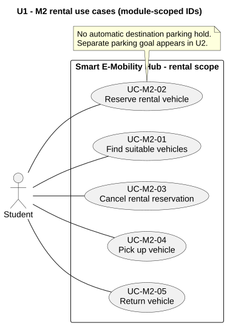
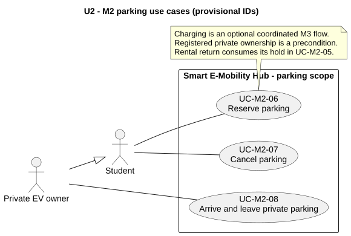

# 2. Requirements Analysis

<!-- BEGIN M2: Reservation & Trip -->
## M2 contribution - Reservation & Trip

> Author: 2452620 Đặng Tuấn Kiệt. Date: 2026-10-11. **Proposed for team review**.
> This section contains only M2's contribution. Other modules' requirements and the consolidated system-wide Phase 0 artifacts are not claimed complete.

### Actors, goals and scope

The Student searches for fleet vehicles, reserves an immediate pickup, starts a trip and returns to an accepting Mobility Hub. A Private EV Owner is a Student role that reserves parking, arrives and departs without creating a rental Trip. Operator is an external actor for incident recovery; the simulated sensor/event source crosses the boundary through Core. Internal modules and the expiry scheduler are implementation components, not use-case actors.

M2 covers FR-02 (search and battery/availability), FR-03 (reserve/cancel), FR-04 (pickup/return), FR-05 (parking), and FR-07's private-parking slice. M3 owns charging and private charging-profile registration. Core owns shared resource state. Allocation supplies advisory alternatives and resource priorities; Monitoring owns incident handling; UI presents user actions and authoritative results. Payment, fines, GPS, route planning and physical hardware operation are excluded.

### Functional requirements and use cases

The [M2 requirements baseline](../requirements/fr-02-05-07-reservation.md) is authoritative for input/output contracts, acceptance criteria (§4), business rules (§5) and complete use-case specifications (§6). It supplies the missing M2 Phase 0 foundation specifically for Phase 1 review.

| Requirement | Student goal / use cases | Observable acceptance outcome |
|---|---|---|
| FR-02 | UC-M2-01 Find suitable vehicles | Filtered fleet candidates with battery/state/as_of; invalid inputs rejected; empty results and alternatives explained |
| FR-03 | UC-M2-02 Reserve; UC-M2-03 Cancel | One exclusive ten-minute hold, concurrency/quota checks, owner-only cancellation before pickup |
| FR-04 | UC-M2-04 Pick up; UC-M2-05 Return | Exactly one Trip, atomic origin release/destination occupancy; failed return keeps Trip open |
| FR-05 | UC-M2-06 Reserve parking; UC-M2-07 Cancel; UC-M2-08 Arrive/depart; UC-M2-05 consumes rental return hold | Exclusive interval/space claim and no overcapacity; expiry/cancellation never erases actual occupancy |
| FR-07 parking | UC-M2-06/07/08 with private ownership | Private profile validated, no rental Trip, joint bay/charger confirmation counts one space |

Editable PlantUML sources accompany each SVG. These scoped diagrams feed the [draft system overview](../requirements/use-case-diagrams/uc-overview.svg). The [actor analysis](../requirements/stakeholder-actor-analysis.md) records current participation and UI-view overlap. Final reconciliation awaits M3/M5/M6 diagrams by Oct 25 under the open timeline PR #15.

### Business constraints and parameter rationale

The **canonical parameter register is baseline §3**. The proposed rental is immediate with a ten-minute hold and zero grace: Core allows pickup only at `t < hold_expires_at`; equality means expiry. Each student may hold one live rental and one live parking reservation. Rental confirmation does not automatically reserve a destination space; an Active renter may separately request a ten-minute immediate return-space hold.

Private parking can start within 24 hours, with a default two-hour stay (30..240 minutes), and arrival in `[start,start+10 min)`. Intervals use half-open overlap rules; actual occupancy overrides calendar optimism. Overstay keeps occupancy and triggers monitoring instead of an automatic release. A rental's planned duration defaults to 30 minutes (5..120); expected return is calculated at actual pickup. M5's overdue condition is strictly more than 60 minutes beyond that time, without fines or forced completion.

Rental minimum battery is proposed at 20%, distinct from M5's <=15% rental-pool lockout and <=10% critical incident, M3's <=15% charging urgency and M6's <20% depletion metric. UTC storage/ICT display follows proposed D-005; server time at the serialized command boundary is authoritative.

The rules prioritize consistency over pretending that future arrivals or departures are certain. A charging point requires its associated parking bay; one vehicle is counted once. M3 urgency reorders eligible waiting requests, never takes a confirmed student's resource. RedistributionTask and student Reservation share a proposed Core claim mechanism while retaining separate ownership and lifecycles.

### Quality requirements and traceability

This design addresses draft NFR-06/07/08/09 (uniqueness, capacity, valid transitions, atomicity), NFR-12/13 (simulation isolation/determinism), NFR-16/18 (authorization/validation), NFR-21/22 (clear errors/module boundaries), and NFR-25/26 (audit/traceability). NFR-02/03 latency and NFR-19 usability remain implementation/measurement targets, not demonstrated results.

Baseline §9 provides FR -> UC -> BR -> diagram -> V-M2 scenario traceability, with equivalence partitions, boundary values, race conditions, retries, failures, shared bays and simulation isolation. M8 assigns official TC IDs and execution evidence later. Provisional UC-M2/BR-M2 labels avoid clashes with unmerged branches; suggested numeric mappings need team confirmation.

### Evidence, uncertainties and review ownership

Exact branch/commit/PR provenance and the dependency comparison table are in baseline §§1-2. PRs #1/#5 are approved but open; #7/#8/#9/#10 are open without human approval at inspection. No published Core API/class/Vehicle-state document was found. D-002/003/005/007 remain Proposed. M1/M3/M4/M5/M7 must agree the contract/data changes before implementation, and M7 is M2's designated reviewer. This report does not alter their sources or approve their assumptions.
<!-- END M2: Reservation & Trip -->
