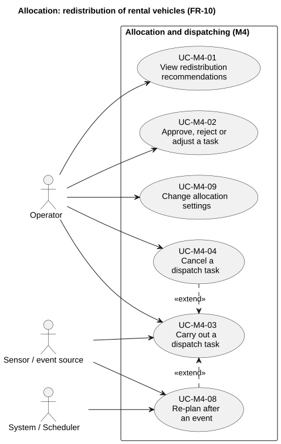
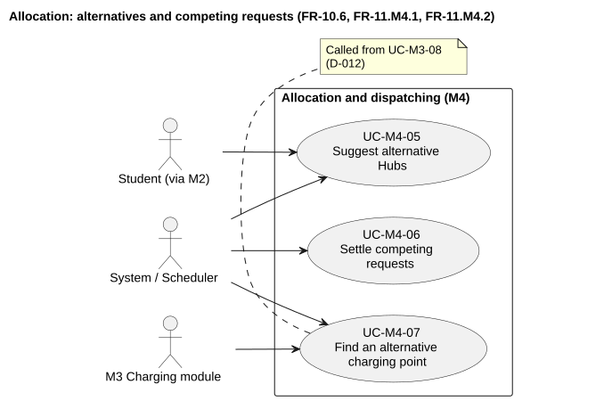

# 2. Requirements Analysis

<!-- BEGIN M4: Resource Allocation & Dispatching -->
## M4 contribution - Resource Allocation & Dispatching

> Author: 2412466 Huỳnh Minh Nhật. Date: 2026-10-22. **Proposed for team review**.
> This section contains only M4's contribution (FR-10 and the allocation side of FR-11).

### Actors, goals and scope

The **Operator** keeps every Hub supplied with vehicles and free parking: the operator reviews recommended moves, approves or rejects them and confirms pick-up and return. The **Student** never calls allocation directly; the reservation module asks for alternative Hubs on the student's behalf. The **System / Scheduler** settles competing requests and re-plans after events. The **Sensor / event source** (simulated by `iot_sim`) reports movements and failures. The **Charging module (M3)** asks for an alternative charging point when a Hub has none free.

Out of scope for this module: reservations (M2), charging sessions and the handling of a failed charging point (M3, D-012), incidents (M5), what-if simulation (M6), route planning and payment. Staff move the vehicles in real life; the system records it.

### Functional requirements and use cases

The [M4 requirements file](../requirements/fr-10-11-allocation.md) is authoritative for the requirement text, the 12 business rules (BR-M4-01 to BR-M4-12) and the nine use-case specifications.

| Requirement | Goal / use cases | Observable outcome |
|---|---|---|
| FR-10.1 to FR-10.3 | UC-M4-01 View redistribution recommendations | Hub balance and a list of dispatch tasks with quantity, priority and reason |
| FR-10.4, FR-10.5 | UC-M4-02 Approve, reject or adjust; UC-M4-03 Carry out; UC-M4-04 Cancel | Vehicle and destination space held atomically, or nothing held; everything released on cancel or failure |
| FR-10.6 | UC-M4-05 Suggest alternative Hubs | Ranked Hubs, or a reason code when none qualifies |
| FR-10.7 | UC-M4-08 Re-plan after an event | Task list matches the new state; no duplicate tasks |
| FR-11.M4.1 | UC-M4-06 Settle competing requests | Exactly one request gets the resource; others get a reason |
| FR-11.M4.2 | UC-M4-07 Find an alternative charging point | Alternative Hub or bay for requests displaced in UC-M3-08 |
| FR-11.M4.3 | UC-M4-02, UC-M4-03 | Capacity is never exceeded |

### Business rules and constraints

The central rule is BR-M4-01, the priority order between classes of requests (operator incident order, confirmed reservation soon, vehicle that must return, charging, rebalancing, walk-in); inside the charging class M3's BR-M3-03 decides. The other rules protect shared resources: a confirmed reservation is never cancelled for a lower class (BR-M4-02), only suitable vehicles are moved (BR-M4-03), the destination space is held first (BR-M4-04), the source keeps a safety stock (BR-M4-05), one vehicle belongs to one active task (BR-M4-07), and a task follows a fixed life cycle (BR-M4-08).

### Quality requirements and traceability

Relevant quality requirements are NFR-04 (network plan within 5 s), NFR-06 (no double allocation), NFR-07 (capacity), NFR-08 and NFR-09 (valid and atomic changes), NFR-13 (same input, same result) and NFR-25 (logging). Each use case carries a `Trace:` line to its requirements and rules, and each rule carries the requirements that cite it.

### Evidence, uncertainties and review ownership

Items that are not decided yet are listed in section 6 of the requirements file. The main ones are the public interface to M2 and M3 (Core API spec v1, M1) and whether a rebalance move can be a system reservation of M2. Rule IDs and use-case IDs follow D-011.
<!-- END M4: Resource Allocation & Dispatching -->
