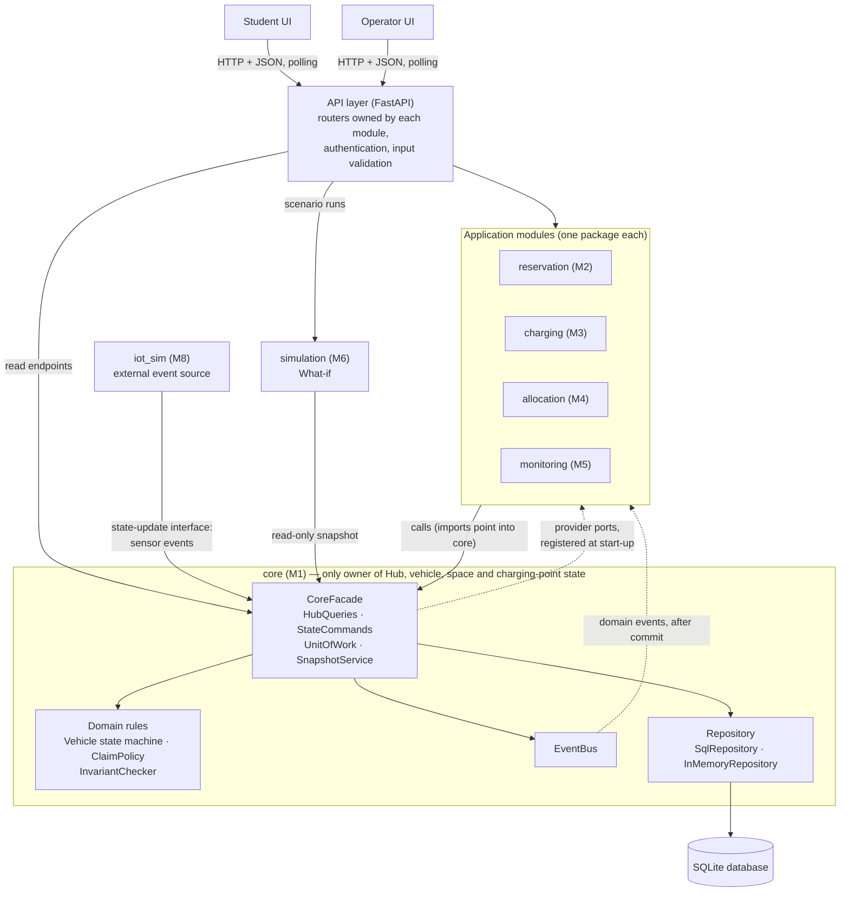

# 3. System Design

## 3.1 Software Architecture

> **Status:** v1.0 · **Owner:** M1 · **Date:** 2026-11-04
> The full tables and runtime flows are in `docs/design/architecture/architecture-diagram.md`. Decision IDs (`D-xxx`), assumptions (`A-xx`) and requirement IDs refer to `docs/DECISIONS.md` and `docs/requirements/`.

### 3.1.1 Overview

The system is a **modular monolith**: one process in which each capability is a separate module with its own folder, and one module, `core`, owns the state of every shared resource (Hubs, parking spaces, charging points, vehicles). The other modules never change that state themselves; they ask `core`, and `core` checks the business rules before it accepts the change (D-003).

*Figure 3.1 — Component diagram. Solid arrows are calls, dashed arrows go from `core` to a module without an import (events and registered ports).*

### 3.1.2 Responsibilities of the components

| Component | Responsibility |
|---|---|
| `ui` (M7) | Student and operator screens. Shows what the API returns and sends user actions; holds no business rule. |
| API layer | HTTP endpoints, authentication and roles (NFR-16), input validation (NFR-18). |
| `core` (M1) | State of Hubs, vehicles, parking spaces and charging points; interval claims on them; the Vehicle state machine; capacity, uniqueness and valid-transition rules (`BR-M1-01` to `BR-M1-03`); atomic multi-entity operations; the state-change log; events; the snapshot for the What-if Simulation. |
| `reservation` (M2) | Rental and parking reservations, trips, hold and expiry, student limits. |
| `charging` (M3) | Charging requests, queue and schedule, priority inside the charging class, handling of a failed charging point. |
| `allocation` (M4) | Priority between request classes, redistribution tasks, alternative Hub and bay lookup. |
| `monitoring` (M5) | Hub utilization and status, incident detection, lifecycle and escalation. |
| `simulation` (M6) | What-if scenarios on a copy of the state, impact metrics, coordination recommendations. |
| `iot_sim` (M8) | Seed data and the simulated sensor feed; outside the system boundary (D-004). |

### 3.1.3 How the components communicate and depend on each other

- **Calls into `core`.** M2 to M5 and the API layer call `CoreFacade` for reads, commands and units of work. Every import points into `core`; `core` imports no module (NFR-22). An import-boundary test in CI checks it.
- **Domain events.** After a change is committed, `core` publishes an event (for example `SpaceOccupancyChanged`). Charging, allocation, monitoring and reservation subscribe and react, so they do not need to import one another.
- **Provider ports.** A few calls go the other way (demand data, alternative Hubs, consuming a reservation hold). `core` defines the interface, the module registers its implementation at start-up, so the import still points into `core`.
- **Sensor events.** `iot_sim` calls the state-update interface of `core` (`apply_sensor_event`); a malformed event is rejected and logged (NFR-10).
- **Interface to the UI.** HTTP and JSON with polling. The OpenAPI schema generated from the Pydantic models is the interface document for the UI.

### 3.1.4 Where the business logic is

| Logic | Location |
|---|---|
| Valid vehicle transitions, capacity, no overlapping claims, version check | `core` |
| Student limits, hold and expiry, trip lifecycle | `reservation` |
| Charging schedule, priority inside the charging class, charging-point failure | `charging` |
| Priority between classes, redistribution plan | `allocation` |
| Hub status, incident rules | `monitoring` |
| Scenario evolution, metrics, recommendations | `simulation` |

Rules that every module relies on sit in one place, so there is one implementation and one set of tests for them. Rules that belong to one process stay in the module of that process.

### 3.1.5 Data storage and access

All persistent data is in one SQLite database accessed through SQLAlchemy (D-002). Each module owns its tables: `core` owns Hub, ParkingSpace, ChargingPoint, Vehicle, UserAccount, ResourceClaim and StateChangeRecord; M2 owns Reservation and Trip; M3 ChargingSession; M4 RedistributionTask; M5 Incident; M6 SimulationRun and CoordinationRecommendation. A module writes only its own tables directly and reaches other data through the owner's interface.

Concurrent requests are handled with optimistic locking: each core entity has a `version`, and a command with an old version fails with `VERSION_CONFLICT`. An operation that changes several entities, such as a pick-up, runs in one unit of work, which is one database transaction shared with the module tables written in the same operation. It either applies completely or not at all (NFR-06, NFR-09).

### 3.1.6 Interaction of the What-if Simulation with the operational state

The simulation never touches the operational store. It asks `core` for a snapshot, a read-only copy of all entities taken in one read transaction and carrying a version number. The simulation evolves two separate in-memory copies (baseline and with recommendations) and returns a report. Applying a recommendation is a separate operator action that goes through the responsible module and `core`. Because the same state, seed and scenario give the same output and `core` sorts the snapshot by ID, results are repeatable (NFR-12, NFR-13).

### 3.1.7 Justification, benefits and limitations

| Decision | Why it suits the project | Benefit | Limitation | Alternative considered |
|---|---|---|---|---|
| Modular monolith (D-003, A-08) | Eight people, about seven weeks, and several operations that must be atomic (NFR-09). | Simple transactions, easy to run and test from a clean clone (NFR-14). | Not physically distributed; one node limits throughput. | Microservices: rejected for coordination cost and the difficulty of atomic multi-entity operations. |
| `core` as the only owner of shared state | A vehicle, a space or a charging point must have one truth (NFR-06, NFR-07). | No two modules can disagree; rules are tested once. | Everyone depends on `core`; a defect there reaches all modules. Reduced by tests and by stubs of the API spec. | Each module keeps its own copy: rejected, copies drift. |
| In-process events after commit | Monitoring and charging must react without importing each other. | No message broker to run. | Events are not stored: one lost in a crash between commit and publish is not replayed. Subscribers re-read state when they start. | Message broker: too heavy for one deployment. |
| Optimistic locking and unit of work | No double booking under 20 to 50 simultaneous requests (NFR-06). | No lock manager, no long locks. | A caller must retry after `VERSION_CONFLICT` under heavy contention. | Pessimistic row locks: need PostgreSQL. |
| Snapshot copy for What-if | The simulation must not change real state (NFR-12). | Isolation by construction. | The copy can become stale; its version lets a later step detect that. | Copy-on-write database file: heavier. |
| SQLite, PostgreSQL as an upgrade path | Reproducible from a clean clone. | Zero-install database. | Single writer; measured against NFR-02 and NFR-03. | PostgreSQL from the start. |

The architecture is stated as a limitation, not hidden: the "distributed operational environment" of the assignment is represented by logically separated modules and Hubs inside one deployment (A-08).
