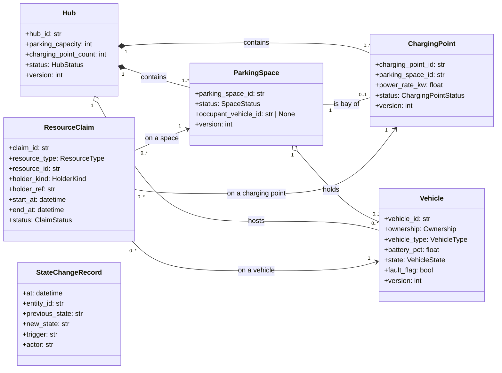
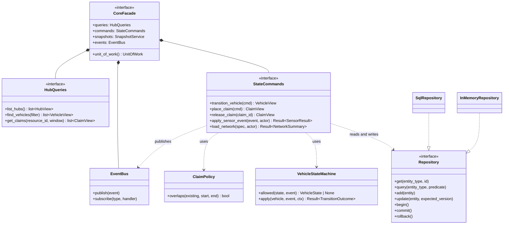
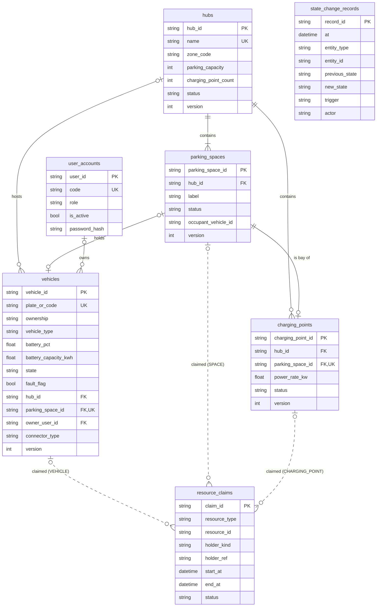
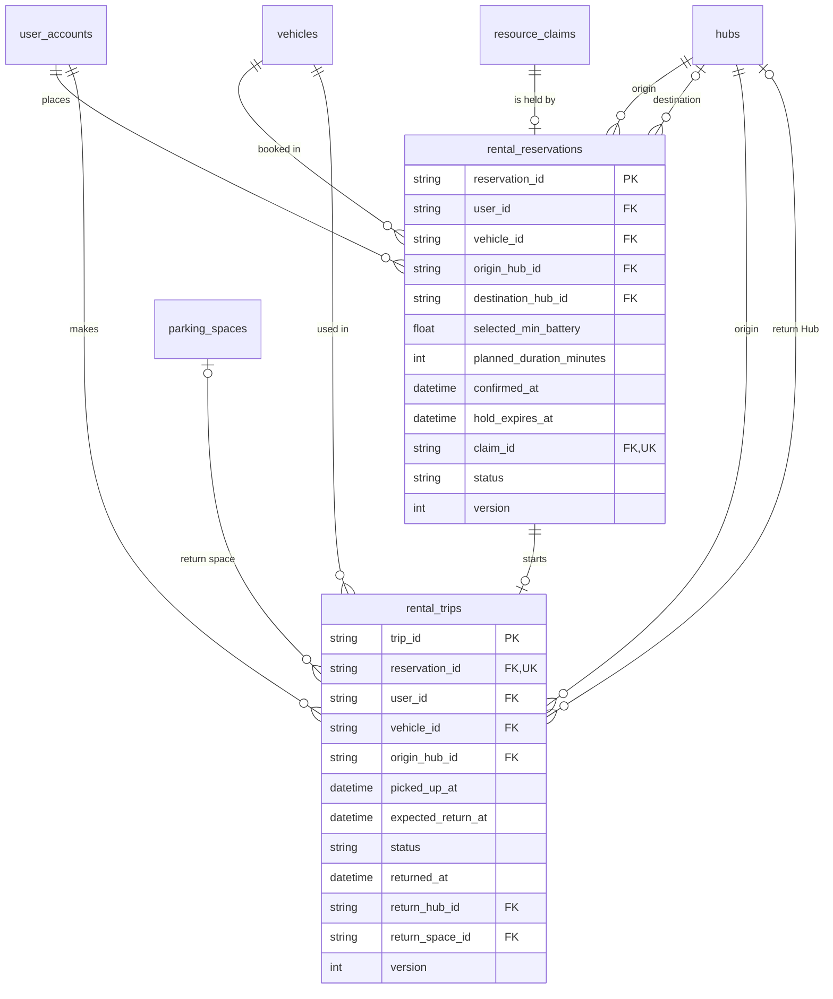
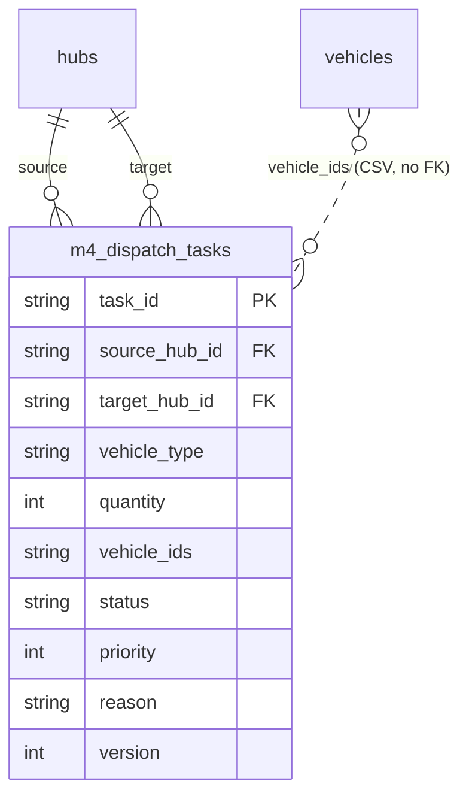
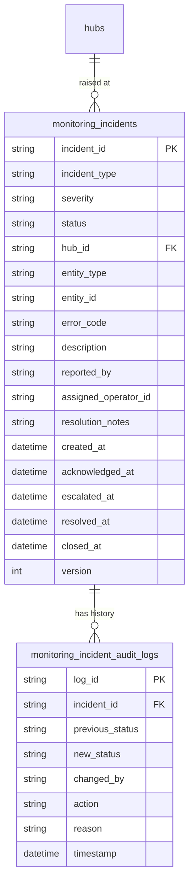

## 3.2 Structural and Data Design

> **Status:** v1.0 · **Owner:** M1 (class diagram, 3.2.1 and 3.2.3) · M7 (data model, 3.2.2) · **Date:** 2026-11-04
> The full diagrams and design notes are in `docs/design/structural/class-diagram-core.md`. Decision IDs (`D-xxx`) refer to `docs/DECISIONS.md`.

### 3.2.1 Class diagram of `core`

The class diagram shows the part of the design that every other module depends on: the domain model owned by `core` and the interfaces through which other modules use it. Reservation, ChargingSession, RedistributionTask, Incident and SimulationRun belong to M2–M6 and appear in the diagram only as references by ID.

*Figure 3.2 — Domain model of `core` (main attributes only; the full attribute list is in the design file).*

*Figure 3.3 — Services and interfaces of `core` (reduced; the full diagram adds the snapshot service, the unit of work, the clock and the invariant checker).*

**Design choices**

| Choice | Reason | Requirement |
|---|---|---|
| A future hold is a `ResourceClaim` with a time interval, separate from current occupancy on `ParkingSpace`. | "Who may use it later" and "who is there now" change at different times and need different checks. | `BR-M1-01` (claims), `BR-M1-02` (occupancy) |
| A `ChargingPoint` is attached to exactly one `ParkingSpace`, its bay. | A vehicle being charged is still parked, so separate capacities would break the Hub capacity rule (D-007). | `BR-M1-02`, NFR-07 |
| Entities carry a `version`; a command gives the version it read. | Optimistic locking prevents lost updates without long locks (D-002). | NFR-06 |
| Hub counters (occupied spaces, free spaces, charging points in use) are computed from the spaces, not stored. | A stored counter can disagree with the spaces. | NFR-07 |
| The Vehicle state machine is a transition table, not code spread over methods. | Tests can loop over every (state, event) pair. | `BR-M1-03`, NFR-08 |
| `Repository` has an SQL and an in-memory implementation. | Same domain code runs on the database and on a snapshot copy; the in-memory one is also the test double. | NFR-12 |
| Other modules see only `CoreFacade` and its view and command types. | Keeps the dependency pointing into `core`. | NFR-22 |

### 3.2.2 Data model (ERD)

The system keeps its data in one SQLite database (D-002). `core` creates the tables of the shared state, and each module registers its own tables in the same database (D-018). Table and column names are the names used in the code. The tables of the reservation, allocation and monitoring modules follow their code and may still change. The charging and simulation modules keep their data in memory and have no tables.

How to read the diagrams: `PK` is a primary key, `FK` a foreign key, `UK` a unique column. A solid line is a foreign key, a dashed line is a reference with no foreign key. `||` means exactly one, `|o` or `o|` zero or one, `|{` one or more, `o{` zero or more. The symbol next to a table says how many rows of that table relate to one row of the other. Enumerated values are listed in `docs/design/structural/erd.md`.

*Figure 3.4 — Data model of `core`.*

- A hold in the future is a row of `resource_claims`. Who is parked now is `parking_spaces.occupant_vehicle_id`. A space therefore has no `RESERVED` status and a charging point no `SCHEDULED` status.
- `resource_claims` points to a vehicle, space or charging point by `resource_type` and `resource_id`, and to the owner module by `holder_kind` and `holder_ref`. None of these is a foreign key, so `core` does not depend on the tables of the modules (D-003, D-017).
- `vehicles.hub_id` and `vehicles.parking_space_id` are both null exactly while the vehicle is `IN_USE`. `occupant_vehicle_id` has no foreign key; the foreign key is `vehicles.parking_space_id`.
- Private EVs are rows of `vehicles` with `ownership = PRIVATE` (D-016).
- Hub counters (occupied, free, charging in use, available vehicles) are computed when a Hub is read, not stored (NFR-07).
- Events are not stored. `core` publishes them in memory after a commit, and the audit trail is `state_change_records` (NFR-25). The schema also creates a table `domain_events`, but no code writes to it, so it is not drawn.

*Figure 3.5 — Tables of the reservation module (M2).*

- A reservation holds exactly one claim (`claim_id`, not null, unique). The reservation module releases the claim at pick-up.
- `PENDING` is not stored. It is a short state of the request with no record. The code stores five statuses.
- Parking reservations (FR-05, FR-07 parking side) are planned and not in the tables yet.

*Figure 3.6 — Table of the allocation module (M4).*

- `vehicle_ids` is one text column with vehicle IDs separated by commas. Normally a task and its vehicles would be a separate table with two foreign keys. The code does not do this, so the database cannot check the IDs. This is recorded as a deviation (Section 4.4).
- On approval the allocation module places claims on the vehicles and one destination space (`holder_kind = DISPATCH_TASK`, `holder_ref = task_id`).

*Figure 3.7 — Tables of the monitoring module (M5).*

- Each ticket belongs to one Hub and has an audit log with one row for each change of status.
- `entity_type` and `entity_id` name the failed component and have no foreign key. `assigned_operator_id` has no foreign key either.
- Lifecycle: `OPEN`, `IN_PROGRESS`, `RESOLVED`, `CLOSED`, and `ESCALATED` when a `HIGH` or `CRITICAL` ticket stays `OPEN` for more than 5 minutes (`BR-M5-04`).

**Design choices**

| Choice | Reason |
|---|---|
| A future hold is a claim, separate from the current occupant of a space | They change at different times and follow different rules (`BR-M1-01`, `BR-M1-02`) |
| One claim table for vehicles, spaces and charging points | The overlap rule is the same for all three, and `core` does not need to know the owner module (D-017) |
| Module tables point to `core` tables; `core` tables never point to module tables | The dependency goes into `core` (NFR-22) |
| A `version` column on the main tables | Optimistic locking prevents lost updates (D-002, NFR-06) |
| Events and What-if results are not stored | A simulation works on an in-memory copy and cannot change the real tables (NFR-12) |

**Rules the diagram does not show**

| Rule | Checked by |
|---|---|
| Foreign keys; one plate per vehicle; one label per space in a Hub; one vehicle per space; one charging point per space (D-007); battery from 0 to 100; location columns both set or both null | The database |
| A vehicle is at a Hub exactly when it is not `IN_USE`; capacity equals the number of spaces; a charging point's bay is in its own Hub | `core` (`InvariantChecker`) |
| Occupied spaces do not exceed capacity; two active claims on one resource never overlap | `core` (`InvariantChecker`) |
| Vehicle state changes follow the transition table | `core` (`VehicleStateMachine`) |

The eight entities of the class diagram (`Hub`, `ParkingSpace`, `ChargingPoint`, `Vehicle`, `ResourceClaim`, `StateChangeRecord`, `DomainEvent`, `UserAccount`) have the same attributes in the code. Seven are tables in Figure 3.4, and `DomainEvent` is a class only. The module tables were compared with their code.

*Figure numbers are provisional and are renumbered when the report is assembled.*

### 3.2.3 Consistency with the other designs

- The states of `Vehicle` are those of the state machine in 3.3 (`vehicle-state-machine.md`); the allowed transitions and their guards are defined there and nowhere else.
- Operations shown in the interfaces are the ones of `docs/design/architecture/core-api-spec.md`.
- Attributes are the ones of the tables in 3.2.2; `battery_pct` is a percentage from 0 to 100 everywhere.
- Business rules `BR-M1-01`, `BR-M1-02` and `BR-M1-03` (`docs/requirements/fr-01-core.md`) are enforced in `core` and cited by the other modules instead of being restated.
