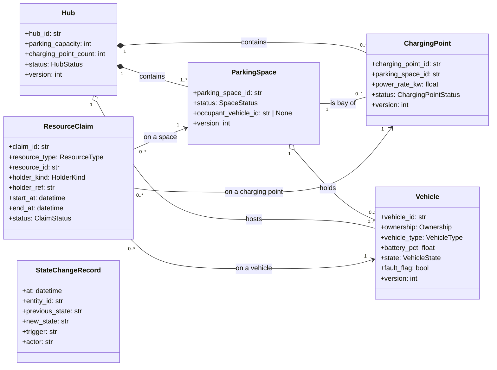

## 3.2 Structural and Data Design

> **Status:** v1.0 · **Owner:** M1 (class diagram, 3.2.1 and 3.2.3) · M7 (data model, 3.2.2) · **Date:** 2026-11-04
> The full diagrams and design notes are in `docs/design/structural/class-diagram-core.md`. Decision IDs (`D-xxx`) refer to `docs/DECISIONS.md`.

### 3.2.1 Class diagram of `core`

The class diagram shows the part of the design that every other module depends on: the domain model owned by `core` and the interfaces through which other modules use it. Reservation, ChargingSession, RedistributionTask, Incident and SimulationRun belong to M2–M6 and appear in the diagram only as references by ID.

*Figure 3.2 — Domain model of `core` (main attributes only; the full attribute list is in the design file).*

*Figure 3.3 — Services and interfaces of `core` (reduced; the full diagram adds the snapshot service, the unit of work, the clock and the invariant checker).*

**Design choices**

| Choice | Reason | Requirement |
|---|---|---|
| A future hold is a `ResourceClaim` with a time interval, separate from current occupancy on `ParkingSpace`. | "Who may use it later" and "who is there now" change at different times and need different checks. | `BR-M1-01` (claims), `BR-M1-02` (occupancy) |
| A `ChargingPoint` is attached to exactly one `ParkingSpace`, its bay. | A vehicle being charged is still parked, so separate capacities would break the Hub capacity rule (D-007). | `BR-M1-02`, NFR-07 |
| Entities carry a `version`; a command gives the version it read. | Optimistic locking prevents lost updates without long locks (D-002). | NFR-06 |
| Hub counters (occupied spaces, free spaces, charging points in use) are computed from the spaces, not stored. | A stored counter can disagree with the spaces. | NFR-07 |
| The Vehicle state machine is a transition table, not code spread over methods. | Tests can loop over every (state, event) pair. | `BR-M1-03`, NFR-08 |
| `Repository` has an SQL and an in-memory implementation. | Same domain code runs on the database and on a snapshot copy; the in-memory one is also the test double. | NFR-12 |
| Other modules see only `CoreFacade` and its view and command types. | Keeps the dependency pointing into `core`. | NFR-22 |

### 3.2.2 Data model (ERD)

The ERD is prepared by M7 and is consistent with the class diagram above: the entities of `core` map one to one to tables, and the claims and the state-change log are added as tables. The differences found between the first ERD draft and the class diagram (attribute names, the status values `RESERVED` and `SCHEDULED`, which become claims) are listed in `class-diagram-core.md` §2.1 and are applied by M7 in the final ERD.

*(M7 inserts the final ERD and its explanation here.)*

### 3.2.3 Consistency with the other designs

- The states of `Vehicle` are those of the state machine in 3.3 (`vehicle-state-machine.md`); the allowed transitions and their guards are defined there and nowhere else.
- Operations shown in the interfaces are the ones of `docs/design/architecture/core-api-spec.md`.
- Attributes are the ones of the tables in 3.2.2; `battery_pct` is a percentage from 0 to 100 everywhere.
- Business rules `BR-M1-01`, `BR-M1-02` and `BR-M1-03` (`docs/requirements/fr-01-core.md`) are enforced in `core` and cited by the other modules instead of being restated.
