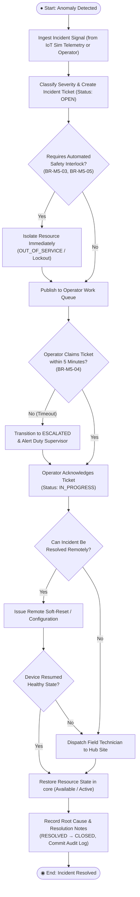
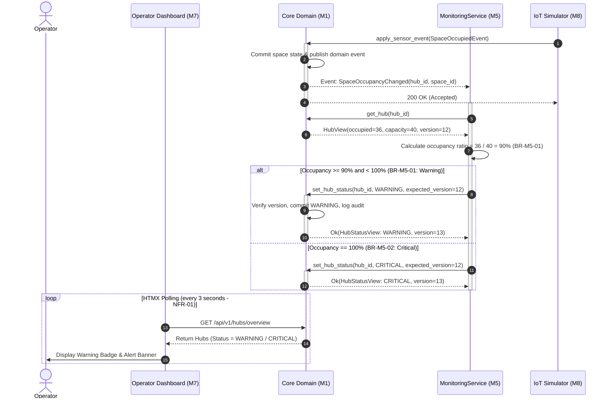

# 5. Behavioral and Interaction Design

> **Status:** Draft v1.0 · **Lead Consolidator:** Whole Team · **Owner (M5 Sections):** Đỗ Hoàng Việt  
> This document specifies the behavioral dynamics, workflow logic, and component interactions of the Smart E-Mobility Hub system using UML Activity, Sequence, and State Machine diagrams.

---

## 5.1 Activity Diagrams

### 5.1.5 Incident Handling Workflow (Module M5)

The incident management workflow (`FR-09`, `UC-M5-02`) handles automated failure ingestion, immediate safety interlocks, human triage, and resolution closure.

#### Workflow Narrative:
1. **Intake & Triage:** Fault signals arrive asynchronously from sensor dropouts or charger fault codes. The intake engine instantiates an `IncidentTicket` with status `OPEN`.
2. **Automated Interlocks (`BR-M5-03`, `BR-M5-05`):** If electrical or battery hazards are present, the system immediately cuts charger power and marks the socket `OUT_OF_SERVICE`, or locks out low-battery vehicles ($\le 15\%$) from the rental inventory.
3. **5-Minute Escalation Window (`BR-M5-04`):** For High and Critical tickets, an unacknowledged ticket remaining `OPEN` for $> 5$ minutes automatically promotes to `ESCALATED`, notifying the Duty Supervisor.
4. **Corrective Recovery:** Software/communication anomalies receive an automated remote reset. If hardware remains unresponsive, a field technician is dispatched for physical part replacement.
5. **Closure & Audit Trail (`NFR-25`):** Once verified healthy, the operator logs root cause notes, marks the ticket `RESOLVED` $\rightarrow$ `CLOSED`, and appends the entry to `TicketAuditLog`.

---

## 5.2 Sequence Diagrams

### 5.2.5 Hub Capacity Warning & Status Synchronization (Module M5)

This sequence diagram illustrates the streamlined, event-driven interaction between the telemetry intake, `monitoring` engine, `core` state store, and the Operator Dashboard when a Hub reaches capacity thresholds (`FR-08`, `UC-M5-01`, `BR-M5-01`, `BR-M5-02`).

#### Key Architecture Principles Demonstrated:
1. **Separation of Concerns:** Telemetry ingestion is decoupled from evaluation via asynchronous domain events (`SpaceOccupancyChanged`).
2. **Authority over Hub Health (`set_hub_status`):** `core` acts as the persistent store; `monitoring` (M5) is the authoritative evaluator that decides when a Hub becomes `WARNING` or `CRITICAL`.
3. **Concurrency Safety:** All status transitions apply optimistic locking (`expected_version`), rejecting dirty writes if concurrent operations alter Hub state.
4. **Latency Verification (`NFR-01`):** Telemetry updates reflect on the operator console within 3–5 seconds through HTMX active polling.

