## 3.3 Behavioral and Interaction Design

<!-- BEGIN M2: Reservation & Trip -->
### 3.3.1 M2 — Reservation and Trip

> Author: 2452620 Đặng Tuấn Kiệt. Design baseline: 2026-11-04. The [Core API v1.3](../design/architecture/core-api-spec.md) is released. This section describes the reviewed design, including flows listed as implementation limitations in [Section 4.4](08-implementation.md#44-deviations-and-implementation-limitations).

#### Design overview

The Student first searches a Core snapshot, then confirms a vehicle. Confirmation rechecks eligibility, quota and concurrent claims in one Core-coordinated transaction. Success creates a Confirmed ten-minute hold while the vehicle still occupies its origin space. Pickup before the deadline creates one Trip and frees that space atomically. Return requires a receiving space and atomically completes the Trip and booking, records the destination occupancy and leaves the vehicle Returned or Maintenance for Core/M3 readiness processing.

When the destination is full, the Trip remains open. Core may obtain advisory alternatives from M4; displaying an alternative does not reserve it. This makes failed return recoverable without fabricating a successful drop-off. No automatic destination hold is created at rental confirmation; the Student can separately reserve a short immediate return-space hold under FR-05.

Private parking has its own specialization: future claim -> actual occupied stay -> actual departure. A planned end time or charging completion cannot physically remove a vehicle. Joint charging uses one parking bay, with charger and bay claims committed together. Resource failures invalidate only unused claims; an active trip/stay remains accountable until verified return, recovery or departure.

#### UML diagram index

| Artifact | IDs and intent | Detailed source and discussion |
|---|---|---|
| Activity | A1 find/confirm with invalid/no-vehicle/conflict branches; A2 cancel/expiry; A3 parking/bay admission and departure | [Activity document](../design/behavioral/reservation-activity-diagram.md) |
| Sequence | S1 reserve; S2 pickup; S3 return and Core-mediated M4 alternatives | [Sequence document](../design/behavioral/reservation-sequence-diagram.md) |
| State machine | R1 rental; R2 private parking and rental-return-hold specialization; complete transition tables | [State document](../design/behavioral/reservation-state-machine.md) |

All ten diagrams in this contribution (eight behavioral and two use-case diagrams) have editable `.puml` sources and generated `.svg` previews. PlantUML is chosen because rubric §3.3 explicitly asks for UML; the repo timeline permits `.puml`. Activity diagrams use UML activity notation, not Mermaid flowcharts labelled as standard UML.

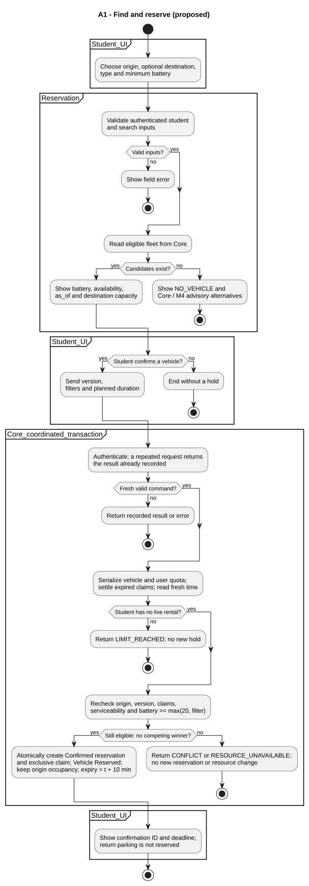

*Figure 3.9 — M2: A1 find and confirm a rental.*

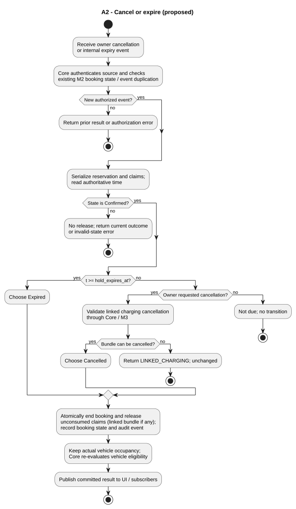

*Figure 3.10 — M2: A2 cancel or expire a booking.*

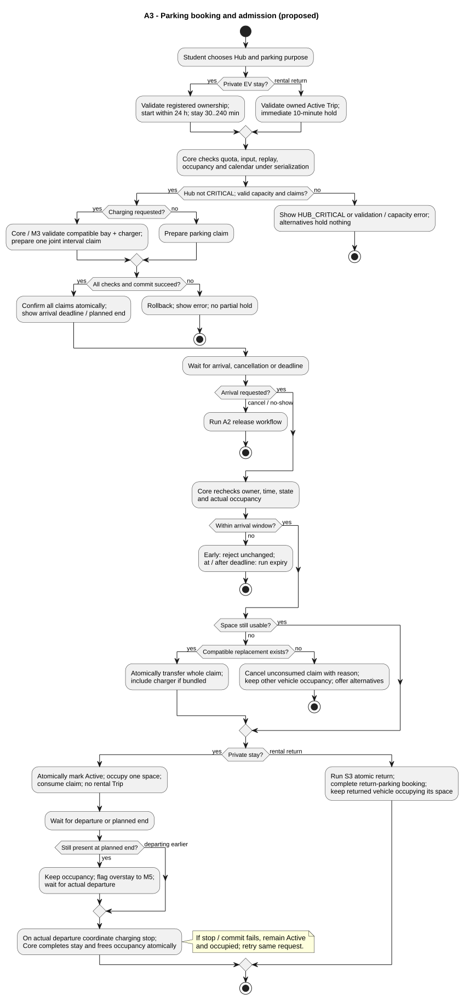

*Figure 3.11 — M2: A3 parking admission and departure.*

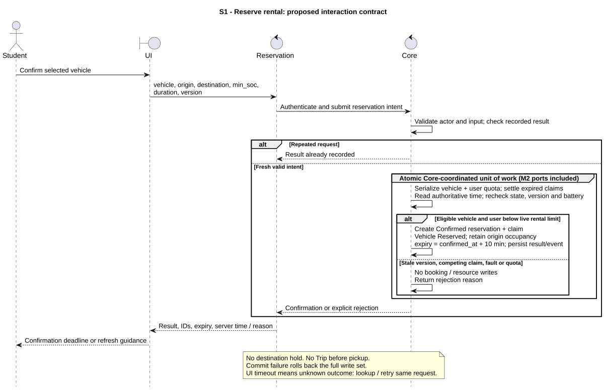

*Figure 3.12 — M2: S1 reserve.*

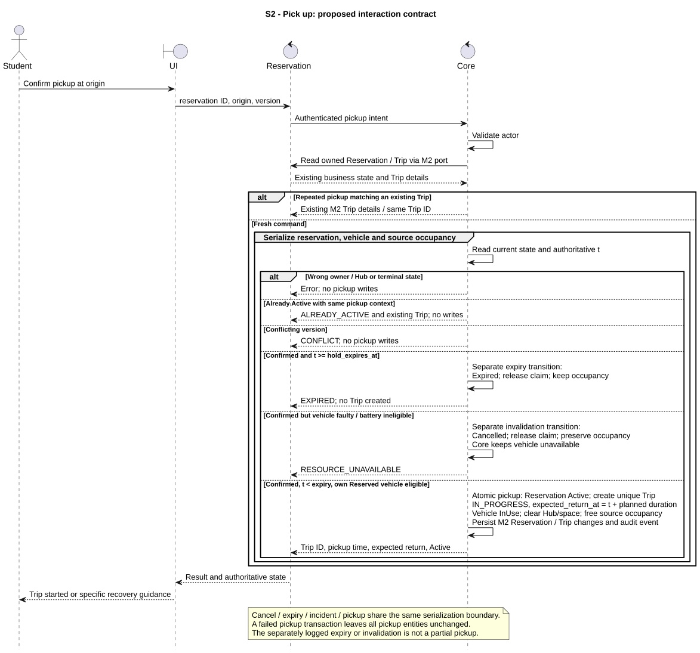

*Figure 3.13 — M2: S2 pick up.*

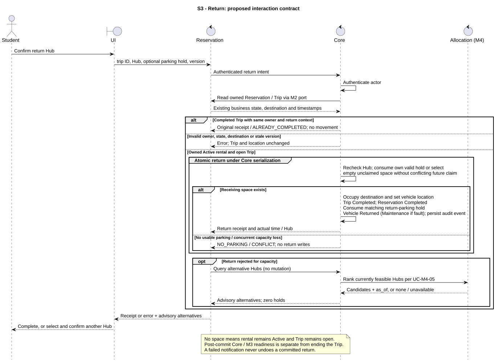

*Figure 3.14 — M2: S3 return, with alternatives through Core.*

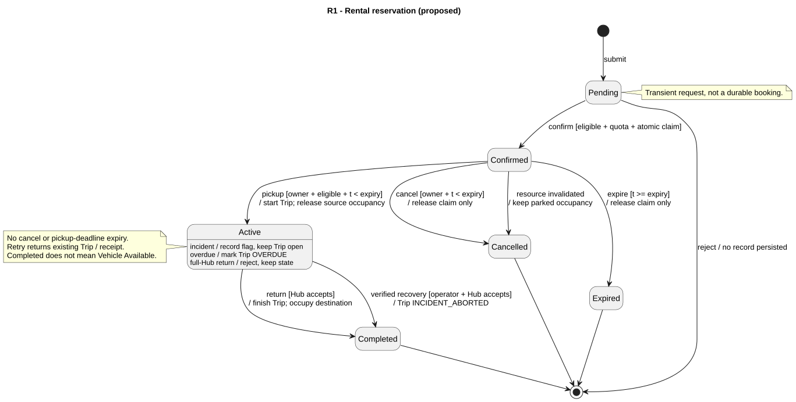

*Figure 3.15 — M2: R1 rental booking and Trip states.*

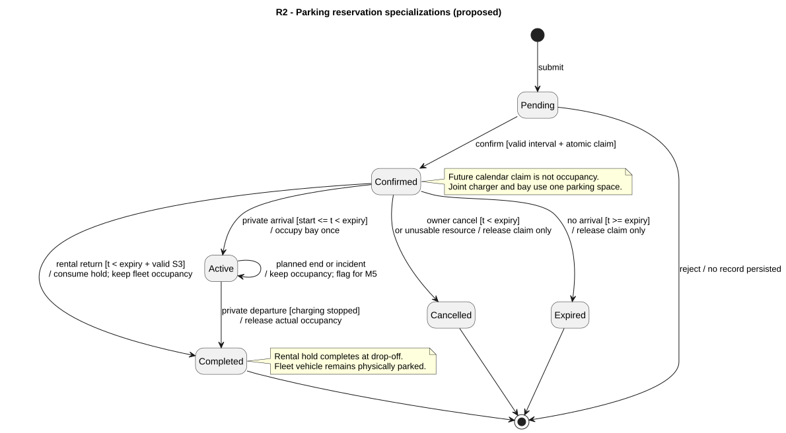

*Figure 3.16 — M2: R2 private parking and return-hold states.*

#### Atomicity, deadlines and retries

M2 orchestrates `core.unit_of_work()`, checks its own booking/Trip and quota under the Core lock, and writes registered M2 entities through `uow.repository` (D-018). Core commands alone change shared claims, vehicles and spaces. Every `Err` exits without commit; a successful explicit commit persists the complete write set. The Core API retains this module-owned retry and orchestration contract in v1.2 (D-015).

At `t = hold_expires_at`, pickup is expired; it is eligible only while `t < expiry`. Time is read inside the serialization boundary. Cancellation, pickup, expiry and resource failure contend on the same current state/version. Only a valid winner commits; a delayed expiry sweep never grants extra pickup time. Active bookings cannot be ended by pickup-deadline expiry.

A repeated request returns the result already recorded. Pickup and return never create a second Trip or reservation or repeat an occupancy change.

#### State and data distinctions

Pending is proposed as transient validation with no persisted booking until confirmation. This retains the six assigned state names without inventing durable stranded Pending records. Reservation Active maps to an open IN_PROGRESS/OVERDUE Trip; Completed can map to a normal completion or a verified incident recovery. Vehicle readiness is decided separately by Core. In private parking, Active means occupied; the rental-return hold instead completes on drop-off while the fleet vehicle remains parked.

The [requirements parameter register and data proposal](../requirements/fr-02-05-07-reservation.md) are the authoritative source for values and schema obligations: parking end/arrival fields, Trip expected_return_at, Core ResourceClaim ownership. Default rental duration is 30 minutes with overdue strictly after due+60 minutes. Private parking defaults to 120 minutes and allows start within 24 hours; those intervals do not imply guaranteed departure. Battery thresholds retain their distinct meanings across modules.

#### Trade-offs and cross-module risks

- Immediate-only rental avoids forecasting a vehicle's future return. Future charging/private parking remains supported, with actual admission rechecks and overstay handling.
- No automatic destination hold improves use of scarce parking but permits full-Hub return rejection; show this clearly in UI and offer a separate immediate hold.
- Atomic Core transactions suit the proposed single deployment. They require stronger coordination than independent module API calls; DB version columns alone cannot protect interval predicates or user quotas.
- Existing student claims are protected from rebalancing/charging priority. Operator safety isolation remains a separate incident action with accountable custody/occupancy.
- Snapshot simulation must clone claims/bookings/trips and use the same rules with a separate clock/result namespace. Recommendations never write back directly; application is a newly authorized operational command.

D-015 through D-020 define the Core interaction rules. The requirements register records which M2 policy values remain proposed. Core API/state validation, M3 bundle semantics, M4 dispatch claims/priority, M5 due-time/incident recovery and M7 schema/UI remain explicit handoffs.

#### Verification evidence and reproducibility

Design-only review on 2026-10-11 covers the 13 V-M2 scenario groups in the requirements baseline. It checks happy/empty/invalid flows, simultaneous claims and quotas, cancellation/expiry boundaries, repeated pickup/return, full Hubs, faults, bay sharing, redistribution priority and isolated simulation. These are document walkthroughs and future test obligations; see the [M2 test catalog](../testing/test-cases/reservation.md) for the later executed rental-service cases.

Render using Java 17 and PlantUML **1.2026.2** (Graphviz 2.44.1 reported by the tool). Set `$plantUmlJar` to the local PlantUML JAR path; the JAR is a tool, not a repository artifact:

```powershell
$plantUmlJar = Join-Path $env:TEMP 'plantuml-m2.jar'
java -jar $plantUmlJar -charset UTF-8 -checkonly 'docs/design/behavioral/reservation-diagrams/*.puml' 'docs/requirements/use-case-diagrams/*.puml'
java -jar $plantUmlJar -charset UTF-8 -tsvg 'docs/design/behavioral/reservation-diagrams/*.puml' 'docs/requirements/use-case-diagrams/*.puml'
java -jar $plantUmlJar -charset UTF-8 -tpng -o "$env:TEMP/m2-diagram-preview" 'docs/design/behavioral/reservation-diagrams/*.puml' 'docs/requirements/use-case-diagrams/*.puml'
git diff --check
```

The initial syntax check and rendering succeeded for all ten sources. PNG previews were inspected for labels, arrows, guard clarity and clipping. Review caught overlapping self-transition labels in R1 and an A3 ordering that could imply waiting until planned end before departure; the source was revised to use internal event text in R1 and explicitly allow earlier departure in A3. Images are regenerated from source, never hand-edited.

Limitations: the Core contract has not been exercised, browser-specific SVG display has not been tested, and system-wide use-case consolidation remains separate. Human review/approval and M8's future implementation tests are still required.

<!-- END M2: Reservation & Trip -->

<!-- BEGIN M3: Charging & Smart Scheduling -->

### 3.3.2 M3 — Charging and Smart Scheduling

> Author: Võ Thanh An. Date: 2026-11-06, revised 2026-11-17 for the Phase 3 implementation. **Reviewed and merged**.

#### Design overview

M3 manages a charging session as a record of its own (D-018) and changes shared resources only through Core commands. The behavior follows the state machine in `charging-session-state-machine.md`:

1. **Session lifecycle:** a request becomes `CHARGING` at once when the vehicle already stands in a free bay, `SCHEDULED` when a start time is given, and `QUEUED` when no bay is free. `optimize_queue` turns `QUEUED` requests into `SCHEDULED` ones; `start_scheduled_session` starts a due `SCHEDULED` session; finish ends in `COMPLETED`, interrupt in `INTERRUPTED`, and cancel in `CANCELLED`. A private EV owner first registers the vehicle (`POST /charging/private/vehicles`; the vehicle is created in state `IN_USE` because it is not parked at a Hub) and then reserves a slot through the same request flow.
2. **Priority (`BR-M3-03`):** queued requests are ranked by the low-battery override first (battery at or below `low_battery_threshold` from `get_config()`, 15 % by default), then vehicles with a booking in the next hour (M2's `ReservationDemand` port; battery only when the port is unavailable), then the lowest battery, then the request time.
3. **Point failure (`UC-M3-08`, `BR-M3-02`):** a failure reaches M3 as the Core event `ChargingPointStatusChanged`. M3 interrupts the session on that point, submits a new request for the same vehicle and owner, moves the `SCHEDULED` sessions of that point, and runs `optimize_queue`, which tries another bay in the Hub and then a later slot every 15 minutes for the next 2 hours. When the Hub has no slot in that window, `optimize_queue` calls M4's `AlternativeChargingProvider` port (`UC-M4-07`), checks the suggested bay again and moves the request to that Hub as `SCHEDULED`; otherwise it stays `QUEUED`.

#### UML diagram index

| Artifact | IDs and intent | Detailed source and discussion |
| --- | --- | --- |
| Activity Diagram | Request handling, priority queue and the point-failure fallback | [`charging-activity-diagram.puml`](../design/behavioral/charging-diagrams/charging-activity-diagram.puml) / [Activity Preview](../design/behavioral/charging-diagrams/charging-activity-diagram.svg) |
| State Machine Diagram | Session states `QUEUED`, `SCHEDULED`, `CHARGING`, `COMPLETED`, `INTERRUPTED`, `CANCELLED` and the claims placed or released on each transition | [`charging-session-state-machine.puml`](../design/behavioral/charging-diagrams/charging-session-state-machine.puml) / [State Preview](../design/behavioral/charging-diagrams/charging-session-state-machine.svg) |

All behavioral diagrams for M3 are maintained as editable `.puml` PlantUML sources with generated `.svg` visual assets in `docs/design/behavioral/charging-diagrams/`.

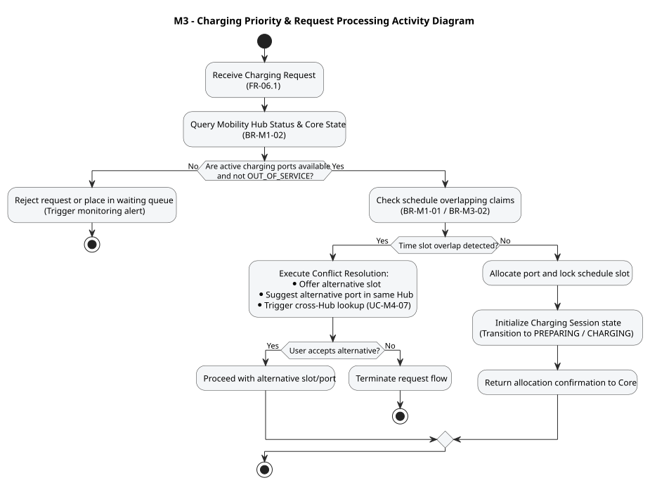

*Figure 3.17 — M3: Charging request, priority queue and point-failure fallback.*

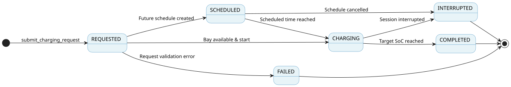

*Figure 3.18 — M3: Charging session states and the claims on each transition.*

#### Key design decisions

- **Claims hold the bay (D-017):** when a bay is bound, for `CHARGING` or `SCHEDULED`, M3 places a claim on the charging point and on the vehicle for the session interval; `COMPLETED`, `INTERRUPTED` and `CANCELLED` release them. Two sessions therefore never overlap on one point.
- **One unit of work per change:** each bind, start, finish, interrupt or cancel runs in its own Core unit of work, so the session record, the claims and the vehicle state commit or roll back together. `optimize_queue` binds each queued request in its own unit of work, because a commit closes the unit of work; a request that finds no slot stays `QUEUED` and does not block the others.
- **Authorization:** students can act only on their own requests and sessions; the queue, demand and optimize endpoints require the operator role (NFR-16).
- **No hardware model:** M3 works on the charging point status kept by Core (`AVAILABLE`, `CHARGING`, `OUT_OF_SERVICE`, `MAINTENANCE`); cable, relay and power control are out of scope.

#### Interface alignment and integration

1. **Core (M1):** vehicle state through `transition_vehicle` (`START_CHARGING`, `FINISH_CHARGING`, `INTERRUPT_CHARGING`), point status through `set_charging_point_status`, claims through `place_claim` and `release_claim`, and the `ChargingPointStatusChanged` event.
2. **M2 (Reservation):** M3 reads upcoming bookings through the `ReservationDemand` port for the booking factor.
3. **M4 and M6:** M3 provides its scheduled sessions through the `ChargingDemand` port (D-020) and calls M4's `AlternativeChargingProvider` port for the third step of `BR-M3-02`.
<!-- END M3: Charging & Smart Scheduling -->

<!-- BEGIN M4: Resource Allocation & Dispatching -->
### 3.3.3 M4 — Resource Allocation and Dispatching

> Author: 2412466 Huỳnh Minh Nhật. Date: 2026-10-22. **Reviewed and merged**.

#### Design overview

The allocation module works in two steps. First it **plans** on a read-only view of the network: it finds Hubs that will run short of vehicles and Hubs with surplus, and proposes dispatch tasks. Planning is a pure function, so M6 can reuse it on a copy of the state. Then, after the operator approves a task, it **commits** through Core in one atomic unit of work: M4 places `HolderKind.DISPATCH_TASK` claims on the vehicles and destination spaces directly via Core (D-017), or nothing is claimed. Pick-up transitions the vehicles using those claims; return, cancel and failure each release active `DISPATCH_TASK` claims through Core.

Two further flows are read-only lookups called through Core: alternative Hubs for a reservation request (M2) and an alternative charging point for requests displaced when a Hub has no free port (M3, UC-M3-08, D-012). Competing requests are ordered by class level, then time, then ID (BR-M4-01), and the winner claims the resource atomically.

#### UML diagram index

| Artifact | IDs and intent | Detailed source and discussion |
|---|---|---|
| Sequence | S1 plan; S2 approve or reject; S3 carry out or cancel; S4 alternative Hubs for M2; S5 alternative charging for M3 | [Sequence document](../design/behavioral/allocation-sequence-diagram.md) |
| Activity | A1 plan redistribution; A2 approve and execute; A3 settle competing requests | [Activity document](../design/behavioral/allocation-activity-diagram.md) |
| State machine | T1 DispatchTask life cycle with a complete transition table | [State document](../design/behavioral/allocation-state-machine.md) |

All eleven diagrams of this contribution (nine behavioral and two use-case diagrams) have editable `.puml` sources and generated `.svg` previews.

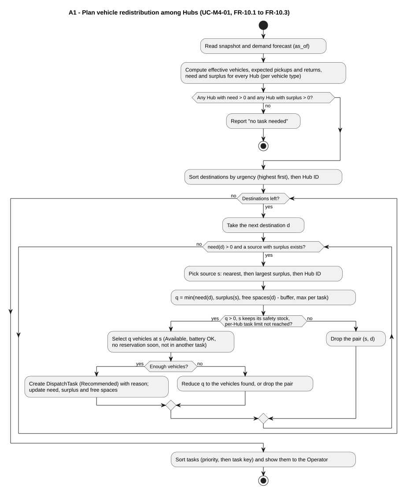

*Figure 3.19 — M4: A1 plan redistribution.*

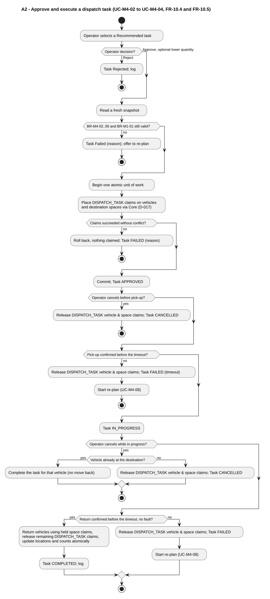

*Figure 3.20 — M4: A2 approve and carry out a task.*

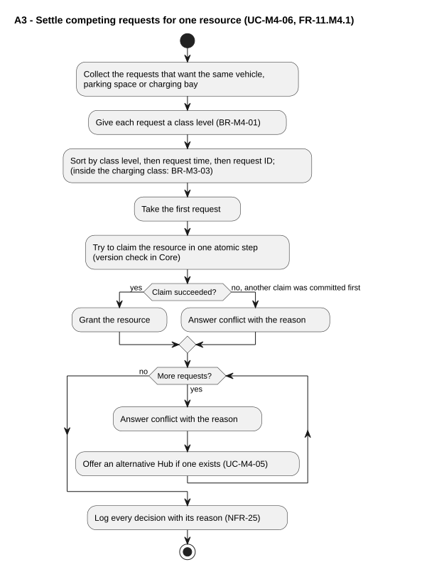

*Figure 3.21 — M4: A3 settle competing requests.*

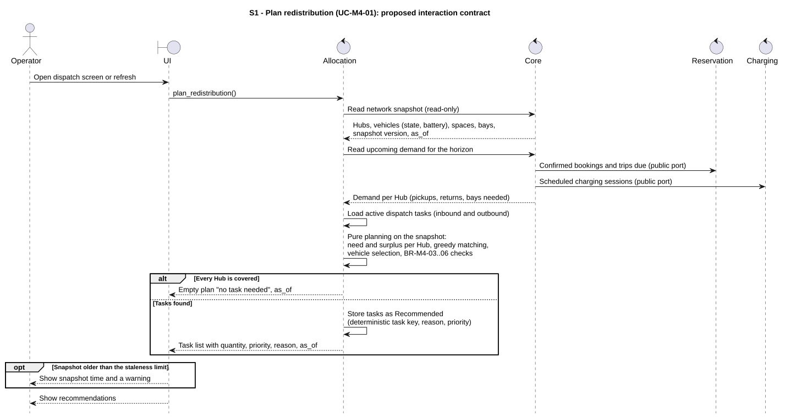

*Figure 3.22 — M4: S1 plan.*

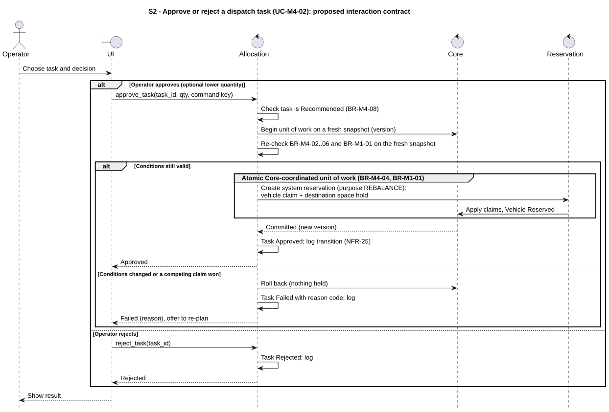

*Figure 3.23 — M4: S2 approve or reject.*

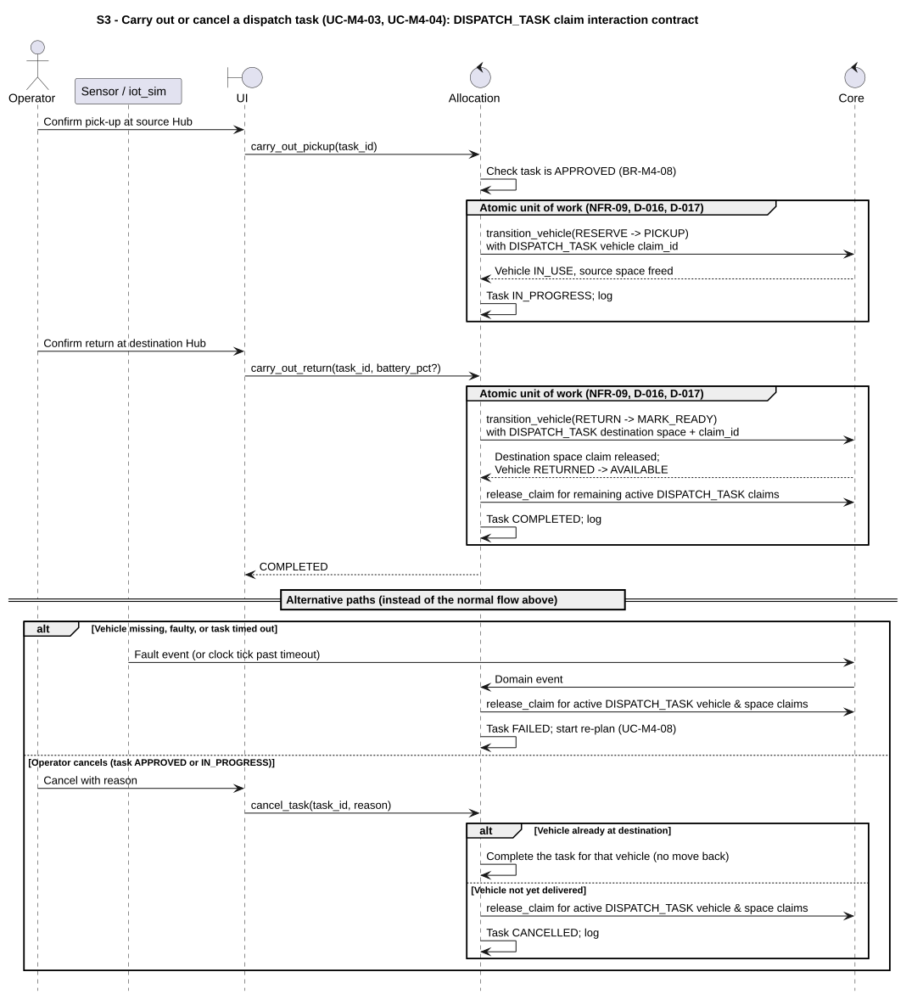

*Figure 3.24 — M4: S3 carry out or cancel.*

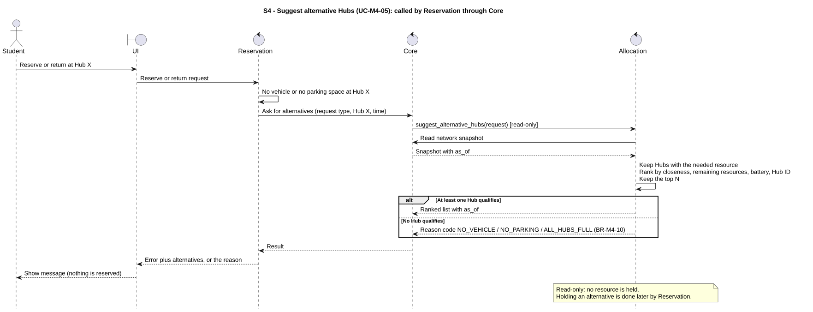

*Figure 3.25 — M4: S4 alternative Hubs for M2.*

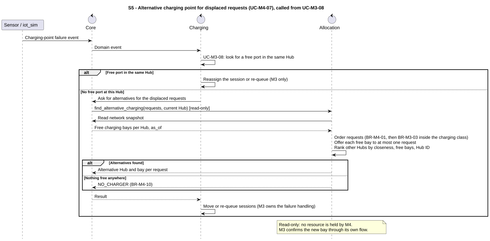

*Figure 3.26 — M4: S5 alternative charging for M3.*

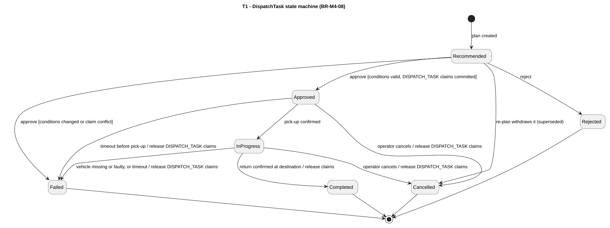

*Figure 3.27 — M4: T1 DispatchTask life cycle.*

#### Key design decisions

The algorithm was chosen among four approaches (threshold rules with greedy matching, min-cost flow, integer programming, reactive only). Threshold rules with greedy matching were chosen because they are fast, repeatable and explainable to an operator; the price is a plan that may not be globally optimal. The comparison, the formulas and a worked example on DS-STD Hubs are in the [algorithm design](../design/architecture/allocation-algorithm-design.md).

Allocation never writes state directly and never calls another module directly; every write and every read of another module's data goes through Core (D-003, NFR-22).

#### Interface alignment and integration

1. **Core & Provider Ports:** Settled by Core API spec v1.0 and D-020. M4 calls `ProviderPort.RESERVATION_DEMAND` and `ProviderPort.CHARGING_DEMAND` for planning inputs, and implements `ProviderPort.ALTERNATIVE_HUB` and `ProviderPort.ALTERNATIVE_CHARGING` for M2 and M3.
2. **Dispatch Lifecycle:** Settled by D-016 and D-017. Tasks place `HolderKind.DISPATCH_TASK` claims atomically; vehicles transition through `pickup`, `return`, and `mark_ready`.
3. **Simulation:** The pure planning function `plan(snapshot, demand, tasks, config)` operates on state snapshots and can be run by M6 on isolated simulation state without side effects.
<!-- END M4: Resource Allocation & Dispatching -->

<!-- BEGIN M5: Monitoring & Incident Handling -->
### 3.3.4 M5 — Monitoring and Incident Handling

> Author: 2453413 Đỗ Hoàng Việt. Date: 2026-11-06. **Reviewed and merged**.

#### Activity Diagrams

##### Incident Handling Workflow (Module M5)

The incident management workflow (`FR-09`, `UC-M5-02`) handles automated failure ingestion, immediate safety interlocks, human triage, and resolution closure.

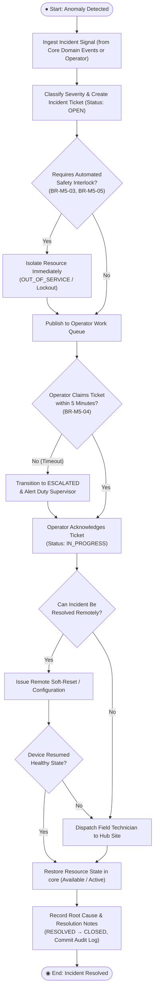

###### Workflow Narrative:
1. **Intake & Triage:** Fault signals arrive asynchronously via Core domain events (`ChargingPointStatusChanged`, `VehicleBatteryChanged`, `SensorEventRejected`, `SensorHeartbeat`) or operator reports. The intake engine instantiates an `IncidentTicket` with status `OPEN`.
2. **Automated Interlocks (`BR-M5-03`, `BR-M5-05`):** If electrical or battery hazards are present, the system immediately cuts charger power and marks the socket `OUT_OF_SERVICE`, or locks out low-battery vehicles ($\le 15\%$) from the rental inventory.
3. **5-Minute Escalation Window (`BR-M5-04`):** For High and Critical tickets, an unacknowledged ticket remaining `OPEN` for $> 5$ minutes automatically promotes to `ESCALATED` via `check_and_escalate_unacknowledged()`, notifying the Duty Supervisor.
4. **Corrective Recovery:** Software/communication anomalies receive an automated remote reset. If hardware remains unresponsive, a field technician is dispatched for physical part replacement.
5. **Closure & Audit Trail (`NFR-25`):** Once verified healthy, the operator logs root cause notes, marks the ticket `RESOLVED` $\rightarrow$ `CLOSED`, and appends the entry to `TicketAuditLog`.

---

#### Sequence Diagrams

##### Hub Capacity Warning & Status Synchronization (Module M5)

This sequence diagram illustrates the streamlined, event-driven interaction between the telemetry intake, `monitoring` engine, `core` state store, and the Operator Dashboard when a Hub reaches capacity thresholds (`FR-08`, `UC-M5-01`, `BR-M5-01`, `BR-M5-02`).

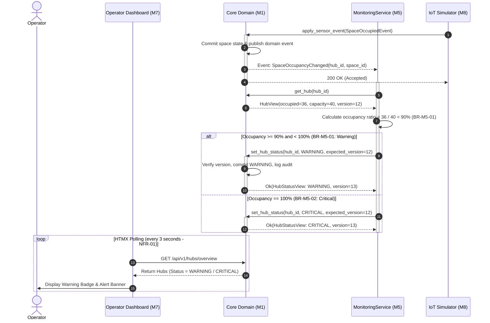

###### Key Architecture Principles Demonstrated:
1. **Separation of Concerns:** Telemetry ingestion is decoupled from evaluation via asynchronous domain events (`SpaceOccupancyChanged`).
2. **Authority over Hub Health (`set_hub_status`):** `core` acts as the persistent store; `monitoring` (M5) is the authoritative evaluator that decides when a Hub becomes `WARNING` or `CRITICAL`.
3. **Concurrency Safety:** All status transitions apply optimistic locking (`expected_version`), rejecting dirty writes if concurrent operations alter Hub state.
4. **Latency Verification (`NFR-01`):** Telemetry updates reflect on the operator console within 3–5 seconds through HTMX active polling.
<!-- END M5: Monitoring & Incident Handling -->
