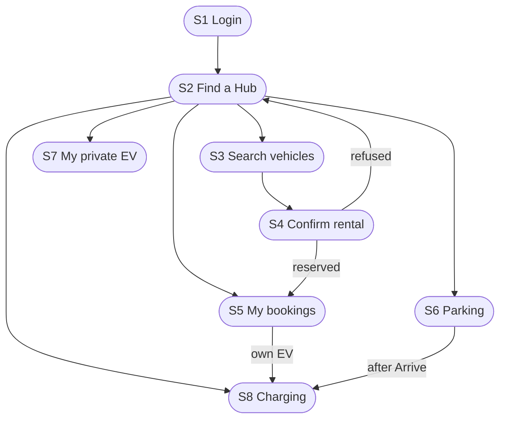
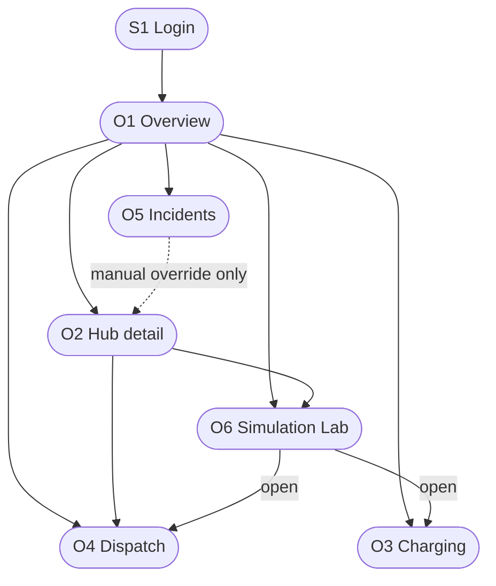

## 3.4 User-interface Design

> **Status:** Final · **Owner:** M7 (completed by M1) · **Date:** 2026-11-26
> Full wireframes: `docs/design/ui/wireframes-student.md` and `wireframes-operator.md`. Flows: `ui-flow-diagrams.md`. Checks against the data: `ui-consistency-review.md`.

### 3.4.1 Approach and principles

The interface is a set of server-rendered web pages (Jinja2, with HTMX to refresh the O1 Hub cards by polling) served by the `ui` module in the same application as the API (D-002). A page may call `core` directly and keeps the login token in a cookie. For the reservation, charging, allocation, monitoring and simulation modules it calls their REST routes with the user's token, through a small internal client (`src/ui/api.py`, `httpx` with `ASGITransport`), because `ui` may not import another module (NFR-22). There are two interfaces: nine screens for the student (S1 to S9) and six for the operator (O1 to O6). The role of the logged-in account (A-06) decides which one is shown. The wireframes show content, actions and feedback, not colours or spacing.

Principles:

1. **The interface shows state and sends actions; it holds no business rule.** The backend decides, and a refused action is explained.
2. **Critical status is visible without navigation (NFR-20).** The operator's alert strip is on every screen.
3. **Every refusal explains itself (NFR-21).** It gives the cause, an alternative when there is one, and the error code under "Details". No stack trace is shown.
4. **Data shows its age.** Screens show the time of the data (`as_of`).
5. **A retry is safe.** The pages call the modules inside the same process (D-026), so a command does not time out on a network. If a student repeats a rental command, M2 recognises it from its own records and returns the stored result instead of acting twice (D-015).

### 3.4.2 Major user flows and navigation

**Student.** After login the student lands on the Hub list (S2). Find a Hub, My bookings, Parking, Charging, My EV and Logout are in the header of every screen. The main path is Find a Hub, Search, Confirm, My bookings. A returned rental vehicle is charged by operators; S5 links to Charging, where the student charges their own EV after parking it (S6, Arrive). Parking and charging are booked one after the other: there is no joint booking (`BR-M2-12`, DEV-15).



*Figure 3.28 — Student flows.*

**Operator.** After login the operator lands on the overview (O1). A tab bar and the alert strip are on every screen, so each tab screen is one click from the others, and a Hub in `WARNING` or `CRITICAL` is always one click away. The Hub detail (O2) opens from a Hub card. The What-if screen changes nothing: a recommendation goes to the owning module only after the operator approves it, and that module may refuse it.



*Figure 3.29 — Operator flows.*

### 3.4.3 Information shown to each actor

| Student screen | Information |
|---|---|
| S2 Find a Hub | For each Hub: vehicles available, free spaces, charging points in use, status in words, time of the data |
| S3 Search | Vehicles the student can rent now (M2 search: code, type, battery, best battery first), filters by type and minimum battery; free spaces at the return Hub |
| S4 Confirm | Vehicle, pick-up Hub, return Hub (space not held), planned minutes, the 10-minute deadline |
| S5 My bookings | Booking state, pick-up deadline, expected return time, overdue notice, the held return space and its deadline, earlier bookings with their status |
| S6 Parking | Assigned space, arrival window, planned end, overstay notice, earlier parking |
| S7 My vehicle | Registered private EVs and their state |
| S8 Charging | The student's charging requests with status, point and time; change time and cancel |

| Operator screen | Information |
|---|---|
| O1 Overview | Per Hub: status, parking use, vehicles available, charging in use; alert strip |
| O2 Hub detail | Vehicles, spaces and charging points with state, battery and fault; state history of a vehicle |
| O3 Charging | Queue with rank, reason and owner (filter by owner); scheduled and running sessions; sessions moved after a point failure; points in use |
| O4 Dispatch | Tasks with route, vehicles, status, priority, reason; allocation settings |
| O5 Incidents | Tickets with type, severity, status, age, history |
| O6 Simulation | Inputs of the five scenarios, the rate with and without the plan, unmet requests per Hub, recommendations with their decision |

The figures below are drawn from the screens as built (`main` after the M7 review of 2026-11-26). Values in braces are examples from the seeded network.

```
+--------------------------------------------------------------------------+
| Smart E-Mobility Hub  {STU-0001}   Find a Hub | My bookings | Parking    |
|                                    Charging | My EV | Logout             |
+--------------------------------------------------------------------------+
| Find a Hub                                                               |
| Choose a Hub to see the vehicles you can rent there.                     |
|                                                                          |
| Hub         Zone   Vehicles Free spaces Charging  Status                 |
|                                         in use                           |
| H01 Metro   METRO  {50}     {20} of 70  {0} of 10 ● Open                 |
|                                                     [ Find a vehicle ]   |
| H02 Dorm A  DORM   {7}      {2} of 60   {9} of 10 ▲ Nearly full          |
|                                                     [ Find a vehicle ]   |
| H03 Dorm B  DORM   {0}      {0} of 50   {8} of 8  ■ Full                 |
|                                         No new parking bookings          |
|                                    ( Find a vehicle ) No vehicle here now|
+--------------------------------------------------------------------------+
| Data as of {18:11:10} · Refresh                                          |
+--------------------------------------------------------------------------+
```

*Figure 3.30 — S2, the Hub list. On a phone each row becomes a card: name, status, then the numbers.*

```
+--------------------------------------------------------------------------+
| < Hubs                                                                   |
| Vehicles at H01 Metro                                                    |
| {46} vehicles with at least {20}% battery you can reserve now, highest   |
| battery first.                                                           |
| Type [ v any ]   Minimum battery (%) [ 20 ]   [ Search ]                 |
|                                                                          |
| Choose a vehicle                                                         |
| +---------------+ +---------------+ +---------------+ +---------------+  |
| | ( ) FLEET-0006| | (•) FLEET-0019| | ( ) FLEET-0016| | ( ) FLEET-0017|  |
| | 100% · E-scoo.| | 98% · E-bike  | | 98% · E-bike  | | 98% · E-scoo. |  |
| +---------------+ +---------------+ +---------------+ +---------------+  |
|  ... one card per vehicle, best battery first                            |
+--------------------------------------------------------------------------+
| Return to [ v any Hub | H05 Campus A ({20} free now) | ... ]             |
|                                         [ Reserve selected vehicle ]     |
+--------------------------------------------------------------------------+
| Hub data as of {18:11:10} · results can change before you confirm.       |
+--------------------------------------------------------------------------+
```

*Figure 3.31 — S3, vehicle search. The "Return to" bar stays at the bottom of the screen.*

```
+--------------------------------------------------------------------------+
| My bookings                                                              |
| +----------------------------------------------------------------------+ |
| | {FLEET-0006} · Reserved                                              | |
| | Pick up at {H01} before {18:21:28} (time left {09:59})               | |
| | Booking {RES-eeeeb086224e}                                           | |
| | [ I picked up the vehicle ]        [ Cancel reservation ]            | |
| +----------------------------------------------------------------------+ |
| Earlier bookings                                                         |
|  {FLEET-0002} · Completed · from {H01} · booked {Thu 26/11 17:07} · RES- |
| After a return you can charge your own vehicle in Charging.              |
+--------------------------------------------------------------------------+
```

*Figure 3.32 — S5, a reserved rental. The time left is worked out when the page loads.*

```
+--------------------------------------------------------------------------+
| Smart E-Mobility Hub: Operator   {OPS-01}                       Logout   |
| [Overview] [Charging] [Dispatch] [Incidents] [Simulation Lab]            |
| Alerts: ■ H03 CRITICAL · ▲ H02 WARNING · Incidents: {2} active           |
+--------------------------------------------------------------------------+
| Network overview                                                         |
| Zone [ v all ]  Status [ v all ]  [ Filter ]                             |
| +----------------+ +----------------+ +----------------+                 |
| | H03 Dorm B     | | H02 Dorm A     | | H01 Metro      |   ...           |
| | ■ CRITICAL     | | ▲ WARNING      | | ● ACTIVE       |                 |
| | Parking 50/50  | | Parking 55/60  | | Parking 50/70  |                 |
| | (100%) [█████] | | (92%) [████░]  | | (71%) [███░░]  |                 |
| | Vehicles {0} · | | Vehicles {7} · | | Vehicles {50} ·|                 |
| | Charging {8}/8 | | Charging {9}/10| | Charging {0}/10|                 |
| | [ Open Hub ]   | | [ Open Hub ]   | | [ Open Hub ]   |                 |
| +----------------+ +----------------+ +----------------+                 |
| (ordered by severity, then by occupancy; the cards and the time are      |
|  re-read every 3 seconds)                                                |
+--------------------------------------------------------------------------+
| Data as of {10:42:05} · Refresh                                          |
+--------------------------------------------------------------------------+
```

*Figure 3.33 — O1, network overview with the alert strip.*

```
+--------------------------------------------------------------------------+
| Dispatch                                                                 |
| Status [ v all ] [ Filter ]   [ Update recommendations ]                 |
|                               [ Move vehicles yourself v ]               |
| +----------------------------------+ +----------------------------------+|
| | {TASK-slot1-001} · H04 → H01 ·   | | {TASK-OPS-b66c} · H01 → H02 ·    ||
| |   RECOMMENDED                    | |   APPROVED                       ||
| | E-bike · {3} vehicles · priority | | E-bike · {3} vehicles · priority ||
| |   {1}                            | |   {1}                            ||
| | Reason: {Hub H01 is short ...}   | | Reason: {Wireframe check}        ||
| | Vehicles: {FLEET-0101, ...}      | | Vehicles: {FLEET-0019, ...}      ||
| | Quantity [ 3 ] [ Approve ]       | | [ Confirm pick-up ] [ Cancel ]   ||
| | Reason [______] [ Reject ]       | |                                  ||
| +----------------------------------+ +----------------------------------+|
| IN_PROGRESS shows [ Confirm delivery ] [ Cancel ]; a FAILED or REJECTED  |
| task keeps its reason and has no action.                                 |
| [ Allocation settings v ]                                                |
+--------------------------------------------------------------------------+
```

*Figure 3.34 — O4, dispatch tasks. Approve can only lower the quantity.*

```
+--------------------------------------------------------------------------+
| Incidents                                                                |
| Severity [v all] Status [v all] Hub [v all] Type [v all] [ Filter ]      |
|  Type            Hub  Severity  Status       Age        Assigned to      |
|  Charger fault   H02  Critical  OPEN         {2} min    –                |
|  Hub full        H03  High      ESCALATED    {12} min   –                |
|  Rental overdue  H05  Low       IN_PROGRESS  {35} min   {OP-01}          |
+--------------------------------------------------------------------------+
| Hub full at H03 · High · ESCALATED                                       |
| {Hub reached 100% parking capacity}                                      |
| Ticket {INC-...} (INC-CAP-01) · reported by {SYSTEM_IOT_INTAKE} ·        |
|   created {10:30} · assigned to nobody yet                               |
| [ Acknowledge ]   Notes (required) [______________] [ Resolve ]          |
| Show history                                                             |
+--------------------------------------------------------------------------+
```

*Figure 3.35 — O5, incident tickets with one ticket open. Each ticket shows only the actions its status allows: OPEN Acknowledge and Escalate; ESCALATED Acknowledge and Resolve; IN_PROGRESS Resolve; RESOLVED Close.*

```
+--------------------------------------------------------------------------+
| Simulation Lab                                                           |
| SIMULATION: a copy of the state, nothing real changes                    |
| Scenario [ v SC-01 Peak-hour demand surge ]                              |
| Target Hubs  [x] H01  [x] H02  [ ] H03 ...                               |
| Surge multiplier [ 1.5 ] × (1 to 5)                                      |
| Duration [ 60 ] min (surge or returns)                                   |
| Time horizon [ 120 ] min   Random seed [ 42 ]   [ Run ]                  |
+--------------------------------------------------------------------------+
| Result · SC-01 Peak-hour demand surge                                    |
| Snapshot {SNAP-d56f} taken {18:11:56} · simulation {SIM-122a} ·          |
|   random seed {42}                                                       |
| Vehicle shortage rate, do nothing {66.67%}                               |
| With every recommendation         {49.79%}                               |
|  Hub  Requests  Unmet (do nothing)  Unmet (with plan)  Rate              |
|  H01  {138}     {92}                {72}               {66.67% → 52.17%} |
|  H02  {99}      {66}                {46}               {66.67% → 46.46%} |
| Recommendations                                                          |
|  1. Move vehicles: {20} from H04 to H01                                  |
|     {Demand surge shortage at H01}                                       |
|     [ Approve: send to Dispatch ]  [ Reject ]                            |
| [ Export report (JSON) ]   [ Discard and reset ]                         |
+--------------------------------------------------------------------------+
```

*Figure 3.36 — O6, What-if Simulation Lab with baseline and mitigated results. Only the fields of the chosen scenario are shown.*

### 3.4.4 User actions and system feedback

| Student action | On success | When refused |
|---|---|---|
| Reserve a vehicle (S4) | Booking "Reserved" in S5 with its deadline and the time left when the page loaded | "Someone else just reserved this vehicle", "This vehicle can no longer be rented", or "You already have a rental" |
| Pick up (S5) | "In progress" with the expected return time | "The time to pick up has passed. Make a new reservation" |
| Return (S5) | The booking listed as "Completed"; with a hold the vehicle is parked in the held space | "No space is free at this Hub"; nothing changes |
| Cancel (S5) | The booking listed as "Cancelled" | Offered only before pick-up |
| Hold a return space (S5) | The held space and its 10-minute deadline | "No free space at this Hub for that time", or "One live parking per student" |
| Parking: book, arrive, leave, cancel (S6) | "Booked" with space and arrival window, then "Parked", then listed as Completed or Cancelled | "No free space", "Too early", "The arrival deadline has passed" |
| Register a private EV (S7) | Vehicle listed as "Away" | M3's cause, e.g. "plate_or_code 'PRIVATE-001' is already used" (INVALID_INPUT) |
| Charging, change time, cancel, start (S8) | "Booked" with day, time and point, "Charging", or "Waiting" when no point is free in 2 hours; the new time; "Cancelled" | "No charging point is free then", with another time, port or Hub |

| Operator action | On success | When refused |
|---|---|---|
| Change a vehicle, point or Hub state (O2) | New state and a new line in the history | Core's cause and code with a link back to the Hub, e.g. VERSION_CONFLICT when someone changed it first (the operator reopens the Hub), or FORBIDDEN for a point in use set AVAILABLE; a point that is CHARGING offers only OUT_OF_SERVICE and MAINTENANCE |
| Plan, create a task ("Move vehicles yourself"), approve, reject, pick-up, delivery, cancel; save settings (O4) | The task with its new status; the saved values | The task keeps its reason when it fails, or the request is refused with the cause |
| Acknowledge, escalate, resolve, close (O5) | Ticket "In progress", "Escalated", "Resolved" or "Closed"; history on demand | The action is hidden when the status does not allow it |
| Run any of the five scenarios (O6) | The result under the form, with and without the plan | M6's message for an invalid input |
| Approve or reject a recommendation (O6) | "Sent to Dispatch as TASK-SIM-..." (a RECOMMENDED task in O4) or "Rejected" | M4 may refuse (no vehicle to dispatch) |
| Start, finish, stop a session; optimize (O3) | The session's new status | M3's cause, e.g. "before the start time" |

Every refusal uses the same block: what failed, the cause, up to two alternatives, and the code under "Details".

### 3.4.5 Design decisions for usability and clarity

| Screen | Decision | Reason |
|---|---|---|
| S2 | One table with vehicles, free spaces and charging | The student compares Hubs without opening each one |
| S3 | Vehicles as small cards to pick, five per row, best battery first; the return Hub and "Reserve" in a bar fixed at the bottom of the screen | A wide four-column table left large gaps between columns, and the main button was far below a long list |
| S4 | The 10-minute deadline, planned time and missing return space shown before confirming | These are the facts that surprise students most |
| S5 | Only the actions allowed in the booking's state; deadline as a time and the time left when the page loaded | The student cannot try a pick-up on an expired booking |
| O1 | One compact card per Hub, ordered by severity, five per row at 1366 px and six at 1920 px; symbol and word, not colour alone | All ten Hubs fit on one 1366×768 screen; Hubs that need attention are seen at once, and the screen is readable without colour |
| O2 | Summary, section links and the Hub action on one line; the vehicle list scrolls inside its panel; spaces as tiles coloured by status with a word; state history under the vehicle; only the button that fits the state | The spaces and points stay one scroll away from the vehicles, and the operator sees how a vehicle got there before overriding |
| O4 | The filter and "Update recommendations" on one toolbar; tasks two per row; a failed task keeps its reason | Planning writes data, so it must be deliberate; more tasks are seen at once |
| S6, S7, S8 | Form and the student's own list side by side, labels above full-width fields | The screen is used across its width instead of a short form on the left |
| All | Student column 1200 px, operator column 1440 px; nothing under 14 px; the login code in the header | Operator screens are dense and desktop only (D-027); the code is what the user typed to log in |
| O5 | Active tickets first, most severe and oldest on top; only the actions the status allows; history under the ticket | The operator handles the worst ticket first and cannot close a ticket before it is resolved |
| O6 | Banner that the screen works on a copy; only the chosen scenario's fields; both rates side by side; approve sends to Dispatch, not straight to the fleet | Simulated results are not mistaken for real state, the comparison is read at a glance, and a person approves every real move |
| All | Loading, empty and error states | The user can tell "nothing here" from "something failed" |

### 3.4.6 Interfaces for ordinary users and operators

| Capability | FR | Screens |
|---|---|---|
| View Hubs and resource status | FR-01 | S2, O1, O2 |
| Find suitable rental vehicles | FR-02 | S3 |
| Reserve rental vehicles | FR-03 | S4, S5 |
| Pick up and return | FR-04 | S5 |
| Reserve parking spaces | FR-05 | S6, S5 |
| Request or schedule charging | FR-06 | S8 |
| Private EV parking and charging | FR-07 | S6, S7, S8 |
| Monitor vehicles, parking, charging points, Hubs | FR-08 | O1, O2 |
| Handle incidents | FR-09 | O5, O2 |
| Redistribute vehicles | FR-10 | O4 |
| Charging priorities and schedules | FR-11 | O3, O4 |
| What-if simulation and recommendations | FR-12 | O6 |

A private EV owner is a student with a registered vehicle and uses the student interface. `iot_sim` has no screen.

**Use on phones (D-027).** Students mostly use phones, so the student screens (login, S1 to S9) adapt below 640 px wide with plain CSS (one `@media` block in `app.css`, no framework, D-002); the operator screens stay desktop screens for the control room. Checked at 360 and 390 px wide (TC-M7-045 and a page check in the browser):

| Rule | How the phone layout meets it |
|---|---|
| One column, no sideways scrolling | Two-column panels (S6 to S8) become one column; S2's Hub table becomes stacked cards; no page is wider than the screen at 360 px |
| Title and main action on the first screen | S3 keeps "Reserve selected vehicle" in a bar fixed at the bottom; S4, S5 and S9 show their action buttons without scrolling |
| Key value first | S2 card: Hub name, then status, then numbers; S3 card: the vehicle code, then the battery in bold, then the type |
| Menu marked and reachable | The header menu wraps into large links; the current page is outlined |
| Readable fields and buttons | Labels above full-width fields with 16 px text (no zoom on focus); every button, menu link, the app name and the "< Back" links at least 44 px high, 8 px apart; nothing only on hover |

A browser could keep an old stylesheet after an update, so the page links `app.css?v=<file time>`. A phone app later would be one more client of the same REST routes (D-023, D-026).

### 3.4.7 Non-functional requirements

| NFR | How the interface meets it |
|---|---|
| NFR-01 | O1 re-reads its Hub cards and the time of the data every 3 seconds; the other screens show the new state after an action or Refresh, with the time of the data |
| NFR-12, NFR-13 | O6 works on a copy and shows the random seed with the result; M6's report and the exported JSON carry it (TC-M6-005, TC-M7-053) |
| NFR-16 | The role comes from the login; the API refuses a student on operator routes |
| NFR-20 | Alert strip on every operator screen; O1 ordered by severity |
| NFR-21 | One refusal block with cause, alternative and code |

NFR-20 and NFR-21: the alert strip lists the Hubs in WARNING or CRITICAL and counts the active incidents on every operator screen (TC-M7-006, TC-M7-020). A refusal shows its cause and code in one block, never a stack trace (TC-M7-005, TC-M7-021, TC-M7-024, TC-M7-027, TC-M7-030, TC-M7-032). Limits: Section 4.4, DEV-10 to DEV-13.

### 3.4.8 Consistency with the data design and status

Every field on a screen was traced to a `core` query, a table in Section 3.2.2, a function of the reservation, allocation or monitoring module, or a requirement of the charging or simulation module. Three points matter:

- Some `core` queries have no REST route (the next claim on a resource, one vehicle by ID, the configured limits). A page calls them directly, so they do not block the interface.
- A page reads `core` directly and calls M2 to M6 through their routes (`ui/api.py`, D-026). No screen shows sample data.
- The charging screens show the session states of M3: Queued, Scheduled, Charging, Completed, Interrupted, Cancelled.

| Backend | Status |
|---|---|
| `core`: login, Hubs, vehicles, spaces, charging points, history; vehicle, point and Hub commands in O2 | Connected (TC-M7-038, TC-M7-039, TC-M7-051, TC-M7-052) |
| Reservation (M2): search, reserve, pick up, cancel, return | Connected in S3 to S5 (TC-M7-028 to TC-M7-030, TC-M7-034) |
| Reservation (M2): parking, return-space hold | Connected in S5 and S6 (TC-M7-035, TC-M7-036) |
| Charging (M3): requests, change, cancel, sessions, queue, moved sessions, private EV | Connected in S7, S8 and O3 (TC-M7-037, TC-M7-040) |
| Allocation (M4): plan, create a task ("Move vehicles yourself"), approve, reject, pick-up, delivery, cancel, settings | Connected in O4 (TC-M7-041, TC-M7-043, TC-M7-050) |
| Monitoring (M5): incidents | Connected in O5: filters, acknowledge, escalate, resolve, close, history (TC-M7-043); remote reset and stale-data icon are not offered |
| Simulation (M6) | Five scenarios connected in O6 with the comparison, approve, reject and export (TC-M7-031, TC-M7-032, TC-M7-041, TC-M7-042) |
