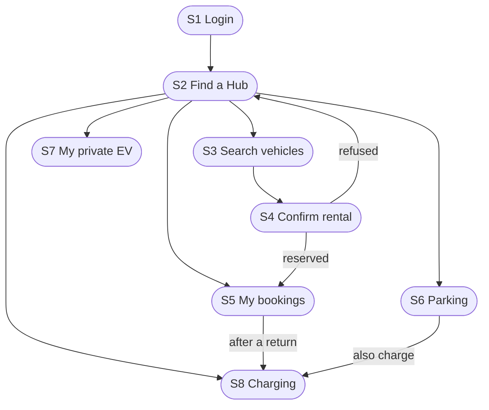

## 3.4 User-interface Design

> Revised for Phase 3 · Owner: M7 · Date: 2026-11-25
> Full wireframes: `docs/design/ui/wireframes-student.md` and `wireframes-operator.md`. Flows: `ui-flow-diagrams.md`. Checks against the data: `ui-consistency-review.md`. "Planned" means the screen follows a requirement for which there is no code yet. Figure numbers are provisional.

### 3.4.1 Approach and principles

The interface is a set of server-rendered web pages (Jinja2, with HTMX to refresh parts of a page by polling) served by the `ui` module in the same application as the API (D-002). A page may call `core` directly and keeps the login token in a cookie. For the reservation, charging, allocation, monitoring and simulation modules it calls their REST routes with the user's token, through a small internal client (`src/ui/api.py`, `httpx` with `ASGITransport`), because `ui` may not import another module (NFR-22). There are two interfaces: nine screens for the student (S1 to S9) and six for the operator (O1 to O6). The role of the logged-in account (A-06) decides which one is shown. The wireframes show content, actions and feedback, not colours or spacing.

Principles:

1. **The interface shows state and sends actions; it holds no business rule.** The backend decides, and a refused action is explained.
2. **Critical status is visible without navigation (NFR-20).** The operator's alert strip is on every screen.
3. **Every refusal explains itself (NFR-21).** It gives the cause, an alternative when there is one, and the error code under "Details". No stack trace is shown.
4. **Data shows its age.** Screens show the time of the data (`as_of`).
5. **A slow answer is not reported as a failure (Planned).** For rental commands the screen reads the booking again before saying "failed", and a retry uses the same reservation ID.

### 3.4.2 Major user flows and navigation

**Student.** After login the student lands on the Hub list (S2). Find a Hub, My bookings, Parking, Charging, My EV and Logout are in the header of every screen. The main path is Find a Hub, Search, Confirm, My bookings. After a return, the student can request charging for that vehicle. A parking booking with the charging box ticked continues in the charging screen, because the two are booked together (`BR-M2-12`).



*Figure 3.8 — Student flows.*

**Operator.** After login the operator lands on the overview (O1). A tab bar and the alert strip are on every screen, so each tab screen is one click from the others, and a Hub in `WARNING` or `CRITICAL` is always one click away. The Hub detail (O2) opens from a Hub card. The What-if screen changes nothing: a recommendation goes to the owning module only after the operator approves it, and that module may refuse it.


*Figure 3.9 — Operator flows.*

### 3.4.3 Information shown to each actor

| Student screen | Information |
|---|---|
| S2 Find a Hub | For each Hub: vehicles available, free spaces, charging points in use, status in words, time of the data |
| S3 Search | Vehicles the student can rent now (M2 search: code, type, battery, best battery first), filters by type and minimum battery; free spaces at the return Hub |
| S4 Confirm | Vehicle, pick-up Hub, return Hub (space not held), planned minutes, the 10-minute deadline |
| S5 My bookings | Booking state, pick-up deadline, expected return time, overdue notice, the held return space and its deadline, earlier bookings with their status |
| S6 Parking | Assigned space, arrival window, planned end, overstay notice, earlier parking |
| S7 My vehicle | Registered private EVs and their state |
| S8 Charging | The student's charging requests with status, point and time; change time and cancel |

| Operator screen | Information |
|---|---|
| O1 Overview | Per Hub: status, parking use, vehicles available, charging in use; alert strip |
| O2 Hub detail | Vehicles, spaces and charging points with state, battery and fault; state history of a vehicle |
| O3 Charging | Queue with rank, reason and owner (filter by owner); scheduled and running sessions; sessions moved after a point failure; points in use |
| O4 Dispatch | Tasks with route, vehicles, status, priority, reason; allocation settings |
| O5 Incidents | Tickets with type, severity, status, age, history |
| O6 Simulation | Inputs of the five scenarios, the rate with and without the plan, unmet requests per Hub, recommendations with their decision |

```
+--------------------------------------------------------------------------+
| Smart E-Mobility Hub        {user_id}           My bookings | Logout     |
+--------------------------------------------------------------------------+
| From Hub: choose a row below                                             |
|                                                                          |
| Hub                 Zone   Vehicles  Free spaces   Charging in use Status|
| H01 Metro           METRO   {36}     {20} of 70    {3} of 10       Open  |
| H02 Dorm A          DORM    {7}      {2} of 60     {9} of 10  Nearly full|
| H03 Dorm B          DORM    {0}      {0} of 50     {8} of 8        Full  |
|                                         [ Find a vehicle at this Hub ]   |
+--------------------------------------------------------------------------+
| as of {10:42:05} · Refresh                                               |
+--------------------------------------------------------------------------+
```

*Figure 3.10 — S2, the Hub list.*

```
+--------------------------------------------------------------------------+
| < Hubs     Vehicles at H01 Metro                                         |
+--------------------------------------------------------------------------+
| Type [ v any ]   Minimum battery [ 20 ] %    Return to [ v any Hub ]     |
|                                                       [ Search ]         |
|                                                                          |
|    Vehicle       Type            Battery                                 |
| ( ) {EB-0123}    E-bike           {96}%                                  |
| (•) {ES-0045}    E-scooter        {81}%                                  |
| ( ) {EM-0007}    E-motorcycle     {63}%                                  |
|                                                                          |
| Return Hub H05 Campus A: {4} free spaces now. Not a reservation.         |
|                                          [ Reserve selected vehicle ]    |
+--------------------------------------------------------------------------+
| Hub data as of {10:42:05} · results can change before you confirm        |
+--------------------------------------------------------------------------+
```

*Figure 3.11 — S3, vehicle search.*

```
+--------------------------------------------------------------------------+
| RENTAL {reservation_id}   Reserved                                       |
|  Vehicle {ES-0045}        Pick up at {H01 Metro}                         |
|  Pick up before {10:52:05}   (time left {07:42})                         |
|        [ I picked up the vehicle ]          [ Cancel reservation ]       |
+--------------------------------------------------------------------------+
```

*Figure 3.12 — S5, a reserved rental.*

```
+--------------------------------------------------------------------------+
| Smart E-Mobility Hub: Operator   {user_id}                     Logout    |
| [Overview] [Charging] [Dispatch] [Incidents] [Simulation Lab]            |
| Alerts: ■ H03 CRITICAL · ▲ H02 WARNING · Incidents: {2} active           |
+--------------------------------------------------------------------------+
| Zone [ v all ]  Status [ v all ]                                         |
|                                                                          |
| +----------------+ +----------------+ +----------------+                 |
| | H03 Dorm B  ■  | | H02 Dorm A  ▲  | | H01 Metro   ●  |   ...           |
| | CRITICAL       | | WARNING        | | ACTIVE         |                 |
| | Parking 50/50  | | Parking {55}/60| | Parking {40}/70|                 |
| | [██████████]   | | [█████████░]   | | [██████░░░░]   |                 |
| | Vehicles {0}   | | Vehicles {7}   | | Vehicles {36}  |                 |
| | Charging {8}/8 | | Charging {9}/10| | Charging {3}/10|                 |
| +----------------+ +----------------+ +----------------+                 |
| (cards ordered by severity, then by occupancy)                           |
+--------------------------------------------------------------------------+
| Data as of {10:42:05}                                         [Refresh]  |
+--------------------------------------------------------------------------+
```

*Figure 3.13 — O1, network overview with the alert strip.*

```
+--------------------------------------------------------------------------+
| Dispatch                                      [ Update recommendations ] |
+--------------------------------------------------------------------------+
| ⚠ Recommendations are from {10:30} (older than {15} min).                |
|                                                                          |
| Tasks             Status [ v all ]                                       |
|  {T-014}  H01 -> H02   E-scooter  quantity {3}   priority {1}            |
|           RECOMMENDED   reason: {Hub H02 expects 6 pickups, has 2}       |
|           Vehicles: {EB-0123, ES-0031, EM-0007}                          |
|           Quantity [ - ] {3} [ + ]   [ Approve ]   [ Reject ]            |
|                                                                          |
|  {T-012}  H05 -> H01   E-bike     quantity {2}   IN_PROGRESS             |
|           [ Confirm pick-up ]  [ Confirm delivery ]  [ Cancel ]          |
|  {T-009}  H02 -> H04   FAILED   reason: {destination below buffer}       |
|                                                                          |
| [ Allocation settings v ]                                                |
+--------------------------------------------------------------------------+
```

*Figure 3.14 — O4, dispatch tasks.*

```
+--------------------------------------------------------------------------+
| Incidents Severity [ v all ] Status [ v active ] Hub [ v all ] Type [ v ]|
+--------------------------------------------------------------------------+
|  Type                          Hub  Severity  Status       Age           |
|  INC-HW-01 Charger fault       H02  Critical  OPEN         {2} min       |
|  INC-CAP-01 Hub full           H03  High      ESCALATED    {12} min      |
|  INC-USR-01 Rental overdue     H05  Low       IN_PROGRESS  {35} min      |
+--------------------------------------------------------------------------+
| INC-CAP-01 Hub reached 100% parking capacity: H03     High  ESCALATED    |
|  (not acknowledged for more than 5 minutes)                              |
|  Component {Hub H03} · error code {-} · reported by {SYSTEM_IOT_INTAKE}  |
|  History  {10:30} created · {10:35} escalated by the system              |
|  Notes  [__________________________________________________________]     |
|  [ Acknowledge ]                          [ Resolve ]   [ Close ]        |
+--------------------------------------------------------------------------+
```

*Figure 3.15 — O5, incident tickets with the selected ticket.*

```
+--------------------------------------------------------------------------+
| Simulation Lab  ┌ SIMULATION: a copy of the state, nothing real changes ┐|
+--------------------------------------------------------------------------+
| Scenario [ v Peak-hour demand surge ]                                    |
|  Target Hubs     [ H01 x ] [ H02 x ]                                     |
|  Surge multiplier [ 1.5 ]      Duration [ 60 ] min                       |
|  Time horizon     [ 120 ] min   Random seed [ 42 ]       [ Run ]         |
|  ⚠ (on error) The multiplier must be between 1.0 and 5.0.                |
+--------------------------------------------------------------------------+
| Result   snapshot {SNAP-001} taken {10:42:05}   status {SUCCESS}         |
|                              Baseline    With recommendations            |
|  Vehicle shortage rate       {28}%          {9}%                         |
|  Hub overflow / rejected returns {12}%      {3}%                         |
|  Avg charging queue wait     {22} min       {12} min                     |
|  Critical battery count      {6}            {2}                          |
|                                                                          |
| Recommendations                                                          |
|  1. Move {3} vehicles H01 -> H02       feasible   Pending  -> allocation |
|        reason: {shortage rate above threshold}   [ Approve ] [ Reject ]  |
|  Assumptions and limits: {...}                                           |
|  [ Export report ]                           [ Discard and reset ]       |
+--------------------------------------------------------------------------+
```

*Figure 3.16 — O6, What-if Simulation Lab with baseline and mitigated results.*

### 3.4.4 User actions and system feedback

| Student action | On success | When refused |
|---|---|---|
| Reserve a vehicle (S4) | Booking "Reserved" in S5 with its deadline and a countdown | "Someone else just reserved this vehicle", "This vehicle can no longer be rented", or "You already have a rental" |
| Pick up (S5) | "In progress" with the expected return time | "The time to pick up has passed. Make a new reservation" |
| Return (S5) | The booking listed as "Completed"; with a hold the vehicle is parked in the held space | "No space is free at this Hub"; nothing changes |
| Cancel (S5) | The booking listed as "Cancelled" | Offered only before pick-up |
| Hold a return space (S5) | The held space and its 10-minute deadline | "No free space at this Hub for that time", or "One live parking per student" |
| Parking: book, arrive, leave, cancel (S6) | "Booked" with space and arrival window, then "Parked", then listed as Completed or Cancelled | "No free space", "Too early", "The arrival deadline has passed" |
| Register a private EV (S7) | Vehicle listed as "Away" | "This plate is already registered" |
| Charging, change time, cancel, start (S8) | "Booked" with day, time and point, "Charging", or "Waiting" when no point is free in 2 hours; the new time; "Cancelled" | "No charging point is free then", with another time, port or Hub |

| Operator action | On success | When refused |
|---|---|---|
| Change a vehicle, point or Hub state (O2) | New state and a new line in the history | "Cannot be changed directly now. Handle its reservation or trip first", or "Changed by someone else. Refreshed" |
| Plan, approve, reject, pick-up, delivery, cancel; save settings (O4) | The task with its new status; the saved values | The task keeps its reason when it fails, or the request is refused with the cause |
| Acknowledge, escalate, resolve, close (O5) | Ticket "In progress", "Escalated", "Resolved" or "Closed"; history on demand | The action is hidden when the status does not allow it |
| Run any of the five scenarios (O6) | The result under the form, with and without the plan | M6's message for an invalid input |
| Approve or reject a recommendation (O6) | "Sent to Dispatch as TASK-SIM-..." (a RECOMMENDED task in O4) or "Rejected" | M4 may refuse (no vehicle to dispatch) |
| Start, finish, stop a session; optimize (O3) | The session's new status | M3's cause, e.g. "before the start time" |

Every refusal uses the same block: what failed, the cause, up to two alternatives, and the code under "Details".

### 3.4.5 Design decisions for usability and clarity

| Screen | Decision | Reason |
|---|---|---|
| S2 | One table with vehicles, free spaces and charging | The student compares Hubs without opening each one |
| S3 | Vehicles as small cards to pick, five per row, best battery first; the return Hub and "Reserve" in a bar fixed at the bottom of the screen | A wide four-column table left large gaps between columns, and the main button was far below a long list |
| S4 | The 10-minute deadline, planned time and missing return space shown before confirming | These are the facts that surprise students most |
| S5 | Only the actions allowed in the booking's state; deadline as a time and a countdown | The student cannot try a pick-up on an expired booking |
| O1 | One compact card per Hub, ordered by severity, five per row; symbol and word, not colour alone | All ten Hubs fit on one 1366×768 screen; Hubs that need attention are seen at once, and the screen is readable without colour |
| O2 | Summary, section links and the Hub action on one line; the vehicle list scrolls inside its panel; spaces as tiles coloured by status with a word; state history under the vehicle; only the button that fits the state | The spaces and points stay one scroll away from the vehicles, and the operator sees how a vehicle got there before overriding |
| O4 | The filter and "Update recommendations" on one toolbar; tasks two per row; a failed task keeps its reason | Planning writes data, so it must be deliberate; more tasks are seen at once |
| S6, S7, S8 | Form and the student's own list side by side, labels above full-width fields | The screen is used across its width instead of a short form on the left |
| All | Student column 1200 px, operator column 1440 px; nothing under 14 px; the login code in the header | Operator screens are dense and desktop only (D-027); the code is what the user typed to log in |
| O5 | Active tickets first, most severe and oldest on top; only the actions the status allows; history under the ticket | The operator handles the worst ticket first and cannot close a ticket before it is resolved |
| O6 | Banner that the screen works on a copy; only the chosen scenario's fields; both rates side by side; approve sends to Dispatch, not straight to the fleet | Simulated results are not mistaken for real state, the comparison is read at a glance, and a person approves every real move |
| All | Loading, empty and error states | The user can tell "nothing here" from "something failed" |

### 3.4.6 Interfaces for ordinary users and operators

| Capability | FR | Screens |
|---|---|---|
| View Hubs and resource status | FR-01 | S2, O1, O2 |
| Find suitable rental vehicles | FR-02 | S3 |
| Reserve rental vehicles | FR-03 | S4, S5 |
| Pick up and return | FR-04 | S5 |
| Reserve parking spaces | FR-05 | S6, S5 |
| Request or schedule charging | FR-06 | S8 |
| Private EV parking and charging | FR-07 | S6, S7, S8 |
| Monitor vehicles, parking, charging points, Hubs | FR-08 | O1, O2 |
| Handle incidents | FR-09 | O5, O2 |
| Redistribute vehicles | FR-10 | O4 |
| Charging priorities and schedules | FR-11 | O3, O4 |
| What-if simulation and recommendations | FR-12 | O6 |

A private EV owner is a student with a registered vehicle and uses the student interface. `iot_sim` has no screen.

### 3.4.7 Non-functional requirements

| NFR | How the interface meets it |
|---|---|
| NFR-01 | Parts of a page are re-read by polling every 3 seconds |
| NFR-12, NFR-13 | O6 works on a copy and shows the random seed |
| NFR-16 | The role comes from the login; the API refuses a student on operator routes |
| NFR-20 | Alert strip on every operator screen; O1 ordered by severity |
| NFR-21 | One refusal block with cause, alternative and code |

Review of NFR-20 and NFR-21 (Phase 3): the alert strip lists the Hubs in WARNING or CRITICAL and counts the active incidents on every operator screen (TC-M7-006, TC-M7-020). A refusal shows its cause and code in one block, never a stack trace (TC-M7-005, TC-M7-021, TC-M7-024, TC-M7-027, TC-M7-030, TC-M7-032). Limits: Section 4.4, DEV-10 to DEV-13.

### 3.4.8 Consistency with the data design and status

Every field on a screen was traced to a `core` query, a table in Section 3.2.2, a function of the reservation, allocation or monitoring module, or a requirement of the charging or simulation module. Three points matter:

- Some `core` queries have no REST route (the next claim on a resource, one vehicle by ID, the configured limits). A page calls them directly, so they do not block the interface.
- A page reads `core` directly and calls M2 to M6 through their routes (`ui/api.py`, D-026). No screen shows sample data.
- The charging screens show the session states of M3: Queued, Scheduled, Charging, Completed, Interrupted, Cancelled.

| Backend | Status |
|---|---|
| `core`: login, Hubs, vehicles, spaces, charging points, history; vehicle, point and Hub commands in O2 | Connected (TC-M7-038, TC-M7-039) |
| Reservation (M2): search, reserve, pick up, cancel, return | Connected in S3 to S5 (TC-M7-028 to TC-M7-030, TC-M7-034) |
| Reservation (M2): parking, return-space hold | Connected in S5 and S6 (TC-M7-035, TC-M7-036) |
| Charging (M3): requests, change, cancel, sessions, queue, moved sessions, private EV | Connected in S7, S8 and O3 (TC-M7-037, TC-M7-040) |
| Allocation (M4): plan, approve, reject, pick-up, delivery, cancel, settings | Connected in O4 (TC-M7-041, TC-M7-043) |
| Monitoring (M5): incidents | Connected in O5: filters, acknowledge, escalate, resolve, close, history (TC-M7-043); remote reset and stale-data icon are not offered |
| Simulation (M6) | Five scenarios connected in O6 with the comparison, approve, reject and export (TC-M7-031, TC-M7-032, TC-M7-041, TC-M7-042) |
