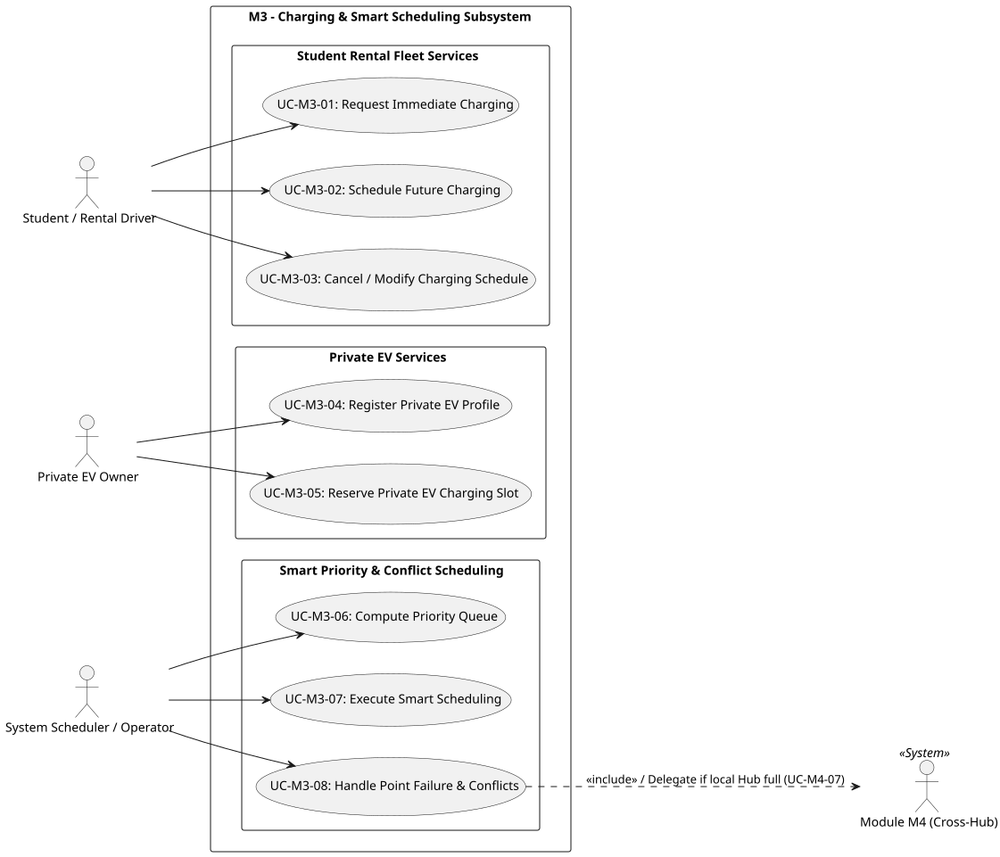

<!-- BEGIN M3: Charging & Smart Scheduling -->

# 02: Requirements Analysis

# Module M3 (Charging & Smart Scheduling)

> **Author:** Võ Thanh An (M3)  
> **Date:** 2026-11-06  
> **Status:** Phase 1 Draft for Integration Review

---

## 2.1 Domain Context & Problem Analysis

The charging infrastructure at each Mobility Hub acts as the essential energy backbone for the entire electric mobility ecosystem. The design and requirements analysis for Module M3 stem from a critical operational challenge: how to seamlessly accommodate diverse charging demands across user groups while simultaneously shielding local power grid infrastructure from overload risks and ensuring uninterrupted service continuity during physical hardware disruptions.

The requirements analysis for Module M3 directly targets three core operational dimensions:

1. **Differentiating Rental Fleet vs. Private EV Workflows (Fleet vs. Private Access):**  
   The shared student rental electric vehicle fleet requires an instant plug-and-charge workflow (`FR-06.1`) to maximize vehicle turnaround efficiency and rapidly release re-energized vehicles for upcoming trips. Conversely, private electric vehicle owners (`FR-07.M3`) demand operational certainty through vehicle specification registration (`FR-07.M3.1`) and advance slot reservations (`FR-07.M3.2`) to eliminate parking uncertainty and hardware connector incompatibility.

2. **Transitioning from Static Queuing to Automated Smart Scheduling (Dynamic Priority Queuing):**  
   Traditional First-Come, First-Served (FCFS) queuing mechanisms fail in energy management contexts: a vehicle with an imminent travel reservation sitting at 10% State of Charge (SoC) could be blocked by a vehicle maintaining an 80% SoC. Requirements `FR-11.M3.1` and `FR-11.M3.2` resolve this inefficiency by replacing static queuing with a real-time dynamic priority scoring algorithm based on battery depletion urgency and trip schedule proximity.

3. **Infrastructure Resilience & Automated Fault Recovery (Hardware Resilience):**  
   Physical charging points represent hardware endpoints prone to electrical faults or relay failures. Requirement `FR-11.M3.3` acts as a self-healing resilience mechanism, automatically detecting port breakdowns and reassigning affected sessions to operational local bays or delegating to Module M4 for cross-Hub alternative routing without disrupting end-user trip schedules.

---

## 2.2 Requirements Rationale & Use-Case Mapping

All functional requirements are explicitly traced to the subsystem Use-Case architecture to guarantee comprehensive operational coverage across all interaction scenarios.

### Subsystem Use-Case Architecture

- **Source:** [`uc-m3-charging.puml`](../requirements/use-case-diagrams/uc-m3-charging.puml)
- **Authoritative Specification:** [`docs/requirements/fr-06-07-11-charging.md`](../requirements/fr-06-07-11-charging.md)

### Detailed Traceability Matrix

| Functional Requirement | Core Technical Intent                                                    | Mapped Use Case                               | Enforced Business Rule | Operational State & System Rationale                                                                                        |
| :--------------------- | :----------------------------------------------------------------------- | :-------------------------------------------- | :--------------------- | :-------------------------------------------------------------------------------------------------------------------------- |
| **FR-06.1**            | Instant charging session initialization for returned rental fleet EVs.   | `UC-M3-01` Request Immediate Charging         | `BR-M3-01`             | Instantly verifies port availability, validates cable connection status, locks port latch, and initiates power flow.        |
| **FR-06.2**            | Pre-allocation of charging slots for student future travel demands.      | `UC-M3-02` Schedule Future Charging           | `BR-M3-01`             | Validates target Hub power capacity window, confirms reservation, and places session into the active queue.                 |
| **FR-06.3**            | Capacity optimization when student travel plans change.                  | `UC-M3-03` Cancel / Modify Charging Schedule  | N/A                    | Enables slot modification or cancellation up to threshold time, instantly returning unused capacity to the active pool.     |
| **FR-07.M3.1**         | Elimination of physical connector and electrical parameter mismatches.   | `UC-M3-04` Register Private EV Profile        | N/A                    | Captures and persists battery capacity, connector type, and current SoC into the private vehicle profile database.          |
| **FR-07.M3.2**         | Securing reserved parking and high-power charging bays for private EVs.  | `UC-M3-05` Reserve Private EV Charging Slot   | `BR-M3-01`             | Locks dedicated private EV charging slots in advance after verifying parking and power capacity constraints.                |
| **FR-11.M3.1**         | Continuous real-time queue re-ordering based on live telemetry.          | `UC-M3-06` Compute Charging Priority Queue    | `BR-M3-03`             | Background service continuously calculates priority scores based on battery depletion urgency and trip schedule proximity.  |
| **FR-11.M3.2**         | Station load-smoothing (peak shaving) and network schedule optimization. | `UC-M3-07` Execute Automated Smart Scheduling | `BR-M3-03`             | Dynamically adjusts power delivery schedules across all Hub ports to prevent transformer overloads and minimize wait times. |
| **FR-11.M3.3**         | High availability and fault tolerance during hardware point failures.    | `UC-M3-08` Handle Point Failure & Conflicts   | `BR-M3-02`             | Automatically detects port failure or schedule overlaps, reassigning sessions locally or delegating to M4 (`UC-M4-07`).     |

---

## 2.3 Comprehensive Business Rules Rationale

### BR-M3-01: Charging-Point Availability & Isolation Rule

- **Architectural Rationale:** This rule establishes a strict safety gate before any charging request is accepted. The system approves a request if and only if an active charging point at the target Mobility Hub is verified as operational and free for the requested time window.
- **Isolation Mechanics:** To prevent electrical failure or relay damage, charging ports marked as `OUT_OF_SERVICE` or undergoing maintenance are strictly isolated at the database query level, preventing the allocation algorithm from selecting them. If all ports are occupied, requests are rejected or placed into the waiting queue.

### BR-M3-02: Charging Schedule Conflict Resolution (Fallback Cascade)

- **Architectural Rationale:** Hardware breakdowns and scheduling overlaps are inevitable during continuous operations. Rule `BR-M3-02` defines a 3-tiered fallback resolution cascade:
  1. **Local Bay Swap (Zero Operational Cost):** Reassigning the vehicle to another available operational port of matching capacity within the same Hub.
  2. **Time Slot Shift (Low Impact):** Offering an alternative immediate or upcoming time slot if the vehicle has no imminent trip departure.
  3. **Cross-Hub Lookup Delegation (M4 Escalation):** If the local Hub is fully saturated, the system delegates to Module M4 (`UC-M4-07`) to locate and route the vehicle to an optimal nearby Mobility Hub.

### BR-M3-03: Smart Charging Priority Scoring & Dynamic Scheduling (Low Battery Override)

- **Architectural Rationale:** This rule governs queue ordering for charging levels 4–6 within the general priority classification (`BR-M4-01`). Priority scores are calculated dynamically by combining two core factors:
  - **Battery Urgency Factor:** Lower current State of Charge (% SoC) values yield higher priority weighting to ensure depleted vehicles receive immediate service.
  - **Schedule Proximity Factor:** Vehicles linked to imminent student trip reservations within a close time window receive elevated priority to prevent travel disruptions.
  - **Low Battery Override Clause:** To prevent severe cell degradation or deep discharge damage, any vehicle entering the queue at or below `LOW_BATTERY_THRESHOLD = 15%` receives an immediate high-priority override flag, granting it top priority for the next available charging port regardless of standard queue order.

## 2.4 Architectural Interfacing & Design Constraints

- **[D-017] Resource Claim Management:** Module M3 shall is responsible for autonomously placing and releasing its own `CHARGING_SESSION` resource claims throughout the lifecycle of every charging session. Claims are established upon session initialization and safely revoked when sessions reach terminal states (`COMPLETED`, `CANCELLED`, or `FAULTED`).
- **[D-020] Charging Demand Data Exposure:** Active and pending charging sessions, along with real-time demand metrics, shall be exposed and transferred to consuming modules—specifically **Module M4** (Resource Allocation and Vehicle Dispatching) and **Module M6** (What-if Simulation and Coordination)—exclusively via the `ChargingDemand` provider port (`ChargingDemandProvider`).
- **Private EV Onboarding (`register_vehicle`):** To accommodate private electric vehicle owners (`FR-07.M3`), the system shall provide and enforce the `register_vehicle` interface to onboard vehicle specifications, battery capacities, and connector profiles prior to permitting scheduling or session state transitions.
