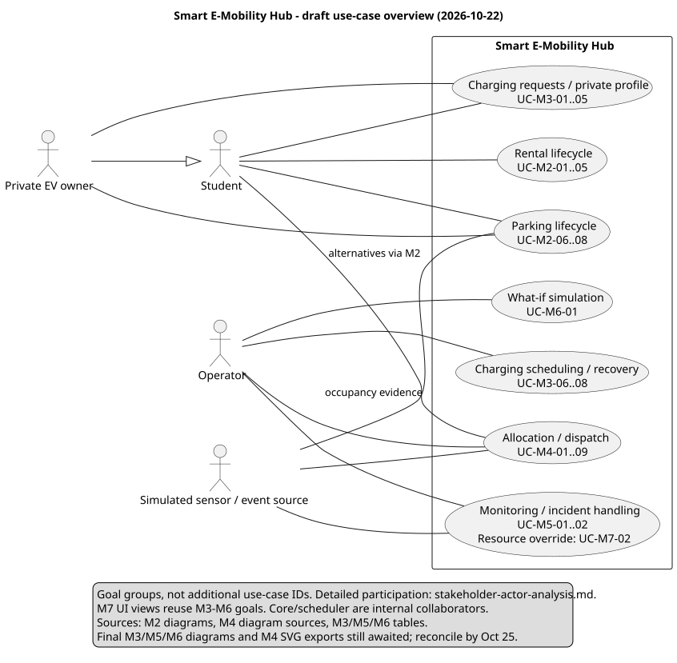

# Stakeholder and actor analysis

> Consolidation owner: M2 - 2452620. Updated 2026-10-22. Draft for module-owner review; identifiers follow CONTRIBUTING section 5.

## Boundary and stakeholders

The system boundary contains the application UI, Core and business modules. Student and Operator are external human actors. Private EV owner specializes Student; it is an ownership-dependent role, not a separate authentication mechanism. The simulated sensor/event source (`iot_sim`, M8) is an external supporting actor under D-004. Core, scheduler, allocation engine, database and clock are internal collaborators, not external actors in the overview. No real charging hardware, payment provider, GPS service or external identity provider is assumed.

| Stakeholder | Interest / responsibility | Participation |
|---|---|---|
| Student / renter | Find a usable vehicle, receive a reliable hold, pick up and return safely | Primary actor for M2 rental and parking; charging requests through M3 |
| Private EV owner (Student) | Register ownership, reserve parking/charging, arrive and depart without duplicate occupancy | Specialized actor for M3 private profile/charging and M2 private parking |
| Operator / duty supervisor | Monitor capacity, handle incidents, authorize dispatch and evaluate simulation | Operator actor; supervisor is an escalation responsibility within this role, pending any future permission split |
| Campus mobility service owner | Capacity, availability, safety and operational policy | Stakeholder; no additional login/UC invented |
| Development / QA team (M1-M8) | Consistent contracts, testability and traceability | Stakeholders; module names are not human actors |
| Course evaluators | Assess design, traceability and honest AI declaration | Stakeholders; no runtime use case |

## Actor participation by use case

Ranges below enumerate consecutive IDs in the cited owner document. This is an actor-participation index, not a reverse FR/BR traceability sheet; M8 derives the latter from owner `Trace:` fields.

| Actor / participant | Use cases | Role and boundary qualification |
|---|---|---|
| Student | UC-M2-01, UC-M2-02, UC-M2-03, UC-M2-04, UC-M2-05 | Primary: search, reserve, cancel, pick up, return rental |
| Student | UC-M2-06, UC-M2-07 | Primary: reserve/cancel parking, either private stay or active rental return hold |
| Private EV owner | UC-M2-08 | Primary: private arrival/departure; inherited Student parking goals apply |
| Student | UC-M3-01, UC-M3-02, UC-M3-03 | Primary: immediate charging, future charging, cancel/modify charging |
| Private EV owner | UC-M3-04, UC-M3-05 | Primary: register private EV profile and reserve its charging slot |
| Operator | UC-M3-06, UC-M3-07, UC-M3-08 | Supervise queue/scheduling and failure recovery; automatic triggers stay internal, not additional external actors |
| Operator | UC-M4-01, UC-M4-02, UC-M4-03, UC-M4-04, UC-M4-09 | View recommendations; approve/reject/adjust; execute; cancel; change allocation settings |
| Student via M2 | UC-M4-05 | Beneficiary/requester of advisory alternative Hubs, reached through Core |
| Internal allocation / charging flow | UC-M4-06, UC-M4-07, UC-M4-08 | Arbitration, displaced-charging lookup and re-plan; M3 is a collaborator, not an external actor. UC-M4-07 is invoked from UC-M3-08 per D-012 |
| Operator | UC-M5-01, UC-M5-02 | Primary: monitor network and handle operational incidents |
| Operator | UC-M6-01 | Primary: configure/run isolated what-if simulation and inspect results |
| Operator | UC-M7-01 through UC-M7-10 | UI participation; most entries are views of owner use cases, mapped below |
| Simulated sensor/event source | UC-M4-03, UC-M4-08; UC-M5-01, UC-M5-02 | Supporting: dispatch observations, re-plan triggers, resource status and incident events via Core |
| Simulated sensor/event source | UC-M2-08; UC-M7-01, UC-M7-03, UC-M7-07, UC-M7-08 | Supporting occupancy/status evidence; not authorization to bypass ownership, custody or Core transition checks |

Student reports may trigger incident handling, but the inspected M5 table names Operator as the primary actor. No separate student incident-report UC is invented here. Authentication is a precondition in the owner documents; a new login UC ID is not allocated by this consolidation.

## UI overlap and consistency

| M7 UI entry | Canonical business use case(s) / treatment |
|---|---|
| UC-M7-01 | View of UC-M5-01 |
| UC-M7-02 | M7-owned resource-state override; coordinate legal transitions/authorization with M1 and incident effects with M5 |
| UC-M7-03, UC-M7-04 | Views of UC-M3-06 and UC-M3-07 respectively |
| UC-M7-05 | View of UC-M4-01 |
| UC-M7-06 | View of UC-M4-02 and UC-M4-03 |
| UC-M7-07 | Views of UC-M5-01 and UC-M5-02 |
| UC-M7-08 | View of UC-M5-02 |
| UC-M7-09, UC-M7-10 | Views of UC-M6-01; M7 source still says UC-12, which is a stale reference to flag for M7 |

M7 describes applying recommendations in its UI. M6 simulation execution never mutates operational state: application is a separately authorized operational command with fresh checks, owned by the relevant module. M4's `REBALANCE` reservation proposal differs from M2's typed task-owned ResourceClaim proposal; see the [M2 reconciliation](fr-02-05-07-reservation.md). Neither is silently treated as an agreed interface.

## Source register and diagram coverage

All dependency PRs below were open on 2026-10-22. A source citation establishes provenance, not approval. M2 was synced with develop `57c064d`; the other branches were read without merging their files.

| Module / source | Inspected revision | Use-case diagram status |
|---|---|---|
| M2 [requirements](fr-02-05-07-reservation.md) | This PR #11 | [Rental](use-case-diagrams/uc-m2-rental.svg), [parking](use-case-diagrams/uc-m2-parking.svg), editable sources alongside |
| M3 [requirements](https://github.com/MabC06/smart-e-mobility-hub/blob/fab7b5f6486a02ca7fafbd66090e26b09df584a4/docs/requirements/fr-06-07-11-charging.md) | PR #7, `fab7b5f6486a02ca7fafbd66090e26b09df584a4` | No module use-case `.puml`/`.svg` in inspected tree; table used |
| M4 [requirements](https://github.com/MabC06/smart-e-mobility-hub/blob/8bb41136532518f7557ec85cd9ad4276e85246e3/docs/requirements/fr-10-11-allocation.md) and Phase 1 design | PR #16, `8bb41136532518f7557ec85cd9ad4276e85246e3`; requirements PR #1 head `966513b7d779eedfbef49f5838e351c4893ebfe8` | [Allocation source](https://github.com/MabC06/smart-e-mobility-hub/blob/8bb41136532518f7557ec85cd9ad4276e85246e3/docs/requirements/use-case-diagrams/uc-m4-allocation.puml), [dispatch source](https://github.com/MabC06/smart-e-mobility-hub/blob/8bb41136532518f7557ec85cd9ad4276e85246e3/docs/requirements/use-case-diagrams/uc-m4-dispatch.puml); SVG exports absent in inspected tree |
| M5 [requirements](https://github.com/MabC06/smart-e-mobility-hub/blob/d52fcddc273bf65f550524dec44e45943d73cadb/docs/requirements/fr-08-09-monitoring.md) | PR #10, `d52fcddc273bf65f550524dec44e45943d73cadb` | No module use-case diagram; table used |
| M6 [requirements](https://github.com/MabC06/smart-e-mobility-hub/blob/12e0c817ccbf32f542b00310576a8dc97439ae65/docs/requirements/fr-12-simulation.md) | PR #9, `12e0c817ccbf32f542b00310576a8dc97439ae65` | No module use-case diagram; table used |
| M7 [operator views](https://github.com/MabC06/smart-e-mobility-hub/blob/465edbeb140bfcaaf38a771a62c3b2ff714a4b48/docs/requirements/use-case-operator-support.md) | PR #8, `465edbeb140bfcaaf38a771a62c3b2ff714a4b48` | View mapping used; no duplicate business diagram claimed |
| M8 traceability/test plan | PR #5, `d96e48a73c0c21ced71880c737f09daef145c465` | Test IDs/execution remain M8/module-owner work |
| M1 [timeline proposal](https://github.com/MabC06/smart-e-mobility-hub/blob/c3c31d26f54dafa6ec271c40d9f815b5a574a77c/docs/task-assignment-timeline.md) | Open PR #15, `c3c31d26f54dafa6ec271c40d9f815b5a574a77c` | Own M2 design Oct 23; final overview/actor update Oct 25 |

[Editable overview source](use-case-diagrams/uc-overview.puml). The seven ellipses group goals for readability; the actor table and linked module diagrams carry individual IDs. No new UC identifiers are allocated to groups. Once M3/M5/M6 final diagrams and M4 exports arrive, compare actor associations, reconcile M7's stale simulation ID and update this index/overview before the Oct 25 review. Until then this is a reviewable draft, not a claim that final cross-module consolidation is complete.
